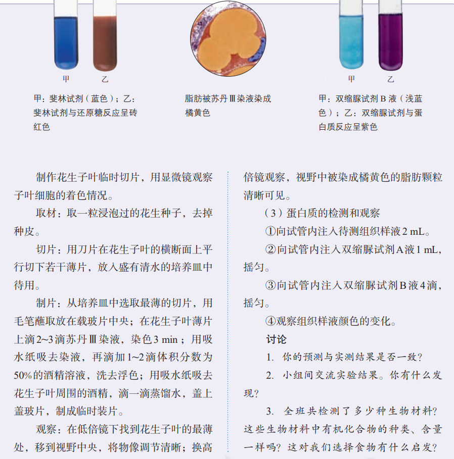
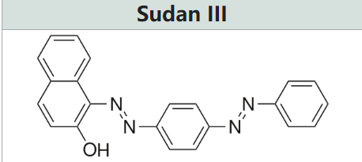
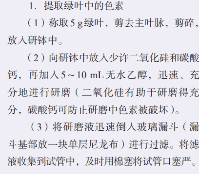
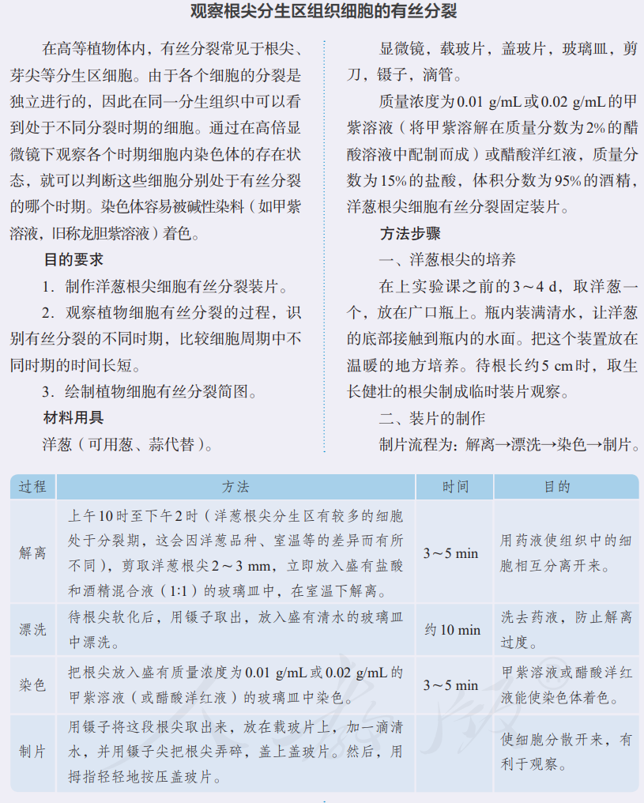
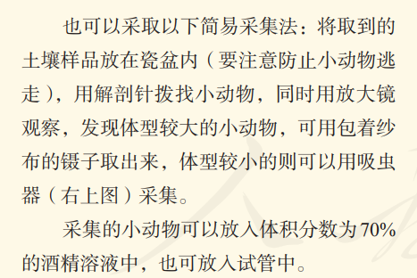
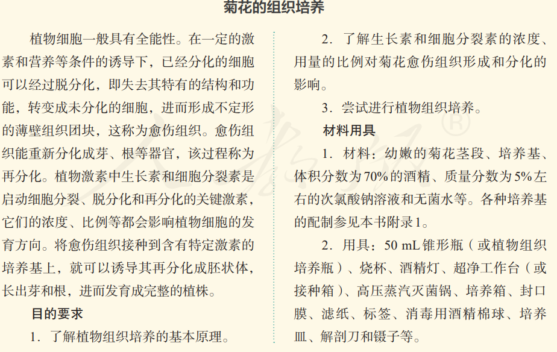
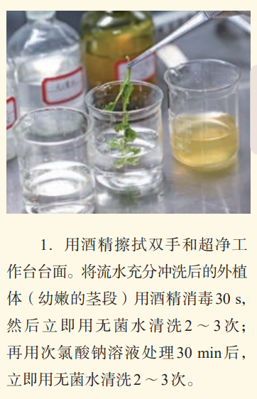
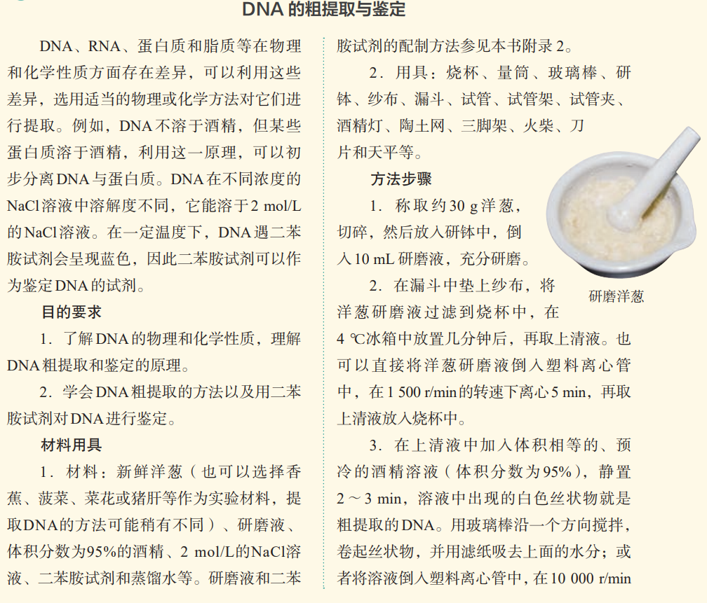
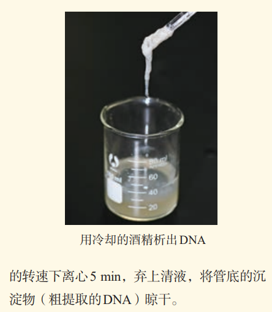
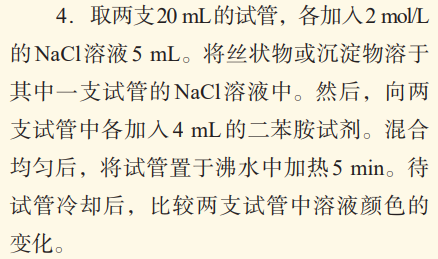

# 引
在高中生物学中，乙醇(酒精)出现在多处实验操作中:
- 《必修1 分子与细胞》脂肪鉴定
- 《必修1 分子与细胞》光合色素提取
- 《必修1 分子与细胞》配置解离液
- 《选择性必修2 生物与环境》固定保存土壤小动物
- 《选择性必修3 生物技术与环境》消毒
- 《选择性必修3 生物技术与工程》DNA粗提取
内容繁杂琐碎，本文将逐个击破.
## 脂肪鉴定

在**脂肪的检测和观察**中，需要的试剂:
- 苏丹III染液
- 体积分数为50%酒精溶液
其中，酒精的作用是洗去浮色.

Sudan III为什么可以检测并观察脂肪？
Sudan III（苏丹Ⅲ）之所以可以检测并观察脂肪，是因为它是一种脂溶性染料，能够溶解在脂肪中，使脂肪呈现红色或橙红色，从而方便我们在实验中识别脂肪。
## 光合色素提取

提取（不含分离）所需试剂:
- $\ce{SiO2,CaCO3}$
- 无水$\ce{C2H5OH}$(或体积分数95%的乙醇加入适量无水碳酸钠)
## 配置解离液

制作洋葱根尖细胞有丝分裂装片所需试剂:
- 0.01g/mL或0.02g/mL的甲紫溶液（将甲紫溶解在质量分数为2%的醋酸溶液中配置而成）或醋酸洋红液
- 质量分数为15%的盐酸
- 体积分数为95%的酒精
解离液是上述盐酸和酒精的1:1混合液，可以让组织中的细胞相互分离开来。
## 固定保存土壤小动物

用体积分数为70%的酒精溶液
## 消毒

消毒双手、工作台和消毒外植体都用体积分数为70%的酒精。
外植体处理顺序：流水冲洗->酒精消毒->无菌水清洗->$\ce{NaClO}$溶液处理->无菌水清洗
## DNA的粗提取

预冷的体积分数为95%的酒精溶液（体积相等）可以让DNA析出.

2mol/L 5mL $\ce{NaCl}$溶液可以让DNA溶解.
# 小结
1. 50%酒精｜脂肪鉴定
作用：洗去浮色

2. 70%酒精
①土壤小动物：固定保存
②微生物实验：消毒
③菊花的组织培养：消毒

4. 95%酒精
①有丝分裂、低温诱导：和盐酸配解离液，使细胞分离
②低温诱导：冲洗卡诺氏固定液
③DNA的粗提取：让DNA析出

6. 无水乙醇｜色素提取
作用：溶解、提取光合色素
