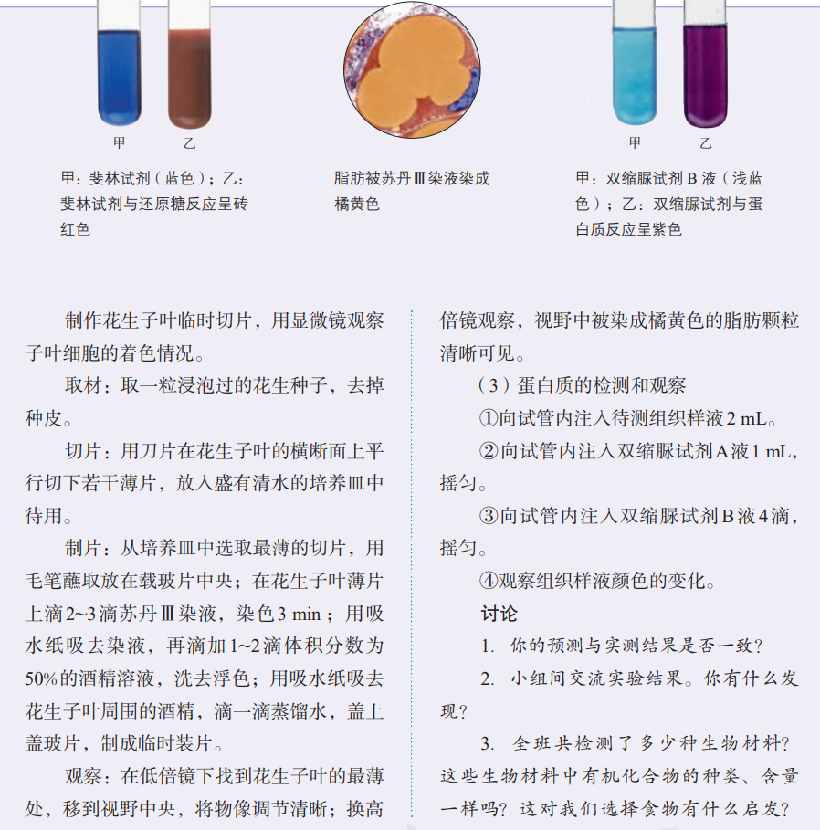
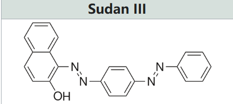
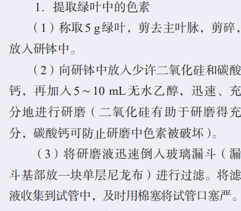
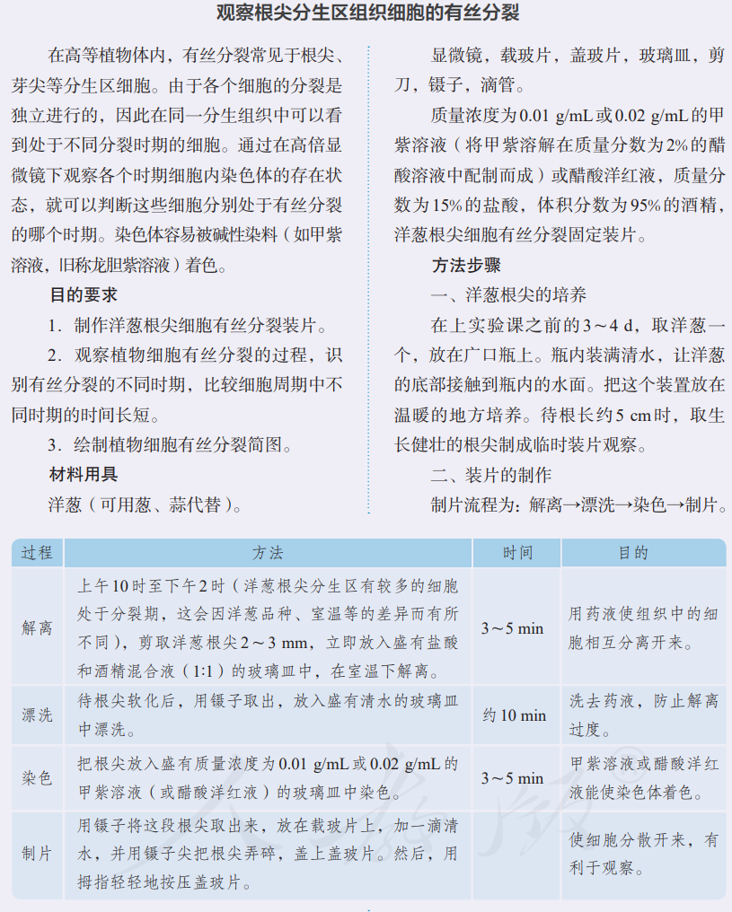
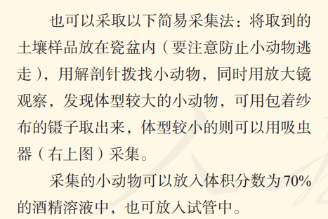
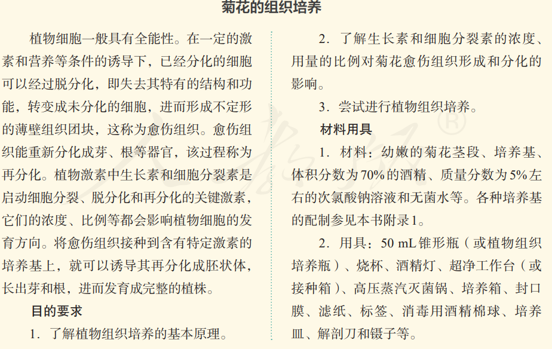
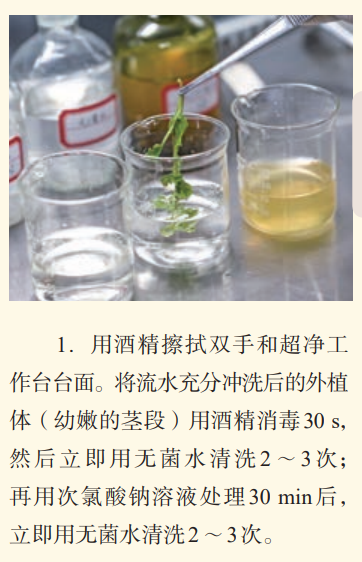
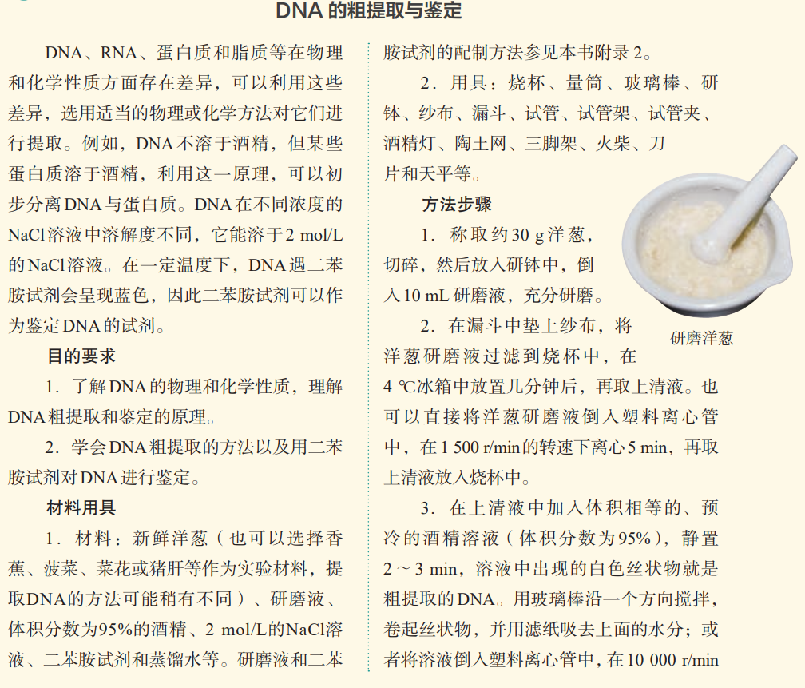
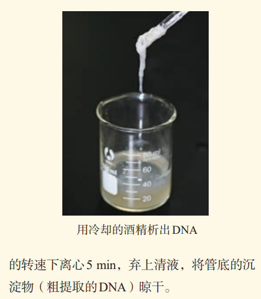
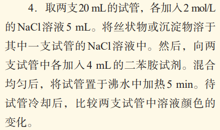

# 引
在高中生物学中，乙醇(酒精)出现在多处实验操作中:
- 《必修1 分子与细胞》脂肪鉴定
- 《必修1 分子与细胞》光合色素提取
- 《必修1 分子与细胞》配置解离液
- 《选择性必修2 生物与环境》固定保存土壤小动物
- 《选择性必修3 生物技术与环境》消毒
- 《选择性必修3 生物技术与工程》DNA粗提取
内容繁杂琐碎，本文将逐个击破.
## 脂肪鉴定

在**脂肪的检测和观察**中，需要的试剂:
- 苏丹III染液
- 体积分数为50%酒精溶液
其中，酒精的作用是洗去浮色.

Sudan III为什么可以检测并观察脂肪？
Sudan III（苏丹Ⅲ）之所以可以检测并观察脂肪，是因为它是一种脂溶性染料，能够溶解在脂肪中，使脂肪呈现红色或橙红色，从而方便我们在实验中识别脂肪。
## 光合色素提取

提取（不含分离）所需试剂:
- $\ce{SiO2,CaCO3}$
- 无水$\ce{C2H5OH}$(或体积分数95%的乙醇加入适量无水碳酸钠)
## 配置解离液

制作洋葱根尖细胞有丝分裂装片所需试剂:
- 0.01g/mL或0.02g/mL的甲紫溶液（将甲紫溶解在质量分数为2%的醋酸溶液中配置而成）或醋酸洋红液
- 质量分数为15%的盐酸
- 体积分数为95%的酒精
解离液是上述盐酸和酒精的1:1混合液，可以让组织中的细胞相互分离开来。
## 固定保存土壤小动物

用体积分数为70%的酒精溶液
## 消毒

消毒双手、工作台和消毒外植体都用体积分数为70%的酒精。
外植体处理顺序：流水冲洗->酒精消毒->无菌水清洗->$\ce{NaClO}$溶液处理->无菌水清洗
## DNA的粗提取

预冷的体积分数为95%的酒精溶液（体积相等）可以让DNA析出.

2mol/L 5mL $\ce{NaCl}$溶液可以让DNA溶解.
# 小结
1. 50%酒精｜脂肪鉴定
作用：洗去浮色

2. 70%酒精
①土壤小动物：固定保存
②微生物实验：消毒
③菊花的组织培养：消毒

4. 95%酒精
①有丝分裂、低温诱导：和盐酸配解离液，使细胞分离
②低温诱导：冲洗卡诺氏固定液
③DNA的粗提取：让DNA析出

6. 无水乙醇｜色素提取
作用：溶解、提取光合色素

# 真题练习
> 题目来源：菁师帮 [2017-2026北京高考真题生物汇编：细胞的增殖](https://www.jingshibang.com/home/#/paperDetail?id=196961)、[2017-2026北京高考真题生物汇编：植物细胞工程](https://www.jingshibang.com/home/#/paperDetail?id=196976)、[2024-2026北京重点校高一（上）期末生物汇编：细胞中的糖类和脂质](https://www.jingshibang.com/home/#/paperDetail?id=195135)  
> 本文仅整理题目，不含答案与解析。

### 1.

(2025 北京昌平高一上期末) 椰子油是一种植物脂肪，在工业生产中应用广泛，同时具有极高的营养价值。相关叙述正确的是（　　）

**A.** 脂肪的氧含量比糖类更~~高~~（含氧量更低，含氢量更高），因此可作为良好的储能物质

**B.** 脂肪又称三酰甘油，通常由一分子~~脂肪酸~~和三分子~~甘油~~组成

**C.** 椰子油在室温下容易成固态，与其含有大量的~~不~~饱和脂肪酸有关

**D.** 用苏丹Ⅲ染液对椰肉细胞进行染色，可观察到部分区域被染成橘黄色
正确答案:D

### 2.

(2026 北京高考真题) 下列使用显微镜的高中生物学实验中，相应操作与目的**不匹配**的是（　　）

**A.** 为使高倍物镜下观察到的细胞变清晰，调节细准焦螺旋

**B.** 为观察到黑藻叶肉细胞中叶绿体的运动，取用生长旺盛的叶片（叶绿体呈绿色，且生长旺盛的叶片细胞代谢活跃，叶绿体运动更明显）

**C.** 为清晰观察植物细胞的吸水和失水，用~~苏丹Ⅲ染料~~对液泡染色

**D.** 为清晰观察根尖细胞的有丝分裂，用盐酸解离根尖
正确答案:C

### 3.

(2022 北京高考真题) 实验操作顺序直接影响实验结果。表中实验操作顺序有误的是（　　）

| 选项 | 高中生物学实验内容 | 操作步骤 |
| --- | --- | --- |
| A | 检测生物组织中的蛋白质 | 向待测样液中先加双缩脲试剂 A 液，再加 B 液（A:0.1g/mL NaOH,B:0.01g/mL CuSO4） |
| B | 观察细胞质流动 | 先用低倍镜找到特定区域的黑藻叶肉细胞，再换高倍镜观察 |
| C | 探究温度对酶活性的影响 | 室温下将淀粉溶液与淀粉酶溶液~~混匀后，在设定温度下保温~~(先保温，再混合) |
| D | 观察根尖分生区组织细胞的有丝分裂 | 将解离后的根尖用清水漂洗后（）防止解离过度），再用甲紫溶液染色 |

**A.** A　**B.** B　**C.** C　**D.** D
正确答案:C

### 4.

(2020 北京高考真题) 下列高中生物学实验中，用紫色的洋葱鳞片叶和黑藻叶片作为实验材料均可完成的是（　　）

**A.** 观察~~叶绿体~~（洋葱鳞片叶细胞不含叶绿体）和细胞质流动

**B.** 提取和分离~~叶绿素~~（同A）

**C.** 观察细胞质壁分离及复原

**D.** 观察细胞的~~有丝分裂~~(叶片细胞为高度分化的成熟细胞，没有细胞周期)
正确答案:C

### 5.

(2017 北京高考真题) 洋葱根尖和小鼠骨髓细胞都能用于观察细胞有丝分裂，下列有关叙述正确的是（　　）

**A.** ~~都~~（动物细胞用胰蛋白酶或胶原蛋白酶处理）需要用盐酸溶液使细胞相互分离

**B.** 都需要用低倍镜找到分裂细胞再换高倍镜观察

**C.** 在有丝分裂中期都能观察到~~染色体数目加倍~~（中期没有染色体数目加倍）

**D.** 在有丝分裂末期~~都~~（动物细胞不产生细胞板）能观察到细胞板
正确答案:B

### 6.

(2024 北京高考真题) 五彩缤纷的月季装点着美丽的京城，其中变色月季“光谱”备受青睐。“光谱”月季变色的主要原因是光照引起花瓣细胞液泡中花青素的变化。下列利用“光谱”月季进行的实验，难以达成目的的是（　　）

**A.** 用花瓣细胞观察质壁分离现象

**B.** 用花瓣~~大量提取叶绿素~~(叶绿体数量极少)

**C.** 探索生长素促进其插条生根的最适浓度

**D.** 利用幼嫩茎段进行植物组织培养
