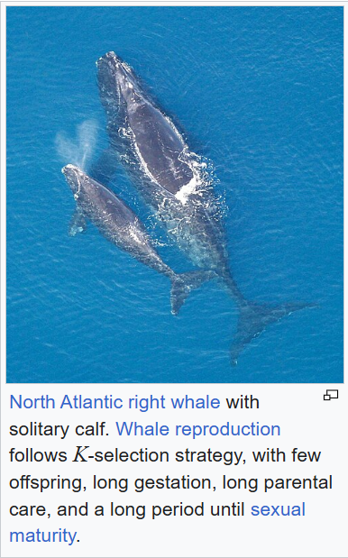
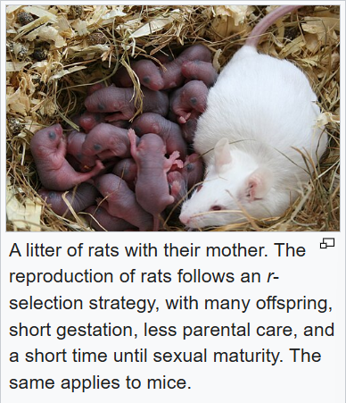
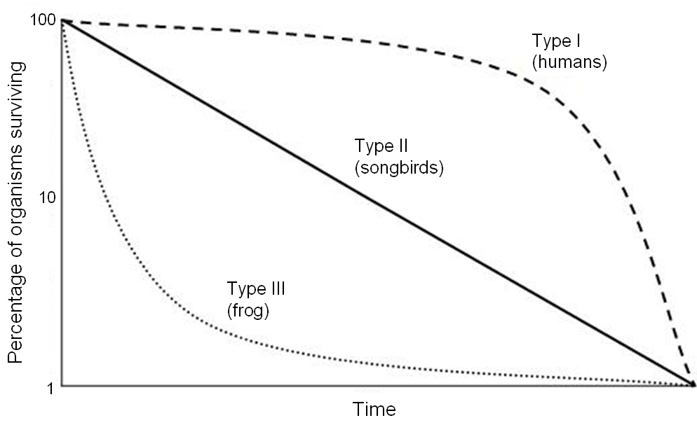

# 种群及其动态
## 种群和物种
### 物种
能够在自然状态下**相互交配**，并且产生**可育后代**的一群生物成为一个物种。
生物分类：
- 界
- 门
- 纲
- 目
- 科
- 属
- 种
> 1. 生殖隔离为基准
> 2. 生物进化的结果
### 种群
在**一定的区域**内，**同种生物**的**所有个体**是一个种群。
> 1. 物种繁殖的基本单位
> 2. 生物进化的基本单位
## 一:种群数量特征
### 1.种群密度
#### 概念
种群在**单位面积**或**单位体积**中的个体数
### 重要性
种群密度是种群**最基本的数量特征**
#### 外部影响因素
- 非生物因素（非密度制约因素）：阳光、温度、水等
- 生物因素（密度制约因素）：捕食、竞争、寄生等
### 2.出生率和死亡率
#### 概念
单位时间内**新产生（或死亡）** 的个体数目 **占该种群个体总数**的比值
#### 重要性
**决定**种群密度最重要的因素
#### 示例
一年中人口的出生率
#### 决定
- 繁殖能力——出生率
- 生存策略——死亡率

> 两种生物对策：
> - r对策
> - K对策

### 3.迁入率和迁出率
#### 概念
单位时间内**迁入（或迁出）**的个体数目占该种群个体总数的比值
#### 重要性
决定种群密度的**次要因素**
#### 净迁移率
净迁移率=迁入率-迁出率
### 4.年龄结构
#### 概念
一个种群中**各年龄期**的个体数目的**比例**
#### 类型
- 增长型
- 稳定型
- 衰退型
  #### 影响方式
  年龄组成通过**影响出生率**和**死亡率**影响种群密度
  
  
  ### 5.性别比例(性比)
  #### 概念
  种群中**雌雄个体数目**的比例
  - 第一性别比：怀孕时的性别比
  - 第二性别比：刚出生婴儿的性别比
  - 第三性别比：所有成熟个体的性别比
#### 规律（只影响出生率）
- 雌>雄：种群密度增长快
- 雌≈雄：种群密度相对稳定
- 雌<雄：种群密度增长慢
> Exception:
> 1. 人在雌:雄=1:1时增长最快
> 2. 特殊动物（蜜蜂，海马）
#### 应用
人工合成性外激素/性引诱剂，影响害虫性别比例
