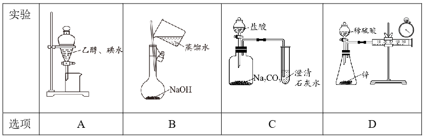
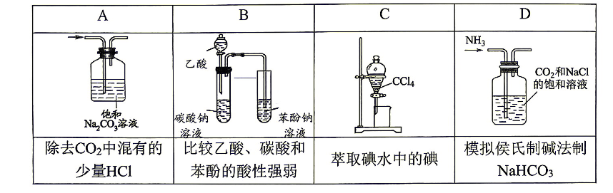
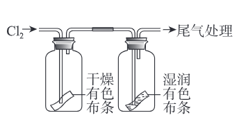
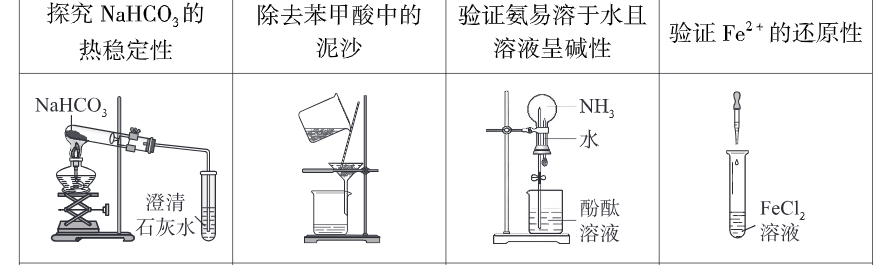
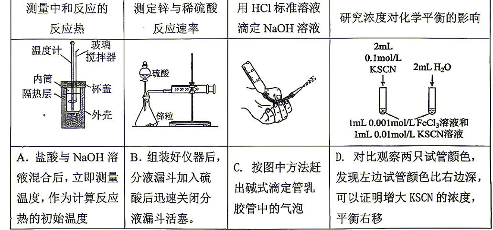
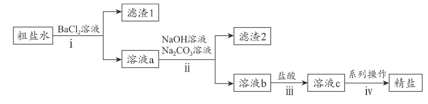
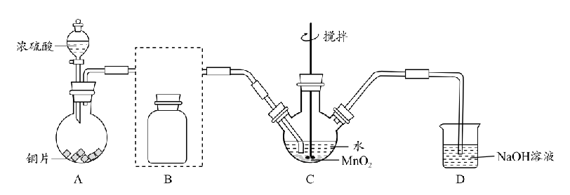
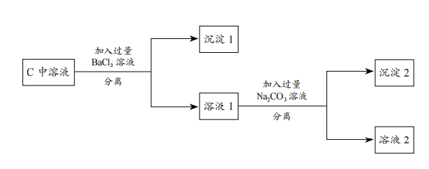
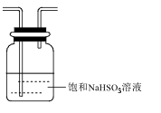

> 本专题整理自 2026 年 11 月北京海淀、朝阳、育才学校、十五中、一六一中高中化学期中试卷，聚焦**判断装置能否达到目的、实验操作顺序、试剂与器材选择**等高频实验操作题。**前半部分仅保留题目与图示，参考答案与解析统一附于文末。**

---

## 一、判断实验装置能否达到目的

### 1. （2026 北京海淀高三上期中·第 5 题）

下列实验中，能达到实验目的的是（  ）

| 选项 | A | B | C | D |
| --- | --- | --- | --- | --- |
| 目的 | 萃取碘水中的碘 | 配制 $100\text{ mL } 0.1\text{ mol/L NaOH}$ 溶液 | 比较 $\text{Cl}$、$\text{C}$ 的非金属性强弱 | 测定锌与稀硫酸反应的速率 |

正确答案:D

A: 乙醇和水混溶，无法萃取水中的碘单质

B:容量瓶不可用于溶解<a id="fnref-1" href="#fn-1">[1]</a>

C:应比较最高价氧化物水化物$\ce{HClO4,H2CO3}$酸性

D:单位时间产生气体体积反映反应速率

---

### 2. （2026 北京十五中高三上期中·第 5 题）

下列实验，能达到实验目的的是（  ）

正确答案:C

A:洗气瓶里应使用饱和$\ce{NaHCO3}$溶液

B:乙酸有挥发性，应用饱和$\ce{NaHCO3}$溶液洗气<a id="fnref-2" href="#fn-2">[2]</a>

D:应该先通$\ce{NH3}$再通$\ce{CO2}$，以增加$\ce{CO2}$溶解度<a id="fnref-3" href="#fn-3">[3]</a>

---

### 3. （2026 北京朝阳高三上期中·第 8 题）

饱和氯水存在：$\ce{Cl2 + H2O <=> HClO + H+ + Cl-}$。下列说法**不正确**的是（  ）

A. $\ce{Cl2}$ 是非极性分子，$\ce{H2O}$ 是极性分子  
B. $\ce{HClO}$ 分子中 $\text{Cl}$ 价电子层上的孤电子对数为 3  
C. 可通过右图实验验证 $\ce{HClO}$ 具有漂白性  
D. 向 $\ce{KI}$ 淀粉溶液中滴加少量氯水，溶液变蓝，说明 $\ce{Cl2}$ 与 $\ce{H2O}$ 的反应存在限度

正确答案:D

D:假设$\ce{Cl2}$完全转换，生成的$\ce{HClO}$同样可以氧化$\ce{I-}$，不能确定为可逆反应<a id="fnref-4" href="#fn-4">[4]</a>

---

## 二、实验操作规范与操作顺序

### 4. （2026 北京朝阳高三上期中·第 10 题）

下列实验的相应操作中，**不合理**的是（  ）

- **A.** 探究 $\ce{NaHCO3}$ 的热稳定性：实验结束时，先把导管移出液面，再熄灭酒精灯  
- **B.** 除去苯甲酸中的泥沙：先加热溶解，冷却后再过滤  
- **C.** 验证氨易溶于水且溶液呈碱性：先打开弹簧夹，再挤压胶头滴管  
- **D.** 验证 $\ce{Fe^2+}$ 的还原性：先滴加几滴 $\ce{KSCN}$ 溶液，再滴加几滴氯水

正确答案:B

B:分离苯甲酸和泥沙，需要利用苯甲酸“溶解度随温度上升而上升”进行重结晶，应加热溶解，趁热过滤

---

### 5. （2026 北京育才学校高三上期中·第 2 题）

下列实验用品的使用**不规范**的是（  ）

A. 用氨进行喷泉实验时，将圆底烧瓶干燥后，再收集氨气  
B. 测溶液的 $\text{pH}$ 时，将 $\text{pH}$ 试纸用蒸馏水润湿后，再进行测量  
C. 在乙醇制乙烯的实验中，将温度计插入反应混合液中，再加热  
D. 在滴定实验中，将滴定管洗净后，再用待盛溶液润洗

正确答案:B

B:应使用干燥的pH试纸

---

### 6. （2025—2026 北京一六一中高二化学·第 5 题）

用 $0.1000\text{ mol}\cdot\text{L}^{-1}\text{ HCl}$ 溶液滴定未知浓度的 $\ce{NaOH}$ 溶液。下列说法**不正确**的是（  ）

A. 酸式滴定管在盛装 $0.1000\text{ mol}\cdot\text{L}^{-1}\text{ HCl}$ 溶液前要用该溶液润洗 $2\sim 3$ 次  
B. 锥形瓶盛装待测 $\ce{NaOH}$ 溶液前须干燥  
C. 滴定时，边摇动锥形瓶，边注视锥形瓶中溶液的颜色变化  
D. 滴定时，若锥形瓶中有液体溅出，测定结果偏低

正确答案:B

B:锥形瓶无需干燥

---

### 7. （2025—2026 北京一六一中高二化学·第 8 题）

下列实验操作或结论，**不正确**的是（  ）

正确答案:A

A:盐酸，$\ce{NaOH}$溶液体积相同，比热容近似与水相同，$t_0=\frac{t_{HCl}+t_{NaOH}}{2}$<a id="fnref-5" href="#fn-5">[5]</a>

---

## 三、实验安全、试剂与器材选择

### 8. （2026 北京朝阳高三上期中·第 5 题）

下列有关实验安全的说法中**不合理**的是（  ）

A. 做钠在空气中燃烧的实验时，不要近距离俯视坩埚  
B. 在用电石制乙炔的实验中，将 $\ce{NaCl}$ 溶液缓慢加入到圆底烧瓶时须用长颈漏斗  
C. 实验方案中出现“当心烫伤”图标，说明实验中会遇到加热操作或用到温度较高的仪器  
D. 中学实验室可将未用完的钠、钾、白磷等放回原试剂瓶

正确答案:B<a id="fnref-6" href="#fn-6">[6]</a>

---

### 9. （2026 北京朝阳高三上期中·第 6 题）

下列物质的制备实验中，选用的试剂和反应条件均正确的是（  ）

| 选项 | 物质 | 试剂 | 反应条件 |
| --- | --- | --- | --- |
| A | $\ce{Fe2O3}$ | $\ce{Fe}$ 和水 | 高温 |
| B | $\ce{Cl2}$ | $\ce{MnO2}$ 和稀盐酸 | 常温 |
| C | 硫酸四氨合铜溶液 | 硫酸铜溶液、氨水 | 常温 |
| D | $\ce{C2H4}$ | 乙醇和浓硫酸 | 加热至 $140\,^\circ\text{C}$ |

正确答案:C

A:$\ce{Fe + H2O(g) \xlongequal{高温} Fe3O4 + H2}$<a id="fnref-7" href="#fn-7">[7]</a>

B:需要使用浓盐酸<a id="fnref-8" href="#fn-8">[8]</a>

D:140℃制乙醚，170℃制乙烯

---

### 10. （2026 北京育才学校高三上期中·第 3 题）

下列物质的制备实验中，选用的试剂和反应条件均正确的是（  ）

| 选项 | 物质 | 试剂 | 反应条件 |
| --- | --- | --- | --- |
| A | $\ce{SO2}$ | $\ce{Cu}$ 和浓硫酸 | 常温 |
| B | $\ce{NH3}$ | $\ce{NH4Cl}$ 固体 | 加热 |
| C | 银氨溶液 | $\ce{AgNO3}$ 溶液和氨水 | 常温 |
| D | $\ce{Cl2}$ | $\ce{MnO2}$ 固体和稀盐酸 | 加热 |

正确答案:C

A:需要加热

B:不单独用$\ce{NH4Cl}$ 固体

D:需要浓盐酸

---

## 四、综合实验操作与流程探究（大题）

### 11. （2026 北京朝阳高三上期中·第 16 题，12 分）

除去粗盐中的杂质离子 $\ce{Ca^2+}$、$\ce{Mg^2+}$ 和 $\ce{SO4^2-}$，流程示意图如下。

已知：
1. 难溶电解质的 $K_{\text{sp}}$：$\ce{BaSO4}: 1.1\times 10^{-10}$，$\ce{BaCO3}: 2.6\times 10^{-9}$，$\ce{Mg(OH)2}: 5.6\times 10^{-12}$，$\ce{CaCO3}: 3.4\times 10^{-9}$，$\ce{Ca(OH)2}: 4.7\times 10^{-6}$。
2. 当溶液中的离子浓度小于 $1\times 10^{-5}\text{ mol/L}$ 时，认为沉淀完全。

请回答：
1. $\text{i}$ 中发生反应的离子方程式是____________。
2. $\text{i}$ 中需加入过量的 $\ce{BaCl2}$，检测 $\ce{BaCl2}$ 是否过量的方法是____________。
3. 若加入 $\ce{BaCl2}$ 后不过滤就加入 $\ce{NaOH}$、饱和 $\ce{Na2CO3}$ 溶液，会导致提纯后的精盐中存在 $\ce{SO4^2-}$，结合沉淀溶解平衡说明原因：____________。
4. 若 $\text{ii}$ 中只用 $6\text{ mol/L NaOH}$ 溶液除去 $\ce{Ca^2+}$、$\ce{Mg^2+}$，会导致____________（填字母）。  
   a. $\ce{Ca^2+}$ 沉淀不完全　　b. 消耗更多 $\ce{NaOH}$　　c. 步骤 $\text{iii}$ 中会消耗更多的盐酸
5. 按图示流程，滤渣 2 的主要成分有____________。
6. $\text{iii}$ 中向烧杯中加入盐酸，使溶液 $\text{c}$ 呈弱酸性。$\text{iv}$ 中“系列操作”的步骤是：  
   ① 将溶液 $\text{c}$ 转移至____________中；  
   ② 用酒精灯加热，____________，停止加热。
7. 测量发现，精盐中 $\ce{NaCl}$ 的质量大于原粗盐中 $\ce{NaCl}$ 的质量，原因是____________。

（2）静置后，沿烧杯壁向上层清液中继续滴加 $2\sim 3$ 滴 $\ce{BaCl2}$ 溶液。若溶液不出现浑浊，则表明 $\ce{SO4^2-}$ 已沉淀完全，$\ce{BaCl2}$ 过量。

---

### 12. （2026 北京海淀高三上期中·第 19 题，13 分）

实验小组研究 $\ce{SO2}$ 与 $\ce{MnO2}$ 的反应。

**【实验 1】** 实验装置如下（夹持装置、A 中加热装置和 C 中冷却装置已略去）。实验结束后，C 中黑色悬浊液最终变澄清，且几乎无色。

1. A 中发生反应的化学方程式是____________。
2. 将除杂装置 B 补充完整并标明所用试剂。

**【实验 2】** 为探究 $\ce{SO2}$ 与 $\ce{MnO2}$ 的反应产物，实验小组取 C 中溶液，通过加热、抽气除去 $\ce{SO2}$ 后进行下列实验。

后续实验证实：沉淀 1 为 $\ce{BaSO4}$，沉淀 2 中含有 $\ce{BaCO3}$、$\ce{MnCO3}$。

3. 根据以上实验，推测 $\ce{SO2}$ 与 $\ce{MnO2}$ 反应的化学方程式____________。
4. 验证溶液 1 中 $\ce{Ba^2+}$、$\ce{Mn^2+}$ 已沉淀完全的实验方法：静置后，沿器壁向上层清液中滴加 $2\sim 3$ 滴____________（填试剂），若溶液不出现浑浊，则说明已沉淀完全。

**【实验 3】** 为验证溶液 2 的成分，将溶液 2 蒸干，获得白色粉末，同时产生刺激性气味气体。进一步实验证明白色粉末中含 $\ce{SO4^2-}$，刺激性气味气体中含 $\ce{SO2}$。

5. 证明白色粉末中含 $\ce{SO4^2-}$ 的实验方法是____________。
6. 根据实验 3，推测溶液 2 中存在____________（填序号）。  
   a. $\ce{S2O3^2-}$　　b. $\ce{SO3^2-}$　　c. $\ce{S2O6^2-}$　　d. $\ce{SO4^2-}$
7. 实验小组反思：若未将 C 中 $\ce{SO2}$ 去除，溶液 2 蒸干后得到的白色粉末中的 $\ce{SO4^2-}$ 可能来源于 $\ce{SO2}$。你是否同意该观点，说明理由：____________。

（4）$\ce{Na2CO3}$溶液
（5）取少量白色粉末于试管中，加入足量稀盐酸，再滴加 $\ce{BaCl2}$ 溶液，产生白色沉淀。

---

# 参考答案与解析

## 第 1 题（2026 海淀高三期中·第 5 题）
**答案：D**

- **A 错误**：乙醇与水互溶，不能作萃取碘水中碘的萃取剂（应选 $\ce{CCl4}$ 或苯等与水不互溶的溶剂）。
- **B 错误**：配制一定物质的量浓度溶液时，固体 $\ce{NaOH}$ 应在**烧杯**中溶解并冷却至室温，再转移至容量瓶中，不能直接在容量瓶中溶解。
- **C 错误**：盐酸具有挥发性且不是 $\text{Cl}$ 的最高价含氧酸，一方面无法用 $\ce{HCl}$ 与 $\ce{H2CO3}$ 的酸性比较 $\text{Cl}$、$\text{C}$ 的非金属性，另一方面挥发出的 $\ce{HCl}$ 也会与澄清石灰水反应。
- **D 正确**：利用分液漏斗控制稀硫酸加入，通过注射器测定一定时间内收集到 $\ce{H2}$ 的体积（配合秒表计时），可测定锌与稀硫酸的反应速率。

---

## 第 2 题（2026 十五中高三期中·第 5 题）
**答案：C**

- **A 错误**：饱和 $\ce{Na2CO3}$ 溶液不仅吸收 $\ce{HCl}$，还会与 $\ce{CO2}$ 反应（$\ce{CO2 + Na2CO3 + H2O = 2NaHCO3}$），应改用**饱和 $\ce{NaHCO3}$ 溶液**。
- **B 错误**：乙酸易挥发，挥发出的乙酸蒸气会直接进入苯酚钠溶液使其变浑浊，干扰碳酸与苯酚酸性的比较（中间缺少除杂装置）。
- **C 正确**：$\ce{CCl4}$ 与水不互溶且碘在 $\ce{CCl4}$ 中的溶解度远大于在水中，可用分液漏斗萃取碘水中的碘。
- **D 错误**：模拟侯氏制碱法时，由于 $\ce{NH3}$ 极易溶于水，通入 $\ce{NH3}$ 的导管直接插入液面以下会发生**倒吸**（且应先通 $\ce{NH3}$ 至饱和后再通 $\ce{CO2}$）。

---

## 第 3 题（2026 朝阳高三期中·第 8 题）
**答案：D**

- **A 正确**：$\ce{Cl2}$ 为对称直线形非极性分子，$\ce{H2O}$ 为 V 形极性分子。
- **B 正确**：$\ce{HClO}$ 结构式为 $\text{H—O—Cl}$，$\text{Cl}$ 原子最外层 7 个电子，形成 1 对共用电子对后剩余 3 对孤电子对。
- **C 正确**：干燥氯气不能使干燥有色布条褪色，而湿润有色布条褪色，说明起漂白作用的是 $\ce{Cl2}$ 与水反应生成的 $\ce{HClO}$。
- **D 错误**：$\ce{Cl2}$ 本身也具有强氧化性，能直接氧化 $\ce{I-}$ 生成 $\ce{I2}$ 使淀粉变蓝，无法据此证明 $\ce{Cl2}$ 与 $\ce{H2O}$ 的反应存在限度。

---

## 第 4 题（2026 朝阳高三期中·第 10 题）
**答案：B**

- **A 合理**：加热固体结束后，先将导管移出澄清石灰水液面，再熄灭酒精灯，防止冷水倒吸炸裂热试管。
- **B 不合理**：苯甲酸在水中的溶解度随温度升高显著增大，若加热溶解后**冷却**再过滤，苯甲酸会大量结晶析出并随泥沙一起留在滤纸上，造成损失；正确操作是**加热溶解后趁热过滤**。
- **C 合理**：先打开弹簧夹，再挤压胶头滴管使水进入烧瓶，氨气溶于水导致瓶内压强骤降，酚酞溶液被吸入形成红色喷泉。
- **D 合理**：先加 $\ce{KSCN}$ 溶液无明显现象（排除原溶液中 $\ce{Fe^3+}$ 干扰），再滴加氯水后溶液变红，可验证 $\ce{Fe^2+}$ 被氯水氧化为 $\ce{Fe^3+}$，体现其还原性。

---

## 第 5 题（2026 育才高三期中·第 2 题）
**答案：B**

- **A 规范**：氨气极易溶于水，收集氨气的圆底烧瓶必须干燥，否则氨气溶于水无法形成较大压强差。
- **B 不规范**：用蒸馏水润湿 $\text{pH}$ 试纸会稀释待测溶液，可能改变溶液的 $\text{pH}$（中性溶液无影响，酸性或碱性溶液测定结果会偏向 7）。
- **C 规范**：乙醇与浓硫酸制乙烯需控制反应液温度在 $170\,^\circ\text{C}$，温度计水银球必须插入反应混合液液面以下。
- **D 规范**：滴定管洗净后需用待盛装的标准液或待测液润洗 $2\sim 3$ 次，避免管内壁残留水稀释溶液。

---

## 第 6 题（2025—2026 一六一中高二·第 5 题）
**答案：B**

- **A 正确**：酸式滴定管使用前需用待盛装的 $\ce{HCl}$ 标准液润洗 $2\sim 3$ 次。
- **B 不正确**：锥形瓶内残留少量蒸馏水**不改变**待测 $\ce{NaOH}$ 的物质的量，因此无需干燥；若用待测液润洗反而会导致结果偏高。
- **C 正确**：滴定时左手控制活塞，右手摇动锥形瓶，眼睛注视锥形瓶内溶液颜色变化以准确判断终点。
- **D 正确**：锥形瓶中待测液溅出，消耗标准液 $\ce{HCl}$ 的体积偏小，测定结果偏低。

---

## 第 7 题（2025—2026 一六一中高二·第 8 题）
**答案：A**

- **A 不正确**：测量中和反应的反应热时，应分别测量混合前酸溶液和碱溶液的温度取平均值作为**初始温度**，混合后立即搅拌并记录**最高温度**，不能在混合后测初始温度。
- **B 正确**：组装好测定锌与稀硫酸反应速率的装置后，加入硫酸后迅速关闭分液漏斗活塞，防止生成的 $\ce{H2}$ 从分液漏斗逸出影响体积测量。
- **C 正确**：赶碱式滴定管乳胶管中气泡时，应将尖嘴向上弯曲，挤压玻璃珠上方乳胶管使溶液喷出以排出气泡。
- **D 正确**：两支试管溶液总体积均为 $4\text{ mL}$，左侧加入 $\ce{KSCN}$ 溶液使 $c(\ce{SCN-})$ 增大而颜色更深，可证明增大反应物浓度平衡向右移动。

---

## 第 8 题（2026 朝阳高三期中·第 5 题）
**答案：B**

- **A 合理**：钠燃烧剧烈且可能溅出高温熔融物，不能近距离俯视坩埚。
- **B 不合理**：电石与水反应剧烈，需要控制 $\ce{NaCl}$ 溶液的滴加速度；**长颈漏斗无法控制液体滴加速率**（且容易漏气），应改用**分液漏斗**。
- **C 合理**：该图标为“当心烫伤”，提示实验涉及加热或高温仪器。
- **D 合理**：钠、钾、白磷均极易反应且危险，实验剩余的钠、钾、白磷需放回原试剂瓶，不可随意丢弃。

---

## 第 9 题（2026 朝阳高三期中·第 6 题）
**答案：C**

- **A 错误**：$\ce{Fe}$ 与水蒸气在高温下反应生成的是 $\ce{Fe3O4}$ 和 $\ce{H2}$，不是 $\ce{Fe2O3}$。
- **B 错误**：$\ce{MnO2}$ 需与**浓盐酸**在**加热**条件下反应才生成 $\ce{Cl2}$，与稀盐酸在常温下不反应。
- **C 正确**：常温下向 $\ce{CuSO4}$ 溶液中滴加氨水先生成 $\ce{Cu(OH)2}$ 沉淀，继续滴加过量氨水沉淀溶解生成 $[\ce{Cu(NH3)4}]^{2+}$（硫酸四氨合铜溶液）。
- **D 错误**：乙醇和浓硫酸在 $140\,^\circ\text{C}$ 时主要发生分子间脱水生成乙醚，制取乙烯（$\ce{C2H4}$）需迅速升温至 **$170\,^\circ\text{C}$**。

---

## 第 10 题（2026 育才高三期中·第 3 题）
**答案：C**

- **A 错误**：$\ce{Cu}$ 与浓硫酸反应需要**加热**，常温下不反应。
- **B 错误**：加热 $\ce{NH4Cl}$ 固体分解生成的 $\ce{NH3}$ 和 $\ce{HCl}$ 在试管口遇冷会重新化合生成 $\ce{NH4Cl}$，实验室制 $\ce{NH3}$ 常用 $\ce{NH4Cl}$ 与 $\ce{Ca(OH)2}$ 固体共热。
- **C 正确**：常温下向 $\ce{AgNO3}$ 溶液中滴加稀氨水至生成的沉淀恰好溶解，即可制得银氨溶液。
- **D 错误**：$\ce{MnO2}$ 固体需与**浓盐酸**共热才生成 $\ce{Cl2}$，与稀盐酸不反应。

---

## 第 11 题（2026 朝阳高三期中·第 16 题）
**参考答案：**
1. $\ce{SO4^2- + Ba^2+ = BaSO4 v}$
2. 静置后，沿烧杯壁向上层清液中继续滴加 $2\sim 3$ 滴 $\ce{BaCl2}$ 溶液。若溶液不出现浑浊，则表明 $\ce{SO4^2-}$ 已沉淀完全，$\ce{BaCl2}$ 过量。
3. $\ce{BaSO4(s) <=> Ba^2+(aq) + SO4^2-(aq)}$，加入饱和 $\ce{Na2CO3}$ 溶液后，生成 $\ce{BaCO3}$，$\ce{Ba^2+}$ 浓度降低，平衡正移，$\ce{SO4^2-}$ 进入溶液中，导致提纯后的精盐中存在 $\ce{SO4^2-}$。
4. bc
5. $\ce{CaCO3}$、$\ce{BaCO3}$、$\ce{Mg(OH)2}$
6. ① **蒸发皿**　② 同时用玻璃棒不断搅拌，当蒸发皿中出现较多固体时，停止加热。
7. $\text{ii}$ 引入 $\ce{Na+}$、$\text{i}$ 和 $\text{iii}$ 引入 $\ce{Cl-}$

---

## 第 12 题（2026 海淀高三期中·第 19 题）
**参考答案：**
1. $\ce{Cu + 2H2SO4(浓) \xlongequal{\Delta} CuSO4 + SO2 ^ + 2H2O}$
2. 补充洗气瓶（长进短出），瓶内盛放**饱和 $\ce{NaHSO3}$ 溶液**（用于吸收挥发出的酸雾等杂质，同时减少 $\ce{SO2}$ 溶解）：

3. $\ce{SO2 + MnO2 === MnSO4}$
4. $\ce{Na2CO3}$ 溶液
5. 取少量白色粉末于试管中，加入足量稀盐酸，再滴加 $\ce{BaCl2}$ 溶液，产生白色沉淀。
6. c
7. **同意**：$\ce{SO2}$ 进入溶液 1，与 $\ce{Na2CO3}$ 反应后转化为 $\ce{SO3^2-}$ 进入溶液 2，蒸干时被 $\ce{O2}$ 氧化为 $\ce{SO4^2-}$。  
   （或**不同意**：$\ce{SO2}$ 进入溶液 1，与 $\ce{Na2CO3}$、$\ce{BaCl2}$ 反应后转化为 $\ce{BaSO3}$ 进入沉淀 2，溶液 2 中不存在大量 $\ce{SO3^2-}$。）

---

# 批注与补充

1. **第 1 题 B 补充**：配制一定物质的量浓度溶液时，固体 $\ce{NaOH}$ 应先在**烧杯**中溶解并冷却至室温，再转移至容量瓶中定容。[↩](#fnref-1)
2. **第 2 题 B 补充**：应在碳酸钠溶液与苯酚钠溶液之间加装盛有饱和 $\ce{NaHCO3}$ 溶液的洗气瓶，除去挥发出的乙酸蒸气，避免干扰碳酸与苯酚酸性的比较。[↩](#fnref-2)
3. **第 2 题 D 补充错因**：除通气顺序外，图中通入 $\ce{NH3}$ 的导管直接插入液面以下，由于 $\ce{NH3}$ 极易溶于水，会发生**倒吸**。[↩](#fnref-3)
4. **第 3 题 D 思路点拨**：判断准确。无论反应是否可逆、$\ce{Cl2}$ 是否完全转化，体系中具有强氧化性的 $\ce{Cl2}$ 或 $\ce{HClO}$ 均能氧化 $\ce{I-}$ 使淀粉-$\ce{KI}$ 变蓝，因此该现象无法证明反应存在限度。[↩](#fnref-4)
5. **第 7 题 A 补充操作要点**：初始温度 $t_0$ 必须在**混合前**分别测量酸、碱溶液温度并取平均值；混合后立即搅拌并记录**最高温度**，不能在混合后再测初始温度。[↩](#fnref-5)
6. **第 8 题 B 补充解析**：电石与水反应剧烈，需控制饱和食盐水的滴加速率；**长颈漏斗无法控制滴加速率且易漏气**，应改用**分液漏斗**。[↩](#fnref-6)
7. **第 9 题 A 补充配平**：$3\ce{Fe} + 4\ce{H2O(g)} \xlongequal{\text{高温}} \ce{Fe3O4} + 4\ce{H2}$。[↩](#fnref-7)
8. **第 9 题 B 补充条件**：$\ce{MnO2}$ 制取 $\ce{Cl2}$ 既需要**浓盐酸**，还需要**加热（$\Delta$）**，常温下不反应。[↩](#fnref-8)
