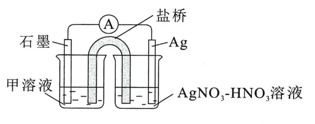

## 设计实验
### 原溶液
- 直接证明:检测产物生成
- 间接证明:检测反应物减少/耗尽
### 类比溶液
- To be unlocked
- To be unlocked
- 缺位实验：$\ce{AgNO3 -> NaNO3}$

  ## 离子检验
  牢记“**取上清液**”.

**（2024 北京高考 19）**（14 分）某小组同学向 $\ce{pH}=1$ 的 $0.5\ \mathrm{mol\cdot L^{-1}}$ 的 $\ce{FeCl3}$ 溶液中分别加入过量的 $\ce{Cu}$ 粉、$\ce{Zn}$ 粉和 $\ce{Mg}$ 粉，探究溶液中氧化剂的微粒及其还原产物。

（1）理论分析

依据金属活动性顺序，$\ce{Cu}$、$\ce{Zn}$、$\ce{Mg}$ 中可将 $\ce{Fe^3+}$ 还原为 $\ce{Fe}$ 的金属是______。

> 选取铁前金属:$\ce{Zn},\ce{Mg}$.

（2）实验验证

| 实验 | 金属 | 操作、现象及产物 |
| --- | --- | --- |
| I | 过量 $\ce{Cu}$ | 一段时间后，溶液逐渐变为蓝绿色，固体中未检测到 $\ce{Fe}$ 单质 |
| II | 过量 $\ce{Zn}$ | 一段时间后有气泡产生，反应缓慢，$\ce{pH}$ 逐渐增大，产生了大量红褐色沉淀后，无气泡冒出，此时溶液 $\ce{pH}$ 为 3~4，取出固体，固体中未检测到 $\ce{Fe}$ 单质 |
| III | 过量 $\ce{Mg}$ | 有大量气泡产生，反应剧烈，$\ce{pH}$ 逐渐增大，产生了大量红褐色沉淀后，持续产生大量气泡，当溶液 $\ce{pH}$ 为 3~4 时，取出固体，固体中检测到 $\ce{Fe}$ 单质 |

① 分别取实验 I、II、III 中的少量溶液，滴加 $\ce{K3[Fe(CN)6]}$ 溶液，证明都有 $\ce{Fe^2+}$ 生成，依据的现象是______。
> 产生蓝色沉淀

② 实验 II、III 都有红褐色沉淀生成，用平衡移动原理解释原因______。

> 平衡原理四板斧：平衡->变化->移动->现象
> $\ce{Fe^3+}$水解方程式为$\ce{Fe^3+ + 3H2O<=> Fe(OH)3 + 3H+}$，加入的$\ce{Mg}$或$\ce{Zn}$会消耗$\ce{H+}$，促进$\ce{Fe^3+}$水解平衡正向移动，使其转化为$\ce{Fe(OH)3}$沉淀

③ 对实验 II 未检测到 $\ce{Fe}$ 单质进行分析及探究。

i. a. 甲认为实验 II 中，当 $\ce{Fe^3+}$、$\ce{H+}$ 浓度较大时，即使 $\ce{Zn}$ 与 $\ce{Fe^2+}$ 反应置换出少量 $\ce{Fe}$，$\ce{Fe}$ 也会被 $\ce{Fe^3+}$、$\ce{H+}$ 消耗。写出 $\ce{Fe}$ 与 $\ce{Fe^3+}$、$\ce{H+}$ 反应的离子方程式______。
> $\ce{Fe + 2Fe^3+ = 3Fe^2+,Fe + 2H^+= Fe^2+ + H2 ^}$

b. 乙认为在 $\ce{pH}$ 为 3~4 的溶液中即便生成 $\ce{Fe}$ 也会被 $\ce{H+}$ 消耗。设计实验______（填实验操作和现象），证实了此条件下可忽略 $\ce{H+}$ 对 $\ce{Fe}$ 的消耗。

> Possible Version I(原溶液体系)
>取II反应后的上清液，加入铁粉，无明显变化

> Possible Version II(类比溶液体系)
> 向$\ce{pH}$为3-4的稀盐酸中加铁粉，一段时间后取出少量溶液，滴加 $\ce{K3[Fe(CN)6]}$ 溶液，不产生蓝色沉淀

> Possible Version III(类比溶液体系-$\ce{Fe^3+}$缺位优化版)
> 向用稀盐酸调$\ce{pH}$为3-4的$1.5\ \mathrm{mol\cdot L^{-1}} \ce{NaCl}$溶液中加铁粉，一段时间后取出少量溶液，滴加 $\ce{K3[Fe(CN)6]}$ 溶液，不产生蓝色沉淀

c. 丙认为产生的红褐色沉淀包裹在 $\ce{Zn}$ 粉上，阻碍了 $\ce{Zn}$ 与 $\ce{Fe^2+}$ 的反应。实验证实了 $\ce{Zn}$ 粉被包裹。

ii. 查阅资料：$0.5\ \mathrm{mol\cdot L^{-1}}$ $\ce{Fe^3+}$ 开始沉淀的 $\ce{pH}$ 约为 1.2，完全沉淀的 $\ce{pH}$ 约为 3。
> 考虑对已知信息进行充分表征:
> - $\ce{pH=1,Fe^3+}$大量存在，Fe不存在
> - $\ce{pH=1.2,Fe^3+ -> Fe(OH)3}$，包裹在$\ce{Zn}$粉上，阻碍$\ce{Zn}$与$\ce{H^+,Fe^2+}$反应
> - $\ce{pH\in(3,4)}$, $\ce{Fe}$与$\ce{H^+}$不反应

结合 a、b 和 c，重新做实验 II，当溶液 $\ce{pH}$ 为 3~4 时，不取出固体，向固-液混合物中持续加入盐酸，控制 $\ce{pH}<1.2$，______（填实验操作和现象），待 $\ce{pH}$ 为 3~4 时，取出固体，固体中检测到 $\ce{Fe}$ 单质。
> 控制$\ce{pH}<1.2$,可以让$\ce{Zn}$表面的红褐色沉淀溶解，从而让$\ce{Zn}$得以还原$\ce{Fe^3+,Fe^2+,H^+}$,最后耗尽$\ce{Fe^3+}$，并让$\ce{pH}$上升到3-4，让Fe存在
> Answer: 红褐色沉淀溶解，溶液黄色褪去，**停止加入盐酸**，有气泡产生
> or 加入几滴$\ce{KSCN}$溶液，待溶液红色消失后，停止加入盐酸

（3）对比实验 II 和 III，解释实验 III 的固体中检测到 $\ce{Fe}$ 单质的原因______。
> Note: 这不是“求异”类题目，应充分分析内外所有原因
> - 内因:还原性$\ce{Mg>Fe}$
> - 外因:$\ce{Mg}$与$\ce{H^+}$反应剧烈，产生大量气泡，使$\ce{Mg}$不易被$\ce{Fe(OH)3}$包裹
> - 反应后溶液$\ce{pH}\in(3,4)$，$\ce{Fe}$可以存在

---

**（15）** 某小组在验证反应“$\ce{Fe + 2Ag+ = Fe^2+ + 2Ag}$”的实验中检测到 $\ce{Fe^3+}$，发现和探究过程如下。向硝酸酸化的 $0.05\ \mathrm{mol\cdot L^{-1}}$ 硝酸银溶液（$\ce{pH}\approx2$）中加入过量铁粉，搅拌后静置，烧杯底部有黑色固体，溶液呈黄色。

（1）检验产物

① 取出少量黑色固体，洗涤后，______（填操作和现象），证明黑色固体中含有 $\ce{Ag}$。

> 加硝酸加热溶解固体（产生无色气泡，遇空气变为红棕色），再滴加稀盐酸，产生白色沉淀

② 取上层清液，滴加 $\ce{K3[Fe(CN)6]}$ 溶液，产生蓝色沉淀，说明溶液中含有______。

> $\ce{Fe^2+}$

（2）针对“溶液呈黄色”，甲认为溶液中有 $\ce{Fe^3+}$，乙认为铁粉过量时不可能有 $\ce{Fe^3+}$，乙依据的原理是______（用离子方程式表示）。针对两种观点继续实验：

> $\ce{2Fe^3+ + Fe = 3Fe^2+}$

① 取上层清液，滴加 $\ce{KSCN}$ 溶液，溶液变红，证实了甲的猜测。同时发现有白色沉淀产生，且溶液颜色深浅、沉淀量多少与取样时间有关，对比实验记录如下：

| 序号 | 取样时间/min | 现象 |
| --- | --- | --- |
| i | 3 | 产生大量白色沉淀；溶液呈红色 |
| ii | 30 | 产生白色沉淀，较 3 min 时量少；溶液红色较 3 min 时加深 |
| iii | 120 | 产生白色沉淀，较 30 min 时量少；溶液红色较 30 min 时变浅 |

已知：$\ce{Ag+}$ 与 $\ce{SCN-}$ 生成白色沉淀 $\ce{AgSCN}$。

② 对 $\ce{Fe^3+}$ 产生的原因作出如下假设：

假设 a：可能是铁粉表面有氧化层，能产生 $\ce{Fe^3+}$；

假设 b：空气中存在 $\ce{O2}$，由于______（用离子方程式表示），可产生 $\ce{Fe^3+}$；

> $\ce{4Fe^2+ + O2 + 4H+ = 4Fe^3+ + 2H2O}$

假设 c：酸性溶液中的 $\ce{NO3-}$ 具有氧化性，可产生 $\ce{Fe^3+}$；

假设 d：根据______现象，判断溶液中存在 $\ce{Ag+}$，可产生 $\ce{Fe^3+}$。

> 加入 $\ce{KSCN}$ 溶液后产生白色沉淀(且沉淀量逐渐减少)

③ 下述实验 I 可证实假设 a、b、c 不是产生 $\ce{Fe^3+}$ 的主要原因。实验 II 可证实假设 d 成立。

实验 I：向硝酸酸化的______溶液（$\ce{pH}\approx2$）中加入过量铁粉，搅拌后静置，不同时间取上层清液滴加 $\ce{KSCN}$ 溶液。3 min 时溶液呈浅红色，30 min 后溶液几乎无色。

> $0.05\ \mathrm{mol\cdot L^{-1}}$ $\ce{NaNO3}$

实验 II：装置如下图。其中甲溶液是______，操作及现象是______。

> 甲溶液：$\ce{FeSO4}$ 溶液
>
> 操作及现象：分别取电池工作前与工作一段时间后左侧烧杯中溶液，同时滴加 $\ce{KSCN}$ 溶液，后者红色更深
> 补充答案: 电流表指针偏转；Ag电极上产生黑色固体

（3）根据实验现象，结合方程式推测实验 i～iii 中 $\ce{Fe^3+}$ 浓度变化的原因：______。

> 溶液中存在反应：① $\ce{2Ag+ + Fe = Fe^2+ + 2Ag}$，② $\ce{Ag+ + Fe^2+ = Fe^3+ + Ag}$，③ $\ce{Fe + 2Fe^3+ = 3Fe^2+}$。
>
> 反应开始时，$c(\ce{Ag+})$ 大，以反应①、②为主，$c(\ce{Fe^3+})$ 增大。约 30 min 后，$c(\ce{Ag+})$ 小，以反应③为主，$c(\ce{Fe^3+})$ 减小。
