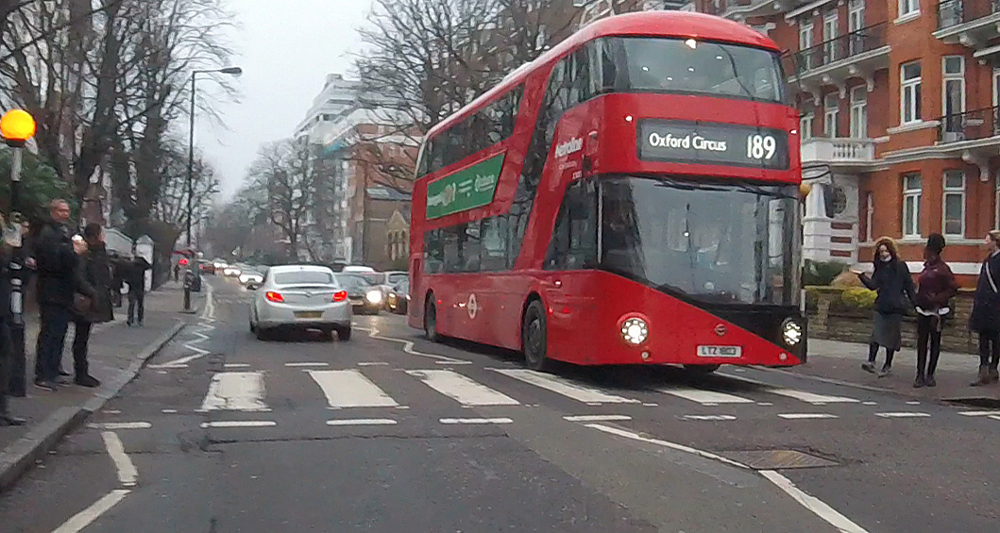
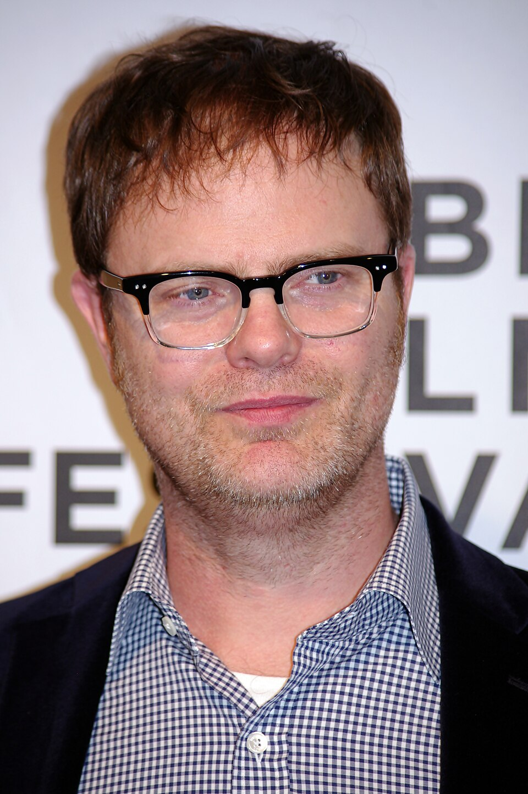

如果你听过林肯公园（Linkin Park）那首传唱二十多年的 *In the End*，副歌一定早就在脑子里单曲循环过：

> *"I tried so hard and got so far*  
> *But **in the end**, it doesn't even matter."*  
> —— Linkin Park, *"In the End"* (*Hybrid Theory*, 2000)

试着把歌词里的 `in` 换成 `at`：*"But **at the end**, it doesn't even matter."*

母语者一听就会皱眉。首先，`at the end` 听起来像话没说完（at the end of **what**？）；其次，即便强行补全，整句的情绪也会瞬间垮掉——从“拼尽全力、走过漫长挣扎，到头来一切归零”的宿命感，变成冷冰冰的“在某个东西的末尾无所谓”。

这就是 `at the end` 与 `in the end` 之间最本质的分野。用一句话记住它们的核心直觉：

> **`at the end` 是“坐标点”**——像一根图钉，钉在某段时间、某段空间或某件事的**尽头**；  
> **`in the end` 是“结算单”**——经历一番曲折、等待或权衡之后，最终落定的**结果或结论**。

---

## 一、核心差别一览

| 维度 | `at the end (of ...)` | `in the end` |
|---|---|---|
| **核心意象** | 具体的终点坐标（点） | 经历过程后的最终走向（结果） |
| **常见结构** | 几乎总是接 **`of + 名词`**（偶尔承前省略） | 独立作状语，**绝不能接 `of`** |
| **适用范围** | 时间终点、空间尽头、事件尾声 | 抽象结果、最终决定、归根结底 |
| **反义搭档** | `at the beginning (of ...)` | `at first` / `initially` |
| **近义替换** | at the very last part of ... | finally / eventually / ultimately |

记住一个极好用的“反义词测试”：
- 如果你想表达的是 **“在开头……，在结尾……”**（`at the beginning` ↔ `at the end`），用 **`at`**；
- 如果你想表达的是 **“起初……，结果最后……”**（`at first` ↔ `in the end`），用 **`in`**。

---

## 二、流行文化里的 `in the end`：折腾之后的“终局”与“领悟”

`in the end` 骨子里带着**故事感**。它前面往往藏着一段过程：努力过、犹豫过、争执过、走过弯路，然后才轮到 `in the end` 出场拍板。

### 1. 披头士的绝唱：用 `at the end of` 唱出 `in the end`

1969 年，披头士录制了四人合作的最后一张录音室专辑 *Abbey Road*。整张专辑最后一首有歌词的曲目叫 *"The End"*，里面只有两句唱词，却成了摇滚史上最著名的告别：

> *"And **in the end**, the love you take is equal to the love you make."*  
> —— The Beatles, *"The End"* (*Abbey Road*, 1969)

这首歌堪称区分两个短语的绝佳范本：
- **At the end of** *Abbey Road*（在专辑的末尾——具体位置），乐队用最后两分钟做了告别；
- 歌词却说 **in the end**（到头来、归根结底——人生结算），你收获的爱，终究等于你付出的爱。

一个是**唱片轨道上的物理位置**，一个是**回望整个人生后的哲学总账**。

### 2. 《办公室》（*The Office*）：一场心理战后的“终极判词”

在美剧《办公室》第七季第 11 集（*"Classy Christmas"*）里，Jim 朝 Dwight 扔了一个雪球，结果招来 Dwight 贯穿整集、无孔不入的“雪球复仇”。剧集最后，Dwight 站在楼顶俯视着被一院子雪人吓得草木皆兵的 Jim，冷冷地道出全集点题台词：

> *"**In the end**, the greatest snowball isn't a snowball at all. It's fear. Merry Christmas."*  
> —— Dwight Schrute, *The Office* (S7E11, "Classy Christmas")

这里用 `In the end` 再贴切不过：它不是在报幕“圣诞节结束的时候”，而是在总结这一整场博弈的**最终真相**——归根结底，最可怕的雪球根本不是雪球，而是恐惧。

---

## 三、流行文化里的 `at the end (of ...)`：钉死时空尽头的“图钉”

与 `in the end` 的“总结感”不同，`at the end` 极其具象。你可以把它想象成地图上的终点旗，或者进度条拉到 100% 的那一帧。

### 3. 《指环王3：王者归来》：把坐标钉在“万物尽头”

摧毁至尊魔戒后，末日火山崩塌，岩浆吞没大地。Frodo 和 Sam 精疲力竭地躺在滚烫的岩石上，以为生命的最后一刻已经到来。Frodo 对 Sam 说：

> *"I'm glad to be with you, Samwise Gamgee, here **at the end of all things**."*  
> —— Frodo Baggins, *The Lord of the Rings: The Return of the King* (2003)

留意这句台词里一个极其精妙的词：**`here`**。

英文里几乎不可能说 `*here in the end`，因为 `in the end` 没有空间感；但 **`here at the end of all things`** 却无比自然——它把时间（万物的终结）和空间（此时此地的末日火山）钉死在了同一个坐标点上。

### 4. 《降世神通》（*Avatar: The Last Airbender*）：隧道尽头的光

> *"Sometimes life is like this dark tunnel. You can't always see the light **at the end of the tunnel**, but if you just keep moving, you will come to a better place."*  
> —— Uncle Iroh, *Avatar: The Last Airbender*

只要涉及**空间尽头**（路头、走廊尽头、书的最后一页、隧道出口），英语里几乎清一色用 **`at the end of`**：
- `at the end of the street`（街的尽头）
- `at the end of the tunnel`（隧道尽头；常喻“熬出头的曙光”）
- `at the end of the movie`（电影结尾处）

---

## 四、最容易混淆的“跨界选手”：`at the end of the day`

学到这里，经常看美剧的同学一定会举手发问：

> “不对啊！美剧里天天听见 **`at the end of the day`**，意思明明也是‘归根结底、说到底’，怎么用的却是 `at` ？”

这是最值得单独拆解的一个 nuance。先看音乐剧《悲惨世界》里那首著名的开场曲：

> *"**At the end of the day** you're another day older*  
> *And that's all you can say for the life of the poor."*  
> —— *Les Misérables*, *"At the End of the Day"*

这句歌词玩了一个极其精准的双关：
1. **字面义（时间坐标）**：工厂女工劳作一整天，到了**傍晚收工那一刻**（标准的 `at the end of + 时间`），唯一的变化只是又老了一天；
2. **引申义（习语）**：因为“一天结束时盘点得失”太有画面感，在现代口语里，`at the end of the day` 已经虚化成了一个固定习语，意思是 **“说到底、归根结底、抛开杂音看本质”**（≈ *when all is said and done*）。

美剧里几乎随处可见这种用法：

- **《神烦警探》（*Brooklyn Nine-Nine*, S2E11 "Stakeout"）**——Jake 谈到兄弟情时说：
  > *"Look, brothers fight, but **at the end of the day**, they're always there for each other."*  
  > （听着，兄弟之间是会吵架，但说到底，他们永远会站在彼此身后。）

- **《老友记》（*Friends*, S1E20 "The One with the Evil Orthodontist"）**——Mindy 坦白自己放不下未婚夫 Barry 时说：
  > *"Look, I know he's not perfect, but the truth is, **at the end of the day**, I still really wanna be Mrs. Dr. Barry Farber, D.D.S."*  
  > （我知道他不完美，但说到底，我还是真的很想当巴里·法伯医生太太。）

### 那么，`in the end` 和 `at the end of the day` 还能互换吗？

**很多时候可以，但有一个清晰的边界：**

- **`in the end` 管“最后发生了什么”（事件结果）**：
  - ✅ *We argued for an hour, but **in the end**, we ordered pizza.*（吵了一小时，最后还是点了披萨。）
  - ❌ *We argued for an hour, but ~~at the end of the day~~, we ordered pizza.*（除非你真的在指“天黑收工的时候”，否则极不自然。）
- **`at the end of the day` 管“最重要的是什么”（权衡后的底线/结论）**：
  - ✅ ***At the end of the day**, your health matters more than any exam.*（说到底，健康比任何考试都重要。）
  - ✅ ***In the end**, your health matters more than any exam.*（这里两者都能用，但 `at the end of the day` 更口语、更有“退一步看大局”的劝说味；`in the end` 略带一丝“时间会证明”的沧桑感。）

---

## 五、进阶 Nuance：同一句话，换一个介词，画面全变

把下面两组句子放在一起读，语感差异会立刻清晰起来：

### 1. 电影情节 vs. 感情走向
- ***At the end of** the movie, she leaves him.*  
  → 镜头聚焦在**电影结尾那一幕**（进度条最后几分钟发生了什么）。
- ***In the end**, she leaves him.*  
  → 焦点在**整段关系的命运**（他们分分合合、努力挽回过，但最终她还是走了）。

### 2. `at the end` 什么时候可以不加 `of`？
教科书常说“`at the end` 后面必须加 `of`”，这其实只对了一半。**只要上下文已经明确指出了“什么东西的末尾”，`of ...` 完全可以省略**：
- *There will be a ten-minute Q&A **at the end**.*（省略了 `of the talk`，指讲座结尾处）
- *Just sign your name **at the end**.*（省略了 `of the form`，指表格最末）
- *Don't tell me what happens **at the end**!*（别剧透结局！指电影或书的最后部分）

注意最后一例：防剧透说 *at the end*（故事结尾处的情节），而不说 *in the end*。

---

## 六、常见雷区 & 三道小自测

**两个高频中式英语雷区：**
1. ❌ *~~In the end of~~ the semester, we had five exams.* → 只要后面跟 `of`，99% 都是 **`At the end of`**。
2. ❌ *We got lost twice, and ~~at the end~~ we took a taxi.* → 表示折腾之后的最终结果，用 **`in the end`**。

**自测一下（投票即可解锁答案与解析）：**

:::poll at-end-in-end-q1
**Q1 · 最终决定：** *"We waited for him for nearly an hour, and ______ we decided to leave without him."*

- [ ] A. at the end
- [x] B. in the end
- [ ] C. at the end of
- [ ] D. at the end of the day

:::reveal 答案与解析
**正确答案：B. `in the end`**

强调经过近一小时等待后的**最终结果/决定**（= *eventually / finally*）。`at the end of` 后面缺少宾语；`at the end of the day` 侧重权衡后的底线结论，不用于叙述“最后做了某件事”。
:::
:::

:::poll at-end-in-end-q2
**Q2 · 空间尽头：** *"There's a small coffee shop ______ the lane."*

- [x] A. at the end of
- [ ] B. in the end of
- [ ] C. in the end
- [ ] D. at the end

:::reveal 答案与解析
**正确答案：A. `at the end of`**

小巷尽头是具体的**物理空间坐标**，必须用 `at the end of + 名词`。注意英文中绝没有 `in the end of` 这种搭配。
:::
:::

:::poll at-end-in-end-q3
**Q3 · 权衡底线：** *"People complain about the noise, but ______, it's still the most convenient neighborhood in town."*

- [ ] A. at the end
- [ ] B. at the end of
- [x] C. at the end of the day
- [ ] D. in the end of the day

:::reveal 答案与解析
**正确答案：C. `at the end of the day`**

口语里最地道的“说到底、归根结底”，用来在权衡利弊后给出核心结论（≈ *when all is said and done*）。如果换成 `in the end` 语法也成立，但 `at the end of the day` 更符合日常美剧式劝说语感。
:::
:::
