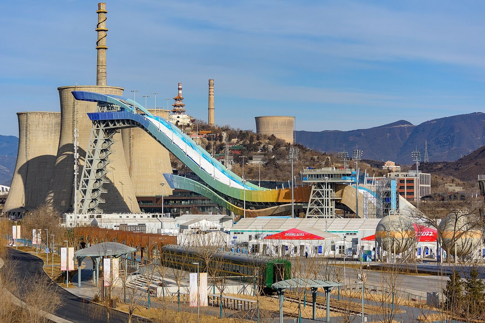
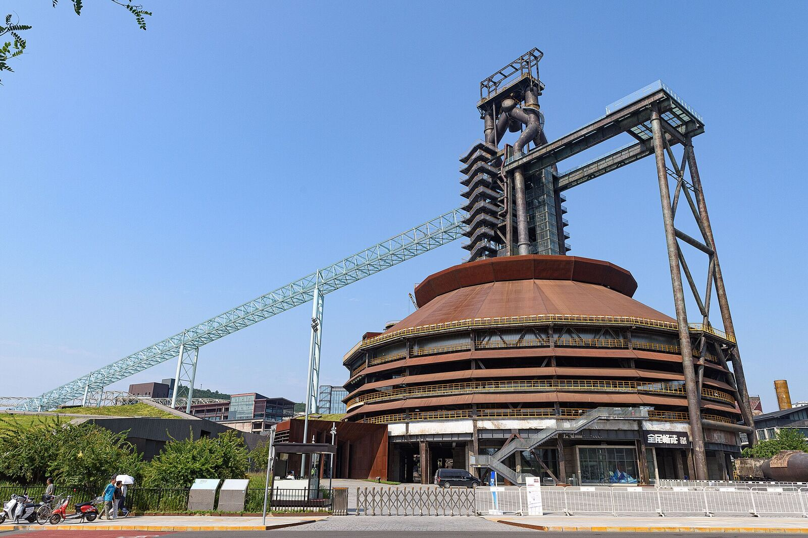
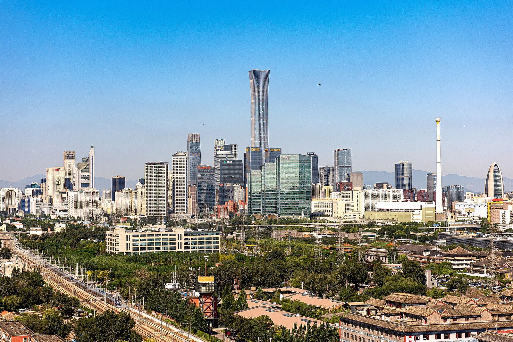
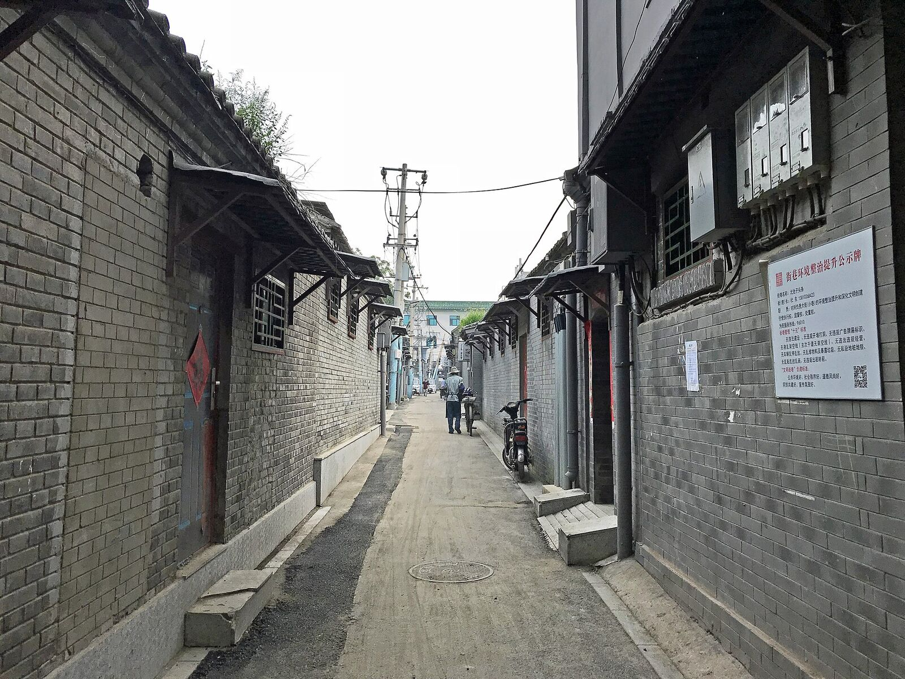
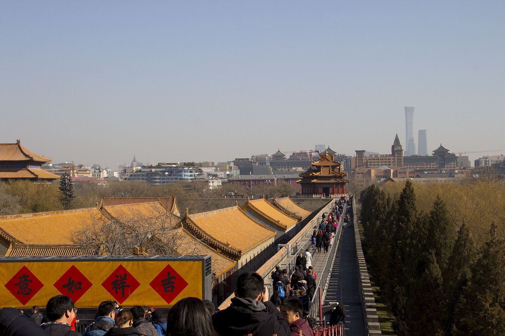

## 题目

假设你是红星中学高三学生李华。你班即将举行主题为“驻足一角，感悟北京”的英语演讲活动，你打算参加。现在你需要准备一份演讲稿，分享自己的相关经历，内容包括：

1. 你的经历；
2. 你的感悟。

注意：

1. 词数 100 左右；
2. 开头和结尾已给出，不计入总词数。

```text
Dear all,
______________________
```

题目说开头和结尾都已给出，但这里只列出了开头“Dear all,”。下面的范文以 Thank you! 收尾，实际作答时以试卷上给出的结尾为准，这两句都不计入词数。

## 审题：这篇和书信有什么不同

**文体是演讲稿。** 听众是全班同学，所以语气要亲切、有现场感：可以用一个问题开场（Have you ever...?），可以对听众说话，结尾可以回到自己或大家身上。但它仍然是一篇 100 词的短文，不要写成长篇抒情。

**“驻足一角”是关键。** “一角”是北京的一个具体地方，“驻足”是停下来看一看、听一听。所以要写**一个地点、一次停留、一个画面**，而不是把故宫、长城、鸟巢挨个介绍一遍。写成导游词或景点清单，就偏离了题目。

**“感悟北京”要从这一角说开去。** 感悟不是“北京很美”，而是这个角落让你看到了北京的什么：古今交融、旧物新生、包容、奋斗、人情味……最好再落到自己身上，说说这对你有什么启发。

**两个要点，时态不同。** 经历用一般过去时（I stopped at... / I saw...）；感悟里讲北京的特点和你的想法，用一般现在时（Beijing never throws its past away.）。

## 写哪“一角”

下面几个地方都很好写。每一个都有能写进作文的画面，也自然地引出一种感悟。

### 首钢园：旧厂房里长出的冬奥赛场

首钢园在石景山区，原来是首钢的老厂区。2010 年底，这里的钢铁主流程全面停产，高炉、冷却塔、筒仓保留了下来。北京冬奥组委曾在这里的筒仓里办公，旁边建起了首钢滑雪大跳台（“雪飞天”），2022 年冬奥会的单板滑雪和自由式滑雪大跳台比赛就在这里举行。如今老高炉改成了展厅和活动场地，园区里还承办服贸会等大型活动。

- 可以写的画面：锈红色的高炉和银白色的跳台并肩而立；有人沿着群明湖跑步，有人在钢架下拍照。
- 自然引出的感悟：北京不丢掉过去，而是让旧物焕发新生（give old things a new life）；城市的绿色转型。



### CBD：现代首都的心跳

北京商务中心区（CBD）在朝阳区，国贸一带高楼林立。最显眼的是中国尊（中信大厦），高 528 米，是北京最高的建筑；不远处还有造型独特的中央电视台总部大楼。

- 可以写的画面：清晨站在天桥上，车流不断，上班族拿着咖啡匆匆走进写字楼；夜里写字楼的灯一盏盏亮着。
- 自然引出的感悟：北京的活力与奋斗；高楼之所以伟大，是因为有让城市运转的普通人。



### 更多可写的“一角”

| 地点 | 可以写的画面 | 自然引出的感悟 |
|---|---|---|
| 胡同 | 灰墙、四合院的门墩、头顶飞过的鸽哨，老人坐在门口聊天 | 慢下来的北京，人情味，老城的生活气息 |
| 故宫角楼 | 黄昏时角楼倒映在护城河里，远处是 CBD 的高楼 | 古今同框，传统与现代并存 |
| 798 艺术区 | 老工厂的红砖墙上挂着现代艺术作品 | 旧厂房的新生，城市的创造力 |
| 奥林匹克公园 | 鸟巢旁跑步、放风筝的市民 | “双奥之城”的自豪，体育精神 |
| 北京中轴线 | 从钟鼓楼远眺南边的景山和故宫 | 城市的秩序与传承（2024 年列入《世界遗产名录》） |





## 怎样写出彩

### 1. 经历：时间 + 地点 + 一个画面

开头一两句交代时间和地点，然后用两三句写**你看到、听到的东西**，最后找一个打动你的细节。比如：

- 时间地点：Last weekend, I stopped at a corner of Beijing: Shougang Park.
- 画面：Today, next to the rusty blast furnaces stands Big Air Shougang.
- 细节：Joggers ran along the lake, and visitors took photos under the steel frames.

写画面时多用具体的名词和动词（rusty blast furnaces, hurried into the towers），少用 beautiful, interesting, wonderful 这类泛泛的形容词。

### 2. 感悟：从这一角，到北京，再到我

一个好用的顺序是“小 → 大 → 我”：

1. 这个角落让我想到了什么：That moment taught me something about Beijing.
2. 由此看到的北京：It never throws its past away. Instead, it gives old things a new life.
3. 对我的启发：I hope to grow like this city, keeping my roots while chasing new dreams.

第三步是加分项：高三学生、面临选择和变化，这些都可以和城市的特点联系起来，让感悟显得真诚而不空洞。

### 3. 用上演讲的语气

- 开头可以用问题抓住听众：Have you ever watched Beijing wake up?
- 也可以直接把听众带到现场：Imagine standing beside a giant blast furnace...
- 结尾可以邀请大家：Next time you pass by, why not stop for a moment?

一篇里用一两处就够了，不要每句都是感叹句。

### 4. 句式有变化，但准确第一

地点状语开头的完全倒装（Above them rose China Zun.）特别适合写景，一篇用一次就很出彩。再配一个定语从句（where athletes competed...）、一个非谓语（Standing beside the cooling towers, ...），句式就够丰富了。

## 范文一：首钢园

> Dear all,
>
> Last weekend, I stopped at a corner of Beijing: Shougang Park. Standing beside the cooling towers, I could hardly believe that this place used to be a noisy steel mill. Today, next to the rusty blast furnaces stands Big Air Shougang, where athletes competed in the 2022 Winter Olympics. Joggers ran along the lake, and visitors took photos under the steel frames.
>
> That moment taught me something about Beijing. It never throws its past away. Instead, it gives old things a new life and moves forward with them. As a senior, I'm facing changes too, and I hope to grow like this city, keeping my roots while chasing new dreams.
>
> Thank you!

正文 110 词。亮点：

- 第一句就点题：stopped at a corner of Beijing 呼应“驻足一角”。
- Standing beside the cooling towers 是非谓语作状语；could hardly believe... used to be... 写出今昔对比。
- next to the rusty blast furnaces stands Big Air Shougang 是完全倒装，锈红的高炉和新建的跳台同时出现在一句里。
- 感悟按“北京 → 我”展开，keeping my roots while chasing new dreams 把城市和自己联系起来。

## 范文二：CBD

> Dear all,
>
> Have you ever watched Beijing wake up? One early morning, I stopped on a footbridge in the CBD. Below me, endless cars flowed past, and office workers hurried into the towers with coffee in hand. Above them rose China Zun, the tallest building in Beijing, shining in the morning sun.
>
> I could feel the heartbeat of a modern capital. Everyone seemed to be racing toward a goal, yet a street cleaner greeted me with a warm smile. It dawned on me that Beijing is great not only because of its skyscrapers but also because of the ordinary people who keep it running. I want to be one of them.
>
> Thank you!

正文 109 词。亮点：

- 用问题开场，有演讲的现场感。
- Below me... Above them rose China Zun... 从下往上写，画面有层次；后一句是完全倒装。
- yet a street cleaner greeted me with a warm smile 是一个反差细节，引出后面的感悟。
- not only because of... but also because of... 是全文的中心句，最后一句短句收尾，有力量。

## 句子升级对照

| 普通写法 | 升级写法 | 升级在哪里 |
|---|---|---|
| I went to Shougang Park last weekend. | Last weekend, I stopped at a corner of Beijing: Shougang Park. | 用 stopped at a corner 扣题 |
| There are many tall buildings in the CBD. | Above them rose China Zun, the tallest building in Beijing. | 倒装加同位语，写出具体的楼 |
| It was a steel factory before. Now it is a park. | I could hardly believe that this place used to be a noisy steel mill. | 把今昔对比放进“难以置信”里 |
| Beijing has a long history and modern buildings. | Beijing never throws its past away. Instead, it gives old things a new life. | 从具体地点得出感悟，不说套话 |
| I love Beijing very much. | I hope to grow like this city, keeping my roots while chasing new dreams. | 把感悟落到自己身上 |
| People in Beijing are very busy. | Everyone seemed to be racing toward a goal. | 用画面代替概括 |

## 常见错误

- **写成景点介绍**：一口气介绍故宫、长城、颐和园，没有“驻足”，也没有自己的经历。只写一个地点、一次停留。
- **感悟空洞**：Beijing is a beautiful city with a long history and splendid culture. 这句放进任何一篇写北京的作文都成立，等于没说。感悟要从你写的那个角落里来。
- **时态混乱**：经历用过去时，感悟里讲北京的特点用现在时。
- **中式表达**：
  - people mountain people sea → crowds of people / The park was packed with visitors.
  - Beijing becomes more and more beautiful. → Beijing keeps changing for the better.
  - I feel very deep. → It left a deep impression on me. / It moved me deeply.
  - It makes me know... → It helps me understand... / It taught me...
- **演讲稿没有演讲味**：通篇都是陈述句也可以，但用一个问题开场或一句号召结尾，会更像在对同学说话。

## 实用词汇和句型

### 开场与点题

| 表达 | 中文 | 例句 |
|---|---|---|
| Have you ever...? | 你有没有……？ | Have you ever watched Beijing wake up? |
| Imagine... | 想象一下…… | Imagine standing beside a giant blast furnace. |
| stop at a corner of | 在……的一角驻足 | Last weekend, I stopped at a corner of Beijing. |
| pause for a moment | 停下来片刻 | I paused for a moment and looked around. |

### 描写场景

| 表达 | 中文 |
|---|---|
| tower over / stand side by side | 高耸于…… / 并肩而立 |
| rise into the sky | 拔地而起，直插云霄 |
| be packed with / be crowded with | 挤满了…… |
| hurry / stroll / jog | 匆匆走 / 漫步 / 慢跑 |
| shine in the morning sun / be lit up at night | 在朝阳下闪闪发光 / 夜里灯火通明 |
| the sound of pigeon whistles | 鸽哨声 |
| grey brick walls / red brick walls | 灰砖墙 / 红砖墙 |

### 地点与建筑

| 表达 | 中文 |
|---|---|
| Shougang Park | 首钢园 |
| Big Air Shougang | 首钢滑雪大跳台（“雪飞天”） |
| blast furnace / cooling tower / steel mill | 高炉 / 冷却塔 / 钢厂 |
| industrial heritage | 工业遗产 |
| the Central Business District (CBD) | 商务中心区 |
| China Zun (CITIC Tower) | 中国尊（中信大厦） |
| skyscraper / skyline | 摩天大楼 / 天际线 |
| hutong / courtyard house (siheyuan) | 胡同 / 四合院 |
| the corner towers of the Forbidden City | 故宫角楼 |
| the Bird's Nest (the National Stadium) | 鸟巢（国家体育场） |
| a city that has hosted both the Summer and Winter Olympics | 双奥之城 |

### 感悟

| 表达 | 中文 | 例句 |
|---|---|---|
| It dawned on me that... | 我忽然意识到…… | It dawned on me that every street has a story. |
| That moment taught me... | 那一刻让我明白…… | That moment taught me something about Beijing. |
| give old things a new life | 让旧物焕发新生 | The city gives old factories a new life. |
| where the old meets the new | 古今交汇之处 | Shougang Park is where the old meets the new. |
| the heartbeat of a city | 城市的心跳 | I could feel the heartbeat of a modern capital. |
| keep one's roots | 不忘根本 | A great city keeps its roots while it grows. |
| not only because of... but also because of... | 不仅因为……也因为…… | Beijing is great not only because of its buildings but also because of its people. |

### 结尾与号召

| 表达 | 中文 |
|---|---|
| Next time you pass by, why not stop for a moment? | 下次路过时，何不停下来看一看？ |
| Every corner of Beijing has a story to tell. | 北京的每个角落都有故事。 |
| Let's slow down and discover the city around us. | 让我们慢下来，去发现身边的城市。 |

## 图片来源

本文图片均来自 Wikimedia Commons，按原许可协议使用，已缩小尺寸：

- [Big Air Shougang (20220207093457)](https://commons.wikimedia.org/wiki/File:Big_Air_Shougang_(20220207093457).jpg)，N509FZ，[CC BY-SA 4.0](https://creativecommons.org/licenses/by-sa/4.0/)
- [No. 3 Blast Furnace of Shougang Park (20240916133522)](https://commons.wikimedia.org/wiki/File:No._3_Blast_Furnace_of_Shougang_Park_(20240916133522).jpg)，N509FZ，[CC BY-SA 4.0](https://creativecommons.org/licenses/by-sa/4.0/)
- [Skyline of Beijing CBD from the southeast (20210907094201)](https://commons.wikimedia.org/wiki/File:Skyline_of_Beijing_CBD_from_the_southeast_(20210907094201).jpg)，N509FZ，[CC BY-SA 4.0](https://creativecommons.org/licenses/by-sa/4.0/)
- [Hutong, Gasse in Peking, alley in Beijing](https://commons.wikimedia.org/wiki/File:Hutong,_Gasse_in_Peking,_alley_in_Beijing_(44042315480).jpg)，FLASHPACKER TRAVELGUIDE，[CC BY-SA 2.0](https://creativecommons.org/licenses/by-sa/2.0/)
- [Forbidden City during Spring Festival and China Zun 1](https://commons.wikimedia.org/wiki/File:Forbidden_City_during_Spring_Festival_and_China_Zun_1.jpg)，維基小霸王，[CC BY-SA 4.0](https://creativecommons.org/licenses/by-sa/4.0/)
