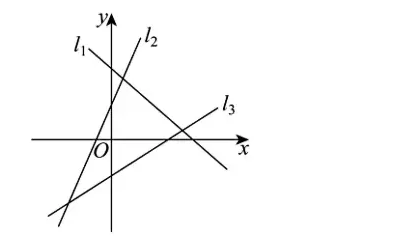
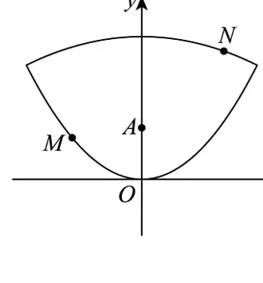
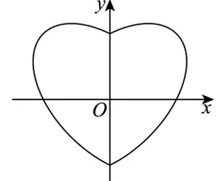

> **试卷编号**：85961133  
> **试卷性质**：大兴一中 2027 届数学周测试题（八）  
> **试卷满分**：100.0 分（共 40 题：单选题 35 道，非选择题 5 道）  
> **PDF 附件下载**：[大兴一中周测8.pdf](./大兴一中周测8.pdf)

---

## 第一部分：参考答案速查表

### 1. 单选题答案（第 1 ~ 35 题）

| 题号 | [1](#q1) | [2](#q2) | [3](#q3) | [4](#q4) | [5](#q5) | [6](#q6) | [7](#q7) | [8](#q8) | [9](#q9) | [10](#q10) |
| :---: | :---: | :---: | :---: | :---: | :---: | :---: | :---: | :---: | :---: | :---: |
| **答案** | **D** | **D** | **C** | **B** | **B** | **C** | **A** | **A** | **C** | **B** |

| 题号 | [11](#q11) | [12](#q12) | [13](#q13) | [14](#q14) | [15](#q15) | [16](#q16) | [17](#q17) | [18](#q18) | [19](#q19) | [20](#q20) |
| :---: | :---: | :---: | :---: | :---: | :---: | :---: | :---: | :---: | :---: | :---: |
| **答案** | **B** | **A** | **D** | **B** | **D** | **A** | **A** | **A** | **B** | **B** |

| 题号 | [21](#q21) | [22](#q22) | [23](#q23) | [24](#q24) | [25](#q25) | [26](#q26) | [27](#q27) | [28](#q28) | [29](#q29) | [30](#q30) |
| :---: | :---: | :---: | :---: | :---: | :---: | :---: | :---: | :---: | :---: | :---: |
| **答案** | **C** | **D** | **D** | **C** | **B** | **B** | **D** | **A** | **D** | **C** |

| 题号 | [31](#q31) | [32](#q32) | [33](#q33) | [34](#q34) | [35](#q35) |
| :---: | :---: | :---: | :---: | :---: | :---: |
| **答案** | **C** | **C** | **D** | **C** | **C** |

---

### 2. 填空题答案（第 36 ~ 40 题）

| 题号 | 参考答案 | 说明 / 完整解集 |
| :---: | :---: | :---: |
| **[36](#q36)** | $0$ | 唯一解 |
| **[37](#q37)** | $6$ | 唯一解 |
| **[38](#q38)** | $\frac{1}{2}$（或 $-\frac{1}{2}$） | 满足 $k = \pm\frac{1}{2}$ 之一即可 |
| **[39](#q39)** | $-4$（填 $(-8, -3)$ 内任意实数即可） | 满足取值范围 $m \in (-8, -3)$ 即可 |
| **[40](#q40)** | $\sqrt{3} - 1$；$2$ | 第一空为 $\sqrt{3} - 1$，第二空为 $2$ |

---

## 第二部分：试题原题与详尽解析

### 一、单选题（第 1 ~ 10 题）：直线方程与位置关系

**1. 下列说法错误的是（ ）**  
A. 有的直线斜率不存在  
B. 截距可以为负数或零  
C. 若直线 $l$ 的倾斜角为 $\alpha$，且 $\alpha \neq 90^\circ$，则它的斜率 $k = \tan\alpha$  
D. 直线倾斜角的取值范围是 $[0, \pi]$  

**【解析】**  
* **A 项**：当直线的倾斜角为 $90^\circ$ 时，直线与 $x$ 轴垂直，斜率不存在，说法正确；  
* **B 项**：截距是直线与坐标轴交点的坐标数值（标量），可为正数、负数或零，说法正确；  
* **C 项**：由斜率定义，当倾斜角 $\alpha \neq 90^\circ$ 时，$k = \tan\alpha$，说法正确；  
* **D 项**：平面直角坐标系中直线的倾斜角 $\alpha$ 的取值范围是 $[0, \pi)$（即 $[0^\circ, 180^\circ)$），包含 $0$ 但不包含 $\pi$，说法错误。  

**【标准答案】D**

---

**2. 如右图中的直线 $l_1, l_2, l_3$ 的斜率分别为 $k_1, k_2, k_3$，则（ ）**  
A. $k_1 < k_2 < k_3$  
B. $k_3 < k_1 < k_2$  
C. $k_3 < k_2 < k_1$  
D. $k_1 < k_3 < k_2$  

**【解析】**  
由图像可知：  
* 直线 $l_1$ 向右下方倾斜，其倾斜角为钝角，因此斜率 $k_1 < 0$；  
* 直线 $l_2$ 与 $l_3$ 向右上方倾斜，倾斜角均为锐角，故 $k_2 > 0$ 且 $k_3 > 0$；  
* 比较两条直线的倾斜程度，$l_2$ 的倾斜角大于 $l_3$ 的倾斜角，由正切函数在 $(0, \frac{\pi}{2})$ 单调递增可知 $k_2 > k_3 > 0$。  
综上，$k_1 < k_3 < k_2$。  

**【标准答案】D**

---

**3. 经过两点 $A(2, m), B(m, 4)$ 的直线 $l$ 的倾斜角为 $45^\circ$，则 $m$ 的值为（ ）**  
A. $-2$  
B. $1$  
C. $3$  
D. $4$  

**【解析】**  
由直线倾斜角为 $45^\circ$ 得斜率 $k = \tan 45^\circ = 1$。  
由两点斜率公式：  
$$k = \frac{4 - m}{m - 2} = 1 \implies 4 - m = m - 2 \implies 2m = 6 \implies m = 3$$  

**【标准答案】C**

---

**4. 过 $A(2, -3)$ 且倾斜角为 $60^\circ$ 的直线方程为（ ）**  
A. $y = \sqrt{3}(x - 2) + 3$  
B. $y = \sqrt{3}(x - 2) - 3$  
C. $y = \frac{\sqrt{3}}{3}(x - 2) + 3$  
D. $y = \frac{\sqrt{3}}{3}(x - 2) - 3$  

**【解析】**  
倾斜角为 $60^\circ$，其斜率 $k = \tan 60^\circ = \sqrt{3}$。  
由点斜式方程：  
$$y - (-3) = \sqrt{3}(x - 2) \implies y = \sqrt{3}(x - 2) - 3$$  

**【标准答案】B**

---

**5. 已知 $\triangle ABC$ 三个顶点的坐标分别为 $A(-6, 3), B(4, -3), C(1, -2)$，则 $AC$ 边上的中线所在直线的方程为（ ）**  
A. $7x - 13y + 11 = 0$  
B. $7x + 13y + 11 = 0$  
C. $13x + 7y + 11 = 0$  
D. $7x + 13y - 11 = 0$  

**【解析】**  
线段 $AC$ 的中点 $D$ 的坐标为：  
$$D\left(\frac{-6 + 1}{2}, \frac{3 + (-2)}{2}\right) = \left(-\frac{5}{2}, \frac{1}{2}\right)$$  
$AC$ 边上的中线经过顶点 $B(4, -3)$ 与中点 $D\left(-\frac{5}{2}, \frac{1}{2}\right)$，其斜率：  
$$k = \frac{\frac{1}{2} - (-3)}{-\frac{5}{2} - 4} = \frac{\frac{7}{2}}{-\frac{13}{2}} = -\frac{7}{13}$$  
中线方程为：  
$$y - (-3) = -\frac{7}{13}(x - 4) \implies 13(y + 3) = -7(x - 4) \implies 7x + 13y + 11 = 0$$  

**【标准答案】B**

---

**6. 经过点 $M(6, 3)$ 且在两坐标轴上截距相等的直线是（ ）**  
A. $x + y - 9 = 0$  
B. $x - y - 3 = 0$  
C. $x + y - 9 = 0$ 或 $x - 2y = 0$  
D. $x - y - 3 = 0$ 或 $x - 2y = 0$  

**【解析】**  
* **情形 1**：截距不为 $0$。  
  设截距式方程为 $\frac{x}{a} + \frac{y}{a} = 1 \implies x + y = a$。  
  代入点 $M(6, 3)$ 得 $6 + 3 = a \implies a = 9$，直线方程为 $x + y - 9 = 0$。  
* **情形 2**：截距均为 $0$。  
  直线过原点 $(0, 0)$，由原点与点 $M(6, 3)$ 得斜率 $k = \frac{3}{6} = \frac{1}{2}$。  
  直线方程为 $y = \frac{1}{2}x \implies x - 2y = 0$。  
综上，该直线方程为 $x + y - 9 = 0$ 或 $x - 2y = 0$。  

**【标准答案】C**

---

**7. 直线 $5x + 4y + 20 = 0$ 在 $x$ 轴上的截距是（ ）**  
A. $-4$  
B. $4$  
C. $(-4, 0)$  
D. $(4, 0)$  

**【解析】**  
令 $y = 0$，代入直线方程得：  
$$5x + 20 = 0 \implies x = -4$$  
直线的截距是交点的坐标数值（标量），不是点坐标。故截距为 $-4$。  

**【标准答案】A**

---

**8. 已知两条不重合的直线 $l_1: ax + 2y - 1 = 0$ 和 $l_2: x + (a+1)y - 1 = 0$，$a \in \mathbf{R}$，若 $l_1 \parallel l_2$，则 $a$ 的值为（ ）**  
A. $-2$  
B. $-2$ 或 $1$  
C. $1$  
D. $-1$ 或 $2$  

**【解析】**  
两直线平行需满足：  
$$a(a + 1) - 2 \times 1 = 0 \implies a^2 + a - 2 = 0 \implies (a + 2)(a - 1) = 0 \implies a = -2 \text{ 或 } a = 1$$  
* 检验 $a = 1$：$l_1: x + 2y - 1 = 0$，$l_2: x + 2y - 1 = 0$，两直线重合，与题意“不重合”矛盾，舍去；  
* 检验 $a = -2$：$l_1: -2x + 2y - 1 = 0 \implies 2x - 2y + 1 = 0$；$l_2: x - y - 1 = 0 \implies 2x - 2y - 2 = 0$，两直线平行且不重合，符合题意。  
因此 $a = -2$。  

**【标准答案】A**

---

**9. 已知直线 $l_1: x + y - 2 = 0$ 和直线 $l_2: mx - 2y - 4 = 0$，若 $l_1 \perp l_2$，则 $m = $（ ）**  
A. $-2$  
B. $1$  
C. $2$  
D. $4$  

**【解析】**  
两直线垂直，则法向量互相垂直（$A_1 A_2 + B_1 B_2 = 0$）：  
$$1 \times m + 1 \times (-2) = 0 \implies m - 2 = 0 \implies m = 2$$  

**【标准答案】C**

---

**10. 已知 $P$ 和 $Q$ 分别为直线 $l_1: 6x + 8y - 20 = 0$ 与 $l_2: 6x + 8y + 5 = 0$ 上任意一点，则 $|PQ|$ 的最小值为（ ）**  
A. $\frac{3}{2}$  
B. $\frac{5}{2}$  
C. $3$  
D. $2$  

**【解析】**  
$|PQ|$ 的最小值即两条平行直线 $l_1$ 与 $l_2$ 之间的距离：  
$$d = \frac{|C_1 - C_2|}{\sqrt{A^2 + B^2}} = \frac{|-20 - 5|}{\sqrt{6^2 + 8^2}} = \frac{25}{\sqrt{100}} = \frac{25}{10} = \frac{5}{2}$$  

**【标准答案】B**

---

### 二、单选题（第 11 ~ 20 题）：对称变换与圆的性质

**11. 已知点 $A(1, 2)$ 与点 $B(5, 4)$ 关于直线 $l$ 对称，则直线 $l$ 的方程为（ ）**  
A. $x + 2y - 7 = 0$  
B. $2x + y - 9 = 0$  
C. $x - 2y + 5 = 0$  
D. $2x - y - 3 = 0$  

**【解析】**  
直线 $l$ 为线段 $AB$ 的垂直平分线：  
* 线段 $AB$ 的中点坐标为 $M\left(\frac{1 + 5}{2}, \frac{2 + 4}{2}\right) = (3, 3)$；  
* 直线 $AB$ 的斜率 $k_{AB} = \frac{4 - 2}{5 - 1} = \frac{1}{2}$；  
* 因为 $l \perp AB$，所以 $k_l = -\frac{1}{k_{AB}} = -2$；  
* 由点斜式得直线 $l$ 的方程：  
  $$y - 3 = -2(x - 3) \implies 2x + y - 9 = 0$$  

**【标准答案】B**

---

**12. 直线 $2x - y + 3 = 0$ 关于点 $(1, 2)$ 对称的直线方程为（ ）**  
A. $2x - y - 3 = 0$  
B. $2x - y - 1 = 0$  
C. $2x + y + 3 = 0$  
D. $x - 2y - 3 = 0$  

**【解析】**  
设对称直线上任一点为 $(x, y)$，其关于点 $(1, 2)$ 对称的点为 $(x_0, y_0) = (2 - x, 4 - y)$。  
代入已知直线方程 $2x_0 - y_0 + 3 = 0$：  
$$2(2 - x) - (4 - y) + 3 = 0 \implies 4 - 2x - 4 + y + 3 = 0 \implies -2x + y + 3 = 0 \implies 2x - y - 3 = 0$$  

**【标准答案】A**

---

**13. 与直线 $l: 2x + y + 1 = 0$ 关于直线 $m: x - y + 2 = 0$ 对称的直线方程为（ ）**  
A. $2x - y + 3 = 0$  
B. $2x + y - 1 = 0$  
C. $x - 2y + 3 = 0$  
D. $x + 2y - 1 = 0$  

**【解析】**  
对称轴为 $x - y + 2 = 0$，即 $y = x + 2$（或 $x = y - 2$）。  
对于斜率为 $1$ 的直线，任一点 $(x, y)$ 关于它的对称点 $(x', y')$ 满足坐标直接代换：  
$$x' = y - 2 \implies y = x' + 2, \quad y' = x + 2 \implies x = y' - 2$$  
代入直线 $l: 2x + y + 1 = 0$ 中：  
$$2(y' - 2) + (x' + 2) + 1 = 0 \implies 2y' - 4 + x' + 2 + 1 = 0 \implies x' + 2y' - 1 = 0$$  
即对称直线方程为 $x + 2y - 1 = 0$。  

**【标准答案】D**

---

**14. 已知点 $A(1, 2), B(2, 1)$ 在直线 $l: x + y - 4 = 0$ 的同侧，$P$ 为直线 $l$ 上的动点，则 $|PA| + |PB|$ 的最小值为（ ）**  
A. $\sqrt{10}$  
B. $2$  
C. $\sqrt{5}$  
D. $2\sqrt{2}$  

**【解析】**  
求点 $A(1, 2)$ 关于直线 $x + y - 4 = 0$ 的对称点 $A'(x', y')$：  
由对称变换公式：$x' = 4 - y_A = 4 - 2 = 2$，$y' = 4 - x_A = 4 - 1 = 3$，得 $A'(2, 3)$。  
则 $|PA| + |PB| = |PA'| + |PB| \ge |A'B|$，  
$$|A'B| = \sqrt{(2 - 2)^2 + (3 - 1)^2} = \sqrt{0 + 4} = 2$$  

**【标准答案】B**

---

**15. 圆 $x^2 + y^2 - 2x + 6y = 0$ 的圆心到直线 $x - y + 2 = 0$ 的距离为（ ）**  
A. $\sqrt{2}$  
B. $2$  
C. $3$  
D. $3\sqrt{2}$  

**【解析】**  
配方得标准方程：  
$$(x - 1)^2 + (y + 3)^2 = 10$$  
圆心坐标为 $(1, -3)$。  
点到直线的距离为：  
$$d = \frac{|1 - (-3) + 2|}{\sqrt{1^2 + (-1)^2}} = \frac{6}{\sqrt{2}} = 3\sqrt{2}$$  

**【标准答案】D**

---

**16. 若直线 $2x + y - 1 = 0$ 是圆 $(x - a)^2 + y^2 = 1$ 的一条对称轴，则 $a = $（ ）**  
A. $\frac{1}{2}$  
B. $-\frac{1}{2}$  
C. $1$  
D. $-1$  

**【解析】**  
圆的任意一条对称轴必然经过圆心。圆心坐标为 $(a, 0)$，将其代入直线方程得：  
$$2a + 0 - 1 = 0 \implies 2a = 1 \implies a = \frac{1}{2}$$  

**【标准答案】A**

---

**17. 过三点 $O(0, 0), M_1(-1, 3), M_2(-3, -1)$ 的圆的方程为（ ）**  
A. $(x+2)^2 + (y-1)^2 = 5$  
B. $(x-2)^2 + (y+1)^2 = 5$  
C. $(x+2)^2 + (y+1)^2 = 5$  
D. $(x-2)^2 + (y-1)^2 = 5$  

**【解析】**  
设圆的一般方程为 $x^2 + y^2 + Dx + Ey + F = 0$：  
* 过 $O(0, 0) \implies F = 0$；  
* 过 $M_1(-1, 3) \implies (-1)^2 + 3^2 - D + 3E = 0 \implies -D + 3E + 10 = 0$；  
* 过 $M_2(-3, -1) \implies (-3)^2 + (-1)^2 - 3D - E = 0 \implies -3D - E + 10 = 0$。  
联立解得 $D = 4, E = -2$。  
因此一般方程为 $x^2 + y^2 + 4x - 2y = 0$，配方得标准方程：  
$$(x + 2)^2 + (y - 1)^2 = 5$$  

**【标准答案】A**

---

**18. 圆 $C$ 经过 $A(2, 5), B(4, 3)$ 两点，且圆心在直线 $3x - y - 3 = 0$ 上，则圆 $C$ 的标准方程为（ ）**  
A. $(x-2)^2 + (y-3)^2 = 4$  
B. $(x+2)^2 + (y-3)^2 = 4$  
C. $(x-2)^2 + (y+3)^2 = 4$  
D. $(x-2)^2 + (y-3)^2 = 16$  

**【解析】**  
线段 $AB$ 的中点为 $M(3, 4)$，斜率 $k_{AB} = \frac{3 - 5}{4 - 2} = -1$。  
垂直平分线斜率为 $1$，方程为 $y - 4 = 1 \cdot (x - 3) \implies y = x + 1$。  
联立垂直平分线与圆心所在直线：  
$$\begin{cases} y = x + 1 \\ 3x - y - 3 = 0 \end{cases} \implies 3x - (x + 1) - 3 = 0 \implies x = 2, \quad y = 3$$  
圆心为 $(2, 3)$，半径 $R = |CA| = \sqrt{(2 - 2)^2 + (3 - 5)^2} = 2$。  
故圆的标准方程为 $(x - 2)^2 + (y - 3)^2 = 4$。  

**【标准答案】A**

---

**19. 点 $P(1, 2)$ 可以向圆 $(x+1)^2 + (y-2)^2 = 6 - k$ 引两条切线，则 $k$ 的取值范围为（ ）**  
A. $k < 6$  
B. $2 < k < 6$  
C. $0 < k < 6$  
D. $k > 2$  

**【解析】**  
1. 方程表示圆，必须满足半径的平方大于零：$r^2 = 6 - k > 0 \implies k < 6$；  
2. 点 $P(1, 2)$ 能向圆引两条不同切线，要求点 $P$ 严格在圆外，即点到圆心 $C(-1, 2)$ 的距离平方大于 $r^2$：  
   $$|PC|^2 = (1 - (-1))^2 + (2 - 2)^2 = 4 > 6 - k \implies k > 2$$  
综合两条件得 $2 < k < 6$。  

**【标准答案】B**

---

**20. 已知直线 $l$ 与圆 $O: x^2 + y^2 = 8$ 相交于 $A, B$ 两点，若圆心 $O$ 到直线 $l$ 的距离为 $2$，则 $|AB| = $（ ）**  
A. $2$  
B. $4$  
C. $6$  
D. $8$  

**【解析】**  
圆的半径 $R = \sqrt{8} = 2\sqrt{2}$，弦心距 $d = 2$。  
由垂径定理可得：  
$$\frac{|AB|}{2} = \sqrt{R^2 - d^2} = \sqrt{8 - 2^2} = 2 \implies |AB| = 4$$  

**【标准答案】B**

---

### 三、单选题（第 21 ~ 30 题）：圆与圆锥曲线基础

**21. 圆 $C_1: x^2 + y^2 = 9$ 与圆 $C_2: x^2 + y^2 - 10y + 21 = 0$ 的位置关系是（ ）**  
A. 内切  
B. 相交  
C. 外切  
D. 内含  

**【解析】**  
* 圆 $C_1$：圆心 $O_1(0, 0)$，半径 $r_1 = 3$；  
* 圆 $C_2$：配方得 $x^2 + (y - 5)^2 = 4$，圆心 $O_2(0, 5)$，半径 $r_2 = 2$；  
* 两圆心距离 $d = |O_1 O_2| = 5$；  
因为 $r_1 + r_2 = 3 + 2 = 5 = d$，所以两圆外切。  

**【标准答案】C**

---

**22. 已知圆 $C_1: (x+2)^2 + (y-5)^2 = 16$ 与圆 $C_2: x^2 + (y-2)^2 = 1$ 交于 $M, N$ 两点，则 $|MN| = $（ ）**  
A. $\frac{\sqrt{39}}{26}$  
B. $\frac{\sqrt{39}}{13}$  
C. $\frac{2\sqrt{39}}{13}$  
D. $\frac{4\sqrt{39}}{13}$  

**【解析】**  
展开两圆方程：  
* $C_1: x^2 + y^2 + 4x - 10y + 13 = 0$  
* $C_2: x^2 + y^2 - 4y + 3 = 0$  
两式相减消去二次项，得公共弦 $MN$ 所在的直线方程：  
$$4x - 6y + 10 = 0 \implies 2x - 3y + 5 = 0$$  
圆 $C_2$ 的圆心为 $(0, 2)$，半径 $r_2 = 1$。圆心到公共弦直线的距离为：  
$$d = \frac{|2(0) - 3(2) + 5|}{\sqrt{2^2 + (-3)^2}} = \frac{1}{\sqrt{13}}$$  
由垂径定理得弦长：  
$$|MN| = 2\sqrt{r_2^2 - d^2} = 2\sqrt{1 - \frac{1}{13}} = 2 \times \frac{2\sqrt{3}}{\sqrt{13}} = \frac{4\sqrt{39}}{13}$$  

**【标准答案】D**

---

**23. 已知 $F_1, F_2$ 分别是椭圆 $C: \frac{x^2}{9} + y^2 = 1$ 的左、右焦点，点 $M$ 在 $C$ 上，则 $|MF_1| + |MF_2| = $（ ）**  
A. $2$  
B. $3$  
C. $4$  
D. $6$  

**【解析】**  
椭圆标准方程中 $a^2 = 9 \implies a = 3$。  
由椭圆的几何定义，曲线上任意一点到两焦点的距离和恒为常数 $2a$：  
$$|MF_1| + |MF_2| = 2a = 2 \times 3 = 6$$  

**【标准答案】D**

---

**24. 与椭圆 $\frac{y^2}{25} + \frac{x^2}{16} = 1$ 有公共焦点的椭圆是（ ）**  
A. $\frac{y^2}{16} + \frac{x^2}{25} = 1$  
B. $\frac{x^2}{30} + \frac{y^2}{20} = 1$  
C. $\frac{y^2}{30} + \frac{x^2}{21} = 1$  
D. $\frac{y^2}{21} + \frac{x^2}{30} = 1$  

**【解析】**  
* 已知椭圆 $\frac{y^2}{25} + \frac{x^2}{16} = 1$ 的焦点在 $y$ 轴上，$c^2 = a^2 - b^2 = 25 - 16 = 9$，焦点为 $(0, \pm 3)$；  
* 与之有公共焦点的椭圆必须满足：焦点在 $y$ 轴（即 $y^2$ 项分母大于 $x^2$ 项分母），且分母差为 $9$；  
* A、B、D 选项中 $x^2$ 分母均大于 $y^2$ 分母，焦点均在 $x$ 轴上；  
* C 选项 $\frac{y^2}{30} + \frac{x^2}{21} = 1$：焦点在 $y$ 轴上，分母差为 $30 - 21 = 9$，焦点坐标同为 $(0, \pm 3)$。  

**【标准答案】C**

---

**25. 若双曲线 $C: \frac{x^2}{a^2} - \frac{y^2}{b^2} = 1$ 离心率为 $2$，过点 $(\sqrt{2}, \sqrt{3})$，则该双曲线的方程为（ ）**  
A. $2x^2 - y^2 = 1$  
B. $x^2 - \frac{y^2}{3} = 1$  
C. $5x^2 - 3y^2 = 1$  
D. $\frac{x^2}{2} - \frac{y^2}{6} = 1$  

**【解析】**  
由离心率 $e = \frac{c}{a} = 2 \implies c = 2a$。  
由双曲线关系式 $c^2 = a^2 + b^2$ 得 $4a^2 = a^2 + b^2 \implies b^2 = 3a^2$。  
双曲线方程设为 $\frac{x^2}{a^2} - \frac{y^2}{3a^2} = 1$。  
代入点 $(\sqrt{2}, \sqrt{3})$：  
$$\frac{2}{a^2} - \frac{3}{3a^2} = 1 \implies \frac{1}{a^2} = 1 \implies a^2 = 1, \quad b^2 = 3$$  
因此双曲线方程为 $x^2 - \frac{y^2}{3} = 1$。  

**【标准答案】B**

---

**26. 已知双曲线 $\frac{x^2}{a^2} - \frac{y^2}{4} = 1 (a > 0)$ 的渐近线方程为 $y = \pm \frac{2}{3}x$，则 $a = $（ ）**  
A. $\sqrt{3}$  
B. $3$  
C. $6$  
D. $9$  

**【解析】**  
焦点在 $x$ 轴的双曲线渐近线方程为 $y = \pm \frac{b}{a}x$。  
题中 $b^2 = 4 \implies b = 2$，故渐近线斜率为 $\pm \frac{2}{a}$。  
由 $\frac{2}{a} = \frac{2}{3}$，解得 $a = 3$。  

**【标准答案】B**

---

**27. 双曲线 $C: \frac{x^2}{a^2} - \frac{y^2}{b^2} = 1 (a > 0, b > 0)$ 的一条渐近线倾斜角为 $\frac{5}{6}\pi$，则双曲线 $C$ 的离心率为（ ）**  
A. $2$  
B. $\sqrt{3}$  
C. $\frac{\sqrt{6}}{3}$  
D. $\frac{2\sqrt{3}}{3}$  

**【解析】**  
倾斜角为 $\frac{5}{6}\pi$ 的渐近线斜率 $k = \tan \frac{5\pi}{6} = -\frac{\sqrt{3}}{3}$。  
因为渐近线斜率为 $\pm \frac{b}{a}$，所以 $\frac{b}{a} = \frac{\sqrt{3}}{3}$。  
离心率：  
$$e = \sqrt{1 + \left(\frac{b}{a}\right)^2} = \sqrt{1 + \frac{1}{3}} = \frac{2}{\sqrt{3}} = \frac{2\sqrt{3}}{3}$$  

**【标准答案】D**

---

**28. 抛物线 $y = \frac{4}{3}x^2$ 的准线方程为（ ）**  
A. $y = -\frac{3}{16}$  
B. $y = -\frac{3}{32}$  
C. $y = -\frac{4}{3}$  
D. $y = -\frac{2}{3}$  

**【解析】**  
将方程化为标准形式：  
$$x^2 = \frac{3}{4}y$$  
对照标准方程 $x^2 = 2py$，可得 $2p = \frac{3}{4} \implies p = \frac{3}{8}$。  
抛物线开口向上，其准线方程为：  
$$y = -\frac{p}{2} = -\frac{3}{16}$$  

**【标准答案】A**

---

**29. 已知抛物线 $C: y^2 = 8x$ 的焦点为 $F$，点 $M$ 在 $C$ 上。若 $M$ 到直线 $x = -3$ 的距离为 $5$，则 $|MF| = $（ ）**  
A. $7$  
B. $6$  
C. $5$  
D. $4$  

**【解析】**  
由 $y^2 = 8x = 2px$ 得 $p = 4, \frac{p}{2} = 2$，焦点为 $F(2, 0)$，准线为 $x = -2$。  
设 $M$ 点横坐标为 $x_M \ge 0$。  
点 $M$ 到直线 $x = -3$ 的距离为 $x_M - (-3) = x_M + 3 = 5 \implies x_M = 2$。  
由抛物线定义，$|MF|$ 等于点 $M$ 到准线 $x = -2$ 的距离：  
$$|MF| = x_M + \frac{p}{2} = 2 + 2 = 4$$  

**【标准答案】D**

---

**30. 已知抛物线 $C: y^2 = 4x$ 的焦点为 $F$，过点 $F$ 的直线与抛物线 $C$ 交于 $A, B$ 两点，若 $A, B$ 两点的横坐标之和为 $6$，则 $|AB| = $（ ）**  
A. $4$  
B. $6$  
C. $8$  
D. $10$  

**【解析】**  
抛物线 $y^2 = 4x = 2px \implies p = 2$。  
由焦点弦长公式：  
$$|AB| = x_1 + x_2 + p$$  
已知横坐标之和 $x_1 + x_2 = 6$，故 $|AB| = 6 + 2 = 8$。  

**【标准答案】C**

---

### 四、单选题（第 31 ~ 35 题）：曲线综合与压轴探究

**31. 已知点 $P(x_0, y_0)$ 在抛物线 $C: y^2 = 4x$ 上，且点 $P$ 到抛物线 $C$ 准线的距离等于点 $P$ 到点 $(7, 0)$ 的距离，则 $x_0 = $（ ）**  
A. $2$  
B. $3$  
C. $4$  
D. $5$  

**【解析】**  
抛物线 $y^2 = 4x$ 的准线方程为 $x = -1$。  
点 $P(x_0, y_0)$ 到准线的距离为 $x_0 + 1$。  
根据题意：  
$$(x_0 + 1)^2 = (x_0 - 7)^2 + y_0^2$$  
由于点 $P$ 在抛物线上，代入 $y_0^2 = 4x_0$：  
$$x_0^2 + 2x_0 + 1 = x_0^2 - 14x_0 + 49 + 4x_0$$  
$$2x_0 + 1 = -10x_0 + 49 \implies 12x_0 = 48 \implies x_0 = 4$$  

**【标准答案】C**

---

**32. 已知曲线 $E: x^4 + y^4 - 2x^2 - 2y^2 + 1 = 0$。下列结论正确的是（ ）**  
A. 曲线 $E$ 上的任意一点 $P$ 在圆 $(x-1)^2 + (y-1)^2 = 1$ 的内部  
B. 曲线 $E$ 上的任意一点 $P$ 在圆 $(x-1)^2 + (y-1)^2 = 1$ 的外部  
C. 曲线 $E$ 上存在点 $P$，使 $|OP| \le \frac{4}{5}$  
D. 曲线 $E$ 上存在点 $P$，使 $|OP| \ge 2$  

**【解析】**  
设点 $P(x, y)$ 到原点距离为 $r$，即 $r^2 = x^2 + y^2$。  
利用恒等式 $x^4 + y^4 = (x^2 + y^2)^2 - 2x^2 y^2 = r^4 - 2x^2 y^2$，原方程可转化为：  
$$r^4 - 2r^2 + 1 = 2x^2 y^2 \implies (r^2 - 1)^2 = 2x^2 y^2 \ge 0$$  
极坐标下设 $x = r\cos\theta, y = r\sin\theta$：  
$$|r^2 - 1| = \sqrt{2}|xy| = \frac{\sqrt{2}}{2}r^2 |\sin 2\theta| \implies r^2 = \frac{1}{1 \mp \frac{\sqrt{2}}{2}|\sin 2\theta|}$$  
1. **分析到原点距离 $|OP|$ 的极值**：  
   * 当分母最大即 $1 + \frac{\sqrt{2}}{2}$ 时，$r^2$ 取得最小值：  
     $$r^2_{\min} = \frac{1}{1 + \frac{\sqrt{2}}{2}} = 2 - \sqrt{2} \approx 0.5858$$  
     此时 $r_{\min} = \sqrt{2 - \sqrt{2}} \approx 0.7654$。  
     因为 $\left(\frac{4}{5}\right)^2 = 0.64 > 0.5858$，所以 $r_{\min} < \frac{4}{5}$，说明曲线上存在点满足 $|OP| \le \frac{4}{5}$，**C 项正确**；  
   * 当分母最小即 $1 - \frac{\sqrt{2}}{2}$ 时，$r^2$ 取得最大值：  
     $$r^2_{\max} = \frac{1}{1 - \frac{\sqrt{2}}{2}} = 2 + \sqrt{2} \approx 3.414 < 4$$  
     因此 $r_{\max} < 2$，不可能存在 $|OP| \ge 2$，**D 项错误**。  
2. **分析与圆 $(x-1)^2 + (y-1)^2 = 1$ 的位置关系**：  
   令 $y = 0$，由原方程解得 $(x^2 - 1)^2 = 0 \implies x = \pm 1$。点 $(1, 0)$ 位于曲线 $E$ 上。  
   计算点 $(1, 0)$ 到圆心 $(1, 1)$ 的距离：$(1 - 1)^2 + (0 - 1)^2 = 1$，说明点 $(1, 0)$ 恰在圆周上，故 **A、B 均错误**。  

**【标准答案】C**

---

**33. 已知平行四边形的两个顶点为 $M(-1, 1), P(t, -t)$，另两个顶点在圆 $O: x^2 + y^2 = 8$ 上。对于给定的 $t$，若这样的平行四边形有且只有一个，则 $t$ 的取值范围是（ ）**  
A. $[-3, -1)$  
B. $[1, 3]$  
C. $[2, 4]$  
D. $[3, 5)$  

**【解析】**  
设另两点为 $A, B \in \odot O: x^2 + y^2 = 8$。圆的半径 $R = 2\sqrt{2}$，直径 $2R = 4\sqrt{2}$。  
已知 $M(-1, 1)$ 与 $P(t, -t)$ 均在直线 $y = -x$ 上，$|MP| = \sqrt{2}|t + 1|$。  

* **情形 1：$MP$ 为对角线**  
  对角线 $AB$ 与 $MP$ 互相平分，即 $AB$ 的中点为 $MP$ 的中点 $Q$：  
  $$Q\left(\frac{t - 1}{2}, \frac{1 - t}{2}\right)$$  
  点 $Q$ 也在直线 $y = -x$ 上，且 $|OQ|^2 = \frac{(t - 1)^2}{2}$。  
  * 若 $Q$ 在圆内且不与圆心重合（$0 < |OQ| < R$），即 $0 < \frac{(t-1)^2}{2} < 8 \iff t \in (-3, 1) \cup (1, 5)$：  
    此时以 $Q$ 为中点的弦 $AB$ 唯一确定（$AB \perp OQ$，斜率为 $1$），由于 $AB$ 与直线 $MP$ 垂直相交于 $Q$，四点绝不共线，恰好构成 **1 个** 平行四边形；  
  * 若 $t = 1$（$Q$ 与原点重合），任意一条直径的中点均为原点，产生无数个平行四边形；  
  * 若 $t \ge 5$ 或 $t \le -3$（$Q$ 在圆周或圆外），无法构成合法的弦，构成 0 个。  

* **情形 2：$MP$ 为平行四边形的一条边**  
  此时对边 $AB$ 为圆的一条弦，满足与 $MP$ 平行且长度相等（即斜率为 $-1$，长为 $|MP| = \sqrt{2}|t + 1|$）：  
  * 存在此类弦的充要条件为弦长不超过圆直径：$\sqrt{2}|t + 1| \le 4\sqrt{2} \implies -5 \le t \le 3$；  
  * 当 $-5 < t < 3$ 且 $t \neq -1$ 时，在直线 $y = -x$ 的两侧各存在一条平行且等长的弦，可构成 **2 个** 平行四边形；  
  * 当 $t = 3$（或 $t = -5$）时，弦长恰等于直径 $4\sqrt{2}$，此弦必须过原点，即恰好落在直线 $y = -x$ 上，此时四个点全在同一直线上退化，无法构成四边形，构成 **0 个** 平行四边形；  
  * 当 $t > 3$ 时，弦长大于直径，圆上不存在等长弦，构成 **0 个** 平行四边形。  

* **综合汇总**：  
  当 $t \in [3, 5)$ 时：  
  * 情形 1 恰有 **1 个**；  
  * 情形 2 恰有 **0 个**；  
  总数恰为 $1 + 0 = 1$ 个。  
故 $t$ 的取值范围是 $[3, 5)$。  

**【标准答案】D**

---

**34. 已知抛物线 $y = \frac{1}{4}x^2$ 和 $y = -\frac{1}{16}x^2 + 5$ 所围成封闭曲线 $E$，点 $M, N$ 在曲线 $E$ 上，给定点 $A(0, a)$，则下列说法中正确的是（ ）**  
A. 存在 $a \in (0, 5)$，对所有点 $M$，均不存在 $N$ 使得 $|AM| = |AN|$  
B. 任意 $a \in (0, 5)$，恰有三对不同的点 $M, N$，满足每对点 $M, N$ 关于点 $A$ 对称  
C. 存在 $a \in (0, 5)$，曲线 $E$ 上恰有四个点满足到 $A$ 的距离等于 $4$  
D. 任意 $a \in (0, 5)$，当点 $M, N$ 运动时，都满足 $|AM| + |AN| \le 10$  

**【解析】**  
联立两抛物线方程：$\frac{1}{4}x^2 = -\frac{1}{16}x^2 + 5 \implies \frac{5}{16}x^2 = 5 \implies x = \pm 4$。  
两曲线交于 $(-4, 4)$ 和 $(4, 4)$。曲线 $E$ 关于 $y$ 轴对称。  

* **A 项**：因为点 $A(0, a)$ 在对称轴 $y$ 轴上，对曲线上任意非 $y$ 轴上的点 $M(x, y)$，其关于 $y$ 轴的对称点 $N(-x, y)$ 必在 $E$ 上，且 $|AM| = |AN|$，故 A 错误；  
* **D 项**：当 $a \to 0$ 时，点 $A$ 趋近于原点，两交点 $(\pm 4, 4)$ 到 $A$ 的距离均为 $4\sqrt{2} \approx 5.66$。取 $M, N$ 分别为这两点时，$|AM| + |AN| = 8\sqrt{2} \approx 11.31 > 10$，故 D 错误；  
* **C 项**：以 $A(0, a)$ 为圆心、半径为 $4$ 的圆方程为 $x^2 + (y - a)^2 = 16$。  
  取 $a = 2$：  
  1. 下半支 $x^2 = 4y$：代入得 $4y + (y - 2)^2 = 16 \implies y^2 + 12 = 16 \implies y^2 = 4 \implies y = 2$（舍负），得到 2 个点 $(\pm 2\sqrt{2}, 2)$；  
  2. 上半支 $x^2 = 16(5 - y)$：代入得 $16(5 - y) + (y - 2)^2 = 16 \implies y^2 - 20y + 68 = 0$，解得 $y = 10 - 4\sqrt{2} \approx 4.343 \in (4, 5)$，得到 2 个点 $(\pm 4\sqrt{5 - y}, y)$；  
  两支的交点互不重合，因此当 $a = 2$ 时恰有 $2 + 2 = 4$ 个点满足到 $A$ 的距离等于 $4$，**C 项正确**。  

**【标准答案】C**

---

**35. 数学中有许多形状优美、寓意美好的曲线，曲线 $C: x^2 + y^2 = 1 + |x|y$ 就是其中之一（如图）。给出下列三个结论：**  
① 曲线 $C$ 恰好经过 $6$ 个整点（即横、纵坐标均为整数的点）；  
② 曲线 $C$ 上任意一点到原点的距离都不超过 $\sqrt{2}$；  
③ 曲线 $C$ 所围成的“心形”区域的面积小于 $3$。  
其中，所有正确结论的序号是（ ）  
A. ①  
B. ②  
C. ①②  
D. ①②③  

**【解析】**  
* **结论①判定**：  
  将原方程整理为关于 $y$ 的方程：$y^2 - |x|y + (x^2 - 1) = 0$。  
  方程有实数解需判别式 $\Delta = |x|^2 - 4(x^2 - 1) = 4 - 3x^2 \ge 0 \implies x^2 \le \frac{4}{3}$。  
  因为 $x \in \mathbf{Z}$，所以 $x$ 只能取 $0, 1, -1$：  
  * 当 $x = 0$ 时：$y^2 = 1 \implies y = \pm 1$，整点为 $(0, 1), (0, -1)$（2个）；  
  * 当 $x = 1$ 时：$y^2 - y = 0 \implies y = 0$ 或 $1$，整点为 $(1, 0), (1, 1)$（2个）；  
  * 当 $x = -1$ 时：$y^2 - y = 0 \implies y = 0$ 或 $1$，整点为 $(-1, 0), (-1, 1)$（2个）；  
  因此整点恰有 $2 + 2 + 2 = 6$ 个，**①正确**。  

* **结论②判定**：  
  设点到原点的距离为 $r$，由方程知 $r^2 = x^2 + y^2 = 1 + |x|y$。  
  解得 $y = \frac{|x| \pm \sqrt{4 - 3x^2}}{2}$，则：  
  $$r^2 = 1 + \frac{x^2 \pm |x|\sqrt{4 - 3x^2}}{2}$$  
  利用三角换元：令 $|x| = \frac{2}{\sqrt{3}}\sin\theta$（$\theta \in [0, \frac{\pi}{2}]$），  
  $$x^2 + |x|\sqrt{4 - 3x^2} = \frac{4}{3}\sin^2\theta + \frac{2}{\sqrt{3}}\sin 2\theta \le 2$$  
  当 $\theta = \frac{\pi}{3}$（即 $|x| = 1$）时取等号，此时 $y = 1$，$r^2_{\max} = 1 + \frac{2}{2} = 2 \implies r \le \sqrt{2}$。  
  故曲线上任意点到原点的距离都不超过 $\sqrt{2}$，**②正确**。  

* **结论③判定**：  
  在第一、四象限（$x \ge 0$），曲线方程为 $x^2 - xy + y^2 = 1$。此为一个倾斜角为 $45^\circ$ 的椭圆，其面积为：  
  $$S = \frac{2\pi}{\sqrt{3}} \approx 3.63 > 3$$  
  由对称性，曲线 $C$ 的左、右两部分拼合面积正好与椭圆 $x^2 - xy + y^2 = 1$ 的面积相等，即大于 $3$，故 **③错误**。  
综上，正确结论为 ①②。  

**【标准答案】C**

---

### 五、填空题（第 36 ~ 40 题）：相切、几何性质与离心率

**36. 若直线 $ax + y = 0$ 与圆 $(x - 2)^2 + (y - 2)^2 = 4$ 相切，则 $a = \underline{\hspace{2cm}}$。**  

**【解析】**  
圆心为 $(2, 2)$，半径 $r = 2$。  
直线与圆相切，则圆心到直线的距离等于半径：  
$$d = \frac{|2a + 2|}{\sqrt{a^2 + 1}} = 2 \implies |a + 1| = \sqrt{a^2 + 1}$$  
两边平方得：  
$$a^2 + 2a + 1 = a^2 + 1 \implies 2a = 0 \implies a = 0$$  

**【标准答案】$0$**

---

**37. 已知抛物线 $y^2 = 2px (p > 0)$ 的顶点到焦点的距离为 $3$，则 $p = \underline{\hspace{2cm}}$。**  

**【解析】**  
抛物线 $y^2 = 2px$ 的顶点为 $(0, 0)$，焦点为 $\left(\frac{p}{2}, 0\right)$。  
顶点到焦点的距离为 $\frac{p}{2} = 3 \implies p = 6$。  

**【标准答案】$6$**

---

**38. 若直线 $y = k(x - 3)$ 与双曲线 $\frac{x^2}{4} - y^2 = 1$ 只有一个公共点，则 $k$ 的一个取值为 $\underline{\hspace{2cm}}$。**  

**【解析】**  
直线 $y = k(x - 3)$ 恒过定点 $P(3, 0)$。双曲线的渐近线方程为 $y = \pm \frac{1}{2}x$。  
将直线方程代入双曲线方程：  
$$\frac{x^2}{4} - k^2(x - 3)^2 = 1 \implies (1 - 4k^2)x^2 + 24k^2 x - (36k^2 + 4) = 0$$  
* **情况 1：二次项系数为 0（直线与渐近线平行）**  
  $$1 - 4k^2 = 0 \implies k = \pm \frac{1}{2}$$  
  当 $k = \frac{1}{2}$ 时，方程变为一次方程 $6x - 13 = 0 \implies x = \frac{13}{6}$，恰有 1 个公共点；  
  当 $k = -\frac{1}{2}$ 时，同理恰有 1 个公共点。  
* **情况 2：直线与双曲线相切（判别式 $\Delta = 0$）**  
  $$\Delta = (24k^2)^2 - 4(1 - 4k^2)[-(36k^2 + 4)] = 80k^2 + 16 > 0$$  
  判别式恒大于零，无实数解（过点 $(3, 0)$ 不存在切线）。  
因此所有满足条件的 $k$ 的取值集合为 $\left\{\frac{1}{2}, -\frac{1}{2}\right\}$。填写其中任意一个均可。  

**【标准答案】$\frac{1}{2}$（或 $-\frac{1}{2}$）**

---

**39. 若双曲线 $x^2 + \frac{y^2}{m} = 1$ 的离心率 $e \in (2, 3)$，则 $m$ 的一个取值为 $\underline{\hspace{2cm}}$。**  

**【解析】**  
方程 $x^2 + \frac{y^2}{m} = 1$ 表示双曲线，必有 $m < 0$。  
标准形式为 $\frac{x^2}{1} - \frac{y^2}{-m} = 1$，其中 $a^2 = 1$，$b^2 = -m$。  
由 $c^2 = a^2 + b^2 = 1 - m$，得离心率平方：  
$$e^2 = \frac{c^2}{a^2} = 1 - m$$  
已知 $e \in (2, 3)$，则 $e^2 \in (4, 9)$：  
$$4 < 1 - m < 9 \implies 3 < -m < 8 \implies -8 < m < -3$$  
因此 $m$ 的取值范围是 $(-8, -3)$。题目要求给出“一个取值”，填该区间内的任意实数（如 $-4, -5, -6, -7$）均可。  

**【标准答案】$-4$（填 $(-8, -3)$ 内任意实数即可）**

---

**40. 已知椭圆 $M: \frac{x^2}{a^2} + \frac{y^2}{b^2} = 1 (a > b > 0)$，双曲线 $N: \frac{x^2}{m^2} - \frac{y^2}{n^2} = 1$。若双曲线 $N$ 的两条渐近线与椭圆 $M$ 的四个交点及椭圆 $M$ 的两个焦点恰为一个正六边形的顶点，则椭圆 $M$ 的离心率为 $\underline{\hspace{2cm}}$；双曲线 $N$ 的离心率为 $\underline{\hspace{2cm}}$。**  

**【解析】**  
1. **几何特征确定正六边形顶点坐标**：  
   椭圆的焦点 $F_1(-c, 0), F_2(c, 0)$ 关于原点对称；双曲线渐近线过原点，其与椭圆的四个交点也关于原点对称。  
   因此该正六边形的外接圆圆心必在原点 $O$，外接圆半径等于焦半距 $c$。  
   在正六边形中，两两顶点相对于中心的圆心角为 $60^\circ$。由于 $F_2(c, 0)$ 为其中一个顶点，第一象限的交点 $P$ 对应的极角为 $60^\circ$：  
   $$P\left(c \cos 60^\circ, c \sin 60^\circ\right) = \left(\frac{c}{2}, \frac{\sqrt{3}}{2}c\right)$$  

2. **计算双曲线 $N$ 的离心率**：  
   第一象限渐近线过原点 $O$ 与点 $P$，其倾斜角为 $60^\circ$。  
   渐近线斜率 $\frac{n}{m} = \tan 60^\circ = \sqrt{3}$。  
   双曲线 $N$ 的离心率：  
   $$e_N = \sqrt{1 + \left(\frac{n}{m}\right)^2} = \sqrt{1 + 3} = 2$$  

3. **计算椭圆 $M$ 的离心率**：  
   交点 $P\left(\frac{c}{2}, \frac{\sqrt{3}}{2}c\right)$ 在椭圆 $M$ 上，代入坐标：  
   $$\frac{c^2}{4a^2} + \frac{3c^2}{4b^2} = 1$$  
   设椭圆离心率为 $e = \frac{c}{a} \in (0, 1)$，则 $\frac{c^2}{a^2} = e^2$，且 $b^2 = a^2(1 - e^2)$：  
   $$\frac{e^2}{4} + \frac{3e^2}{4(1 - e^2)} = 1$$  
   去分母化简整理：  
   $$e^2(1 - e^2) + 3e^2 = 4(1 - e^2) \implies e^4 - 8e^2 + 4 = 0$$  
   解关于 $e^2$ 的二次方程：  
   $$e^2 = \frac{8 \pm \sqrt{64 - 16}}{2} = 4 \pm 2\sqrt{3}$$  
   因为 $e \in (0, 1)$，所以 $e^2 \in (0, 1)$，舍去 $4 + 2\sqrt{3} > 1$，得：  
   $$e^2 = 4 - 2\sqrt{3} = (\sqrt{3} - 1)^2$$  
   开方得到椭圆离心率：  
   $$e_M = \sqrt{3} - 1$$  

**【标准答案】$\sqrt{3} - 1$；$2$**
