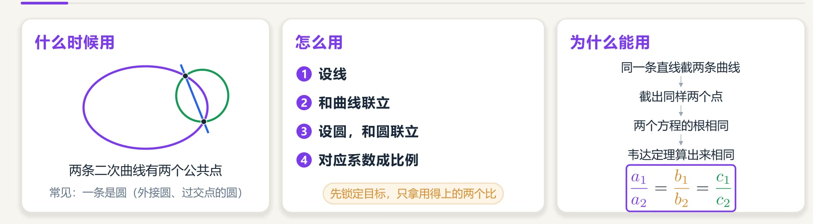
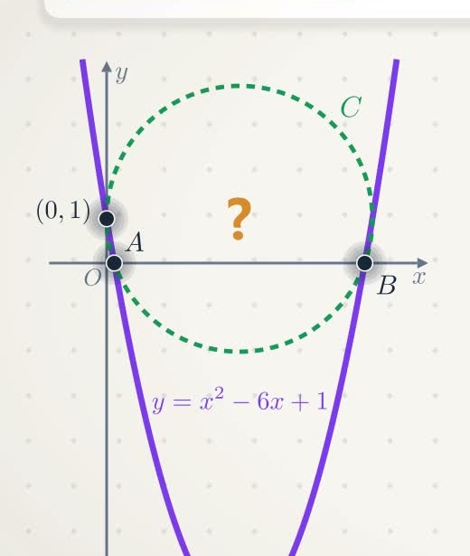
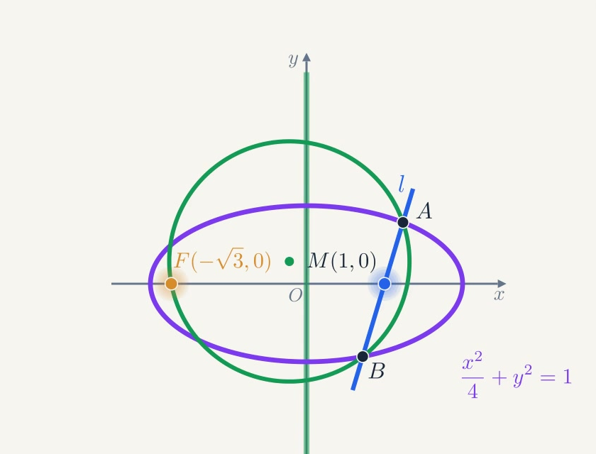
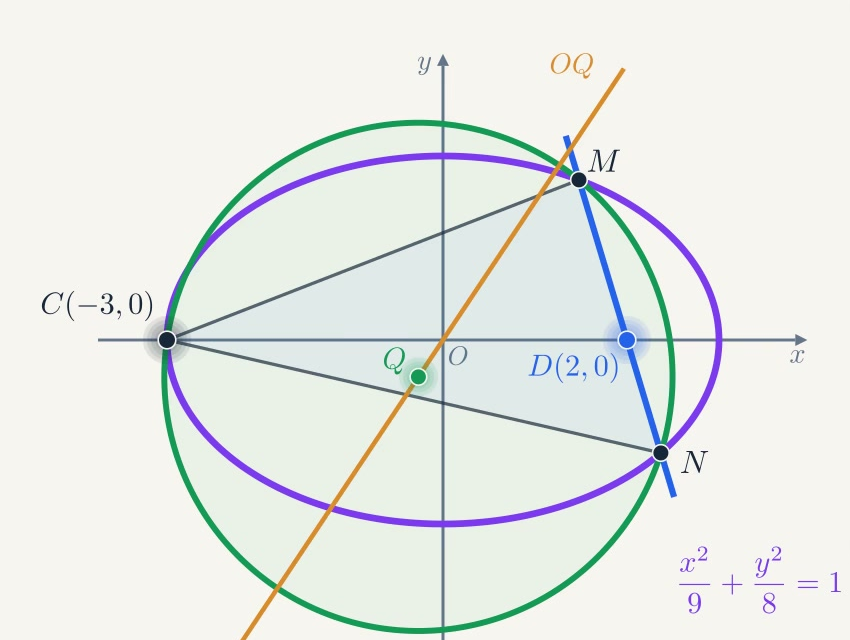
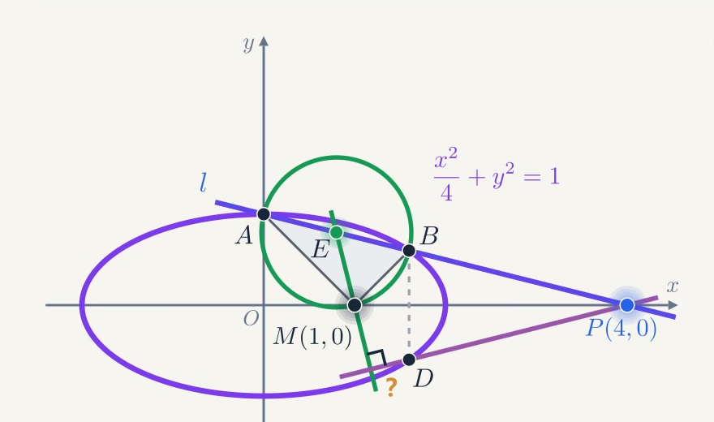

> 题目与可视化模型来源：Bilibili [@数海无涯乐作舟 / 玄鹤](https://space.bilibili.com) 视频 [【可视化】圆锥曲线大题神技！同解方程！计算量砍半！讲透本质！](https://www.bilibili.com/video/BV17g4H6FE9V/)  
> 本文摘抄整理视频中的全部 4 道精选题干（1 道引例、1 道例题、2 道联考模拟压轴大题），并保留清晰的几何示意图，解答部分留空供自行书写练习。

---

## 核心方法回顾：同解方程

### 1. 什么时候用？
两条二次曲线有两个公共点（最常见于**圆锥曲线与圆**的交线，例如三角形外接圆、过两定点与圆锥曲线两交点的圆等）。

### 2. 为什么能用？
同一条直线截两条二次曲线，截出完全相同的两个交点：
- 直线与圆锥曲线联立，消元得到一元二次方程 ①；
- 直线与圆联立，消去同一个元得到一元二次方程 ②；
- 因为两方程在几何上具有相同的两实根，由韦达定理可知对应项系数成正比：
$$\frac{a_1}{a_2} = \frac{b_1}{b_2} = \frac{c_1}{c_2}$$

### 3. 怎么用？（四步走）
1. **设线**：根据题意设直线方程（如 $x = my + n$ 或 $y = kx + m$）；
2. **和曲线联立**：将直线代入圆锥曲线方程，整理得关于 $y$（或 $x$）的一元二次方程 ①；
3. **设圆，和圆联立**：设圆的一般方程 $x^2 + y^2 + dx + ey + f = 0$，代入圆上已知定点消去参数，再将直线代入消去相同字母，得到方程 ②；
4. **对应系数成比例**：锁定设问目标（如外心坐标、斜率关系等），仅提取目标相关的系数比例式进行化简计算。

---

## 试题摘录

### 引例：2011 年高考全国卷文科 · 第 20 题 (1)

在平面直角坐标系 $xOy$ 中，曲线 $y = x^2 - 6x + 1$ 与坐标轴的交点都在圆 $C$ 上，求圆 $C$ 的方程。

#### 【我的解答】
设圆的标准方程:$C:x^2+y^2+Dx+Ey+F=0$

贸然确定A,B,C点坐标，然后带入圆的标准方程计算颇为繁杂。

我们考虑“同解方程”，将$x$轴$y=0$和圆和抛物线联立，分别得到两个一元二次方程:
$$x^2-6x+1=0\\
x^2+Dx+F=0$$、
由于两个方程的根均为$x_A,x_B$，故对应系数相同:
$$D=-6,F=1$$
还剩$F$没有确定，带入点C(0,1):
$$$$

---

### 例题：2024 届四川省绵阳市高三三诊

已知椭圆 $C: \dfrac{x^2}{a^2} + \dfrac{y^2}{b^2} = 1\ (a > 1 > b > 0)$ 的离心率为 $\dfrac{\sqrt{3}}{2}$，过点 $M(1, 0)$ 的直线 $l$ 交椭圆 $C$ 于点 $A, B$，且当 $l \perp x$ 轴时，$|AB| = \sqrt{3}$。

**(1)** 求椭圆 $C$ 的方程；

**(2)** 记椭圆 $C$ 的左焦点为 $F$，若过 $F, A, B$ 三点的圆的圆心恰好在 $y$ 轴上，求直线 $AB$ 的方程。

#### 【我的解答】

<!-- 在此处书写你的解答过程 -->

---

### 实战一：2025 届高三 T8 联考

已知过 $A(-1, 0), B(1, 0)$ 两点的动抛物线的准线始终与圆 $x^2 + y^2 = 9$ 相切，该抛物线焦点 $P$ 的轨迹是某圆锥曲线 $E$ 的一部分。

**(1)** 求曲线 $E$ 的标准方程；

**(2)** 已知点 $C(-3, 0), D(2, 0)$，过点 $D$ 的动直线与曲线 $E$ 交于 $M, N$ 两点，设 $\triangle CMN$ 的外心为 $Q$，$O$ 为坐标原点，问：直线 $OQ$ 与直线 $MN$ 的斜率之积是否为定值？如果是定值，求出该定值；如果不是定值，说明理由。

#### 【我的解答】

<!-- 在此处书写你的解答过程 -->

---

### 实战二：2025 届江西省南昌市高三一模 · 第 18 题

已知椭圆 $C: \dfrac{x^2}{a^2} + \dfrac{y^2}{b^2} = 1\ (a > b > 0)$ 的离心率 $e = \dfrac{\sqrt{3}}{2}$，过点 $P(4, 0)$ 作直线 $l$ 与椭圆 $C$ 交于 $A, B$ 两点（$A$ 在 $B$ 上方），当 $l$ 的斜率为 $-\dfrac{1}{4}$ 时，点 $A$ 恰与椭圆的上顶点重合。

**(1)** 求椭圆 $C$ 的标准方程；

**(2)** 已知点 $M(1, 0)$，设直线 $MA, MB$ 的斜率分别为 $k_1, k_2$，设 $\triangle AMB$ 的外接圆圆心为 $E$，点 $B$ 关于 $x$ 轴的对称点为 $D$。
- **(i)** 求 $k_1 + k_2$ 的值；
- **(ii)** 求证：$ME \perp PD$。

#### 【我的解答】

<!-- 在此处书写你的解答过程 -->
