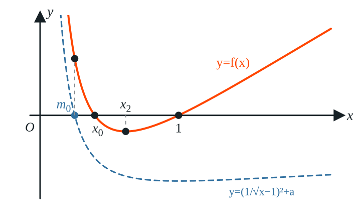
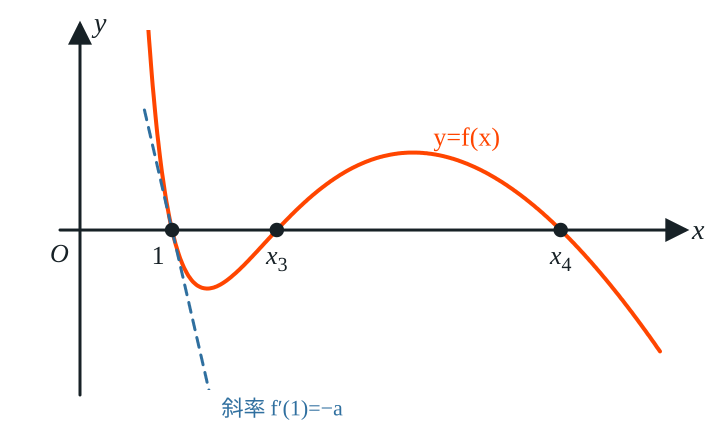
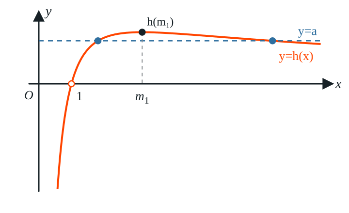

9. 已知函数 $f(x)=\ln x+\dfrac{1}{x}-1-a(x-1)\ (a\in\mathbf{R})$，则下列四个结论不正确的是（　　）

A. $\forall a<0$，$f(x)$ 有极小值

B. $\forall a<0$，$f(x)$ 恰有 2 个零点

C. $\exists a>0$，使得不等式 $f(x)\geqslant 0$ 恒成立

D. $\exists a>0$，使得关于 $x$ 的方程 $f(x)=0$ 有 3 个不同的实数解

**解：** $f(x)$ 的定义域为 $(0,+\infty)$，且 $f(1)=0$.
$$f'(x)=\frac1x-\frac{1}{x^2}-a=\frac{-ax^2+x-1}{x^2}.$$
令 $g(x)=-ax^2+x-1$，则 $f'(x)$ 与 $g(x)$ 同号.

**分析选项A：** 若 $a<0$，则 $g(x)$ 的判别式 $\Delta=1-4a>1>0$，两根之积 $x_1x_2=\dfrac1a<0$，故 $x_1<0<x_2$. 又 $g(x)$ 开口向上，所以
$$x\in(0,x_2)\text{ 时 } f'(x)<0,\ f(x)\text{ 单调递减};\qquad x\in(x_2,+\infty)\text{ 时 } f'(x)>0,\ f(x)\text{ 单调递增}.$$
因此 $f(x)$ 有极小值 $f(x_2)$，选项A正确.

**分析选项B：** 设 $a<0$. $g(x)$ 的对称轴 $x=\dfrac{1}{2a}<0$，所以 $g(x)$ 在 $(0,+\infty)$ 上单调递增. 又 $g(0)=-1<0$，$g(1)=-a>0$，所以 $x_2\in(0,1)$，从而
$$f(x_2)<f(1)=0.$$
在 $(x_2,+\infty)$ 上 $f(x)$ 单调递增，所以那里只有一个零点 $x=1$，且 $f(x)<0$ 对 $x\in[x_2,1)$ 成立.

下面在 $(0,x_2)$ 上找一个函数值为正的点. 由 $\ln t\geqslant 1-\dfrac1t$（取 $t=\sqrt x$）得
$$\ln x\geqslant 2\left(1-\frac{1}{\sqrt x}\right).$$
又 $a<0$，$x>0$ 时 $-a(x-1)=-ax+a>a$，所以
$$f(x)>\ln x+\frac1x-1+a\geqslant 1+\frac1x-\frac{2}{\sqrt x}+a=\left(\frac{1}{\sqrt x}-1\right)^2+a.$$
令 $\dfrac{1}{\sqrt{m_0}}-1=\sqrt{-a}$，即 $m_0=\left(\dfrac{1}{\sqrt{-a}+1}\right)^2\in(0,1)$，则 $f(m_0)>0$.

由于 $f(x)<0$ 对 $x\in[x_2,1)$ 成立，而 $f(m_0)>0$，所以 $0<m_0<x_2<1$. $f(x)$ 在 $(m_0,x_2)$ 上单调递减，且 $f(m_0)>0>f(x_2)$，由零点存在定理，$f(x)$ 在 $(0,x_2)$ 上恰有一个零点 $x_0$.

所以 $f(x)$ 恰有 $x_0$ 和 $1$ 两个零点，选项B正确.

**分析选项C：** 设 $a>0$. 注意到 $f(1)=0$，若 $f(x)\geqslant0$ 恒成立，则 $x=1$ 是 $f(x)$ 的最小值点，必有 $f'(1)=0$. 但 $f'(1)=1-1-a=-a<0$，矛盾. 故选项C错误.

也可以用取点的方法具体找到 $f(x)<0$ 的点. 当 $x>1$ 时，由 $\ln t<t-1$（$t=\sqrt x\neq1$）得 $\ln x<2(\sqrt x-1)$，所以
$$\begin{aligned}
f(x)&<2(\sqrt x-1)+\frac1x-1-a(x-1)\
&=\frac{1}{x}\left[-ax^2+2x\sqrt x+(a-3)x+1\right]\
&=\frac{1}{x}\left[-a(\sqrt x)^4+2(\sqrt x)^3+(a-3)(\sqrt x)^2+1\right]\
&=\frac{1}{x}(\sqrt x-1)\left[-a(\sqrt x)^3+(2-a)(\sqrt x)^2-\sqrt x-1\right].
\end{aligned}$$
取 $x>\max\left\{1,\left(\dfrac2a-1\right)^2\right\}$，则 $\sqrt x-1>0$，且 $\sqrt x>\dfrac2a-1$，即 $a\sqrt x>2-a$，于是 $a(\sqrt x)^3>(2-a)(\sqrt x)^2$，
$$-a(\sqrt x)^3+(2-a)(\sqrt x)^2-\sqrt x-1<-\sqrt x-1<0,$$
所以 $f(x)<0$.

**分析选项D：** 当 $x\neq1$ 时，分离参数：
$$f(x)=(x-1)\bigl(h(x)-a\bigr),\qquad h(x)=\frac{\ln x}{x-1}-\frac1x=\frac{x\ln x-(x-1)}{x(x-1)}.$$
由于 $f(1)=0$，$f(x)=0$ 有 3 个不同的实数解，当且仅当方程 $h(x)=a$ 在 $x\neq1$ 时有 2 个不同的根.

先看 $h(x)$ 的符号. 由 $\ln x>1-\dfrac1x=\dfrac{x-1}{x}$（$x\neq1$）可知：$x>1$ 时 $h(x)>0$；$0<x<1$ 时 $h(x)<0$. 所以当 $a>0$ 时，$h(x)=a$ 的根都在 $(1,+\infty)$ 内.

再求导：
$$\begin{aligned}
h'(x)&=\frac{\frac1x(x-1)-\ln x}{(x-1)^2}+\frac{1}{x^2}
=\frac{1-\frac 1x-\ln x+\frac{(x-1)^2}{x^2}}{(x-1)^2}
=\frac{t(x)}{(x-1)^2},\
t(x)&=2-\frac3x+\frac{1}{x^2}-\ln x,\qquad
t'(x)=\frac{3}{x^2}-\frac{2}{x^3}-\frac{1}{x}=-\frac{(x-1)(x-2)}{x^3}.
\end{aligned}$$
所以 $t(x)$ 在 $(0,1)$ 上递减，在 $(1,2)$ 上递增，在 $(2,+\infty)$ 上递减. 又 $t(1)=0$，故 $t(x)>0$ 对 $x\in(0,1)\cup(1,2]$ 成立；而
$$t(4)=\frac{21}{16}-2\ln2<\frac{21}{16}-2\times0.69<0,$$
所以存在唯一的 $m_1\in(2,4)$ 使 $t(m_1)=0$，且 $x\in(0,1)\cup(1,m_1)$ 时 $t(x)>0$，$x\in(m_1,+\infty)$ 时 $t(x)<0$.

因此 $h(x)$ 的单调递增区间为 $(0,1),(1,m_1)$，单调递减区间为 $(m_1,+\infty)$.

再看端点. 由洛必达法则，
$$\lim_{x\to 1} h(x)=\lim_{x\to 1}\frac{x\ln x-x+1}{x^2-x}=\lim_{x\to 1}\frac{\ln x}{2x-1}=0,$$
即 $x=1$ 是 $h(x)$ 的可去间断点；又 $x\to+\infty$ 时 $\dfrac{\ln x}{x-1}\to0$，$\dfrac1x\to0$，所以 $h(x)\to0$.

最后求最大值. 由 $t(m_1)=0$ 得 $\ln m_1=2-\dfrac3{m_1}+\dfrac{1}{m_1^2}=\dfrac{(2m_1-1)(m_1-1)}{m_1^2}$，代入得
$$h(m_1)=\frac{2m_1-1}{m_1^2}-\frac1{m_1}=\frac{1}{m_1}-\frac{1}{m_1^2}=\frac14-\left(\frac12-\frac{1}{m_1}\right)^2.$$
由 $m_1\in(2,4)$ 得 $\dfrac{1}{m_1}\in\left(\dfrac14,\dfrac12\right)$，所以 $h(m_1)\in\left(\dfrac{3}{16},\dfrac14\right)$，特别地 $h(m_1)>0$.

综上，$h(x)$ 在 $(1,m_1)$ 上的值域为 $(0,h(m_1))$，在 $(m_1,+\infty)$ 上的值域也为 $(0,h(m_1))$. 所以当 $a\in(0,h(m_1))$ 时，$h(x)=a$ 在这两个区间内各有一个根，$f(x)=0$ 连同 $x=1$ 共有 3 个不同的实数解. 例如取 $a=\dfrac18<\dfrac{3}{16}<h(m_1)$ 即可. 因此选项D正确.

**故选 C.**
