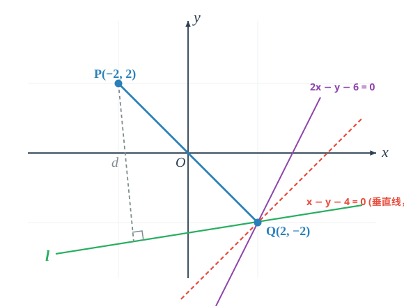

# 引
这个世界上的直线，不一定要由两个点确定，也可以由其他直线确定。
$$y=k(x+2)+3$$
观察这个过点(-2,3)的点斜式方程，可变形为:
$$k(x+2)-(y-3)=0$$
这表示经过直线$y-3=0,x+2=0$交点(-2,3)的几乎所有直线(除$x+2=0$外)。
## 为什么可以表示一组直线
直线是关于$x,y$的一次方程，$y=k(x+2)+3$符合要求
## 为什么经过(-2,3)
直线
$$y=k(x+2)+3$$
是两条直线
$$x+2=0,y-3=0$$
的线性组合。

点(-2,3)在后两条直线上，因此在它们线性组合表示的直线上.
## 为什么不包括x+2=0
联立:
$$x+2=0\\
y=k(x+2)+3$$
我们得到$x=-2,y=3$，这表明$x+2=0$和$y=k(x+2)+3$仅有(-2,3)一个交点.

可以理解为$y=k(x+2)+3$与$y-3=0$线性相关.
## 能否包含除x+2=0外所有直线
任意取平面内点$P(m,n),m\ne-2$，都可以确定唯一的
$$k=\frac{n-3}{m+2}$$
对应唯一的直线.
# 凝练
## 过交点的直线系
类似的，用直线的线性组合表示过交点的几乎所有直线:

设$l_1:A_1x+B_1y+C_1=0,l_2:A_2x+B_2y+C_2=0$是相交两直线，那么:
$$l:A_1x+B_1y+C_1+\lambda(A_2x+B_2y+C_2)=0$$
是经过$l_1$和$l_2$的交点的直线系方程，式中$\lambda\in\R$（直线系$l$不包括直线$l_2$）.
## 平行于直线的直线系
由直线$l:Ax+By+C=0$所确定的平行直线系的方程是:
$$Ax+By+C'=0$$
# 演兵I
## 例1
已知两直线$2x+3y-5=0,7x+15y+1=0$相交于点P. 求出过点P且垂直于直线$12x-5y-1=0$的直线方程.

首先排除直线系的“漏网之鱼”:

两直线$2x+3y-5=0,7x+15y+1=0$显然与直线$12x-5y-1=0$不垂直.

设直线:
$$l:2x+3y-5+\lambda(7x+15y+1)=0\\
l:(7\lambda+2)x+(15\lambda+3)y+(\lambda-5)=0$$
直线垂直，等价于直线法向量垂直:
$$12(7\lambda+2)-5(15\lambda+3)=0\\
9\lambda+9=0\\
\lambda=-1$$
回代直线:
$$l:-5x-12y-6=0\\
l:5x+12y+6=0$$
## 例2
求直线$l_1:A_1x+B_1y+C_1=0$和直线$l_2:A_2x+B_2y+C_2=0$的角平分线.

我们需要求出一条过$l_1,l_2$交点的直线$l_3$，其上的任意一点到$l_1,l_2$的距离相同:
$$l_3:A_1x+B_1y+C_1+\lambda(A_2x+B_2y+C_2)=0\\
P(x,y)\in l_3\\
d_{P\rightarrow l_1}=\frac{|A_1x+B_1y+C_1|}{\sqrt{A_1^2+B_1^2}}=\frac{|\lambda(A_2x+B_2y+C_2)|}{\sqrt{A_1^2+B_1^2}}\\
d_{P\rightarrow l_2}=\frac{|A_2x+B_2y+C_2|}{\sqrt{A_2^2+B_2^2}}$$
一般地，点P不在$l_2$上，即$A_2x+B_2y+C_2\ne0$.

因此可以得出:
$$|\lambda|=\sqrt{\frac{A_1^2+B_1^2}{A_2^2+B_2^2}}$$
对应符号相反的两个$\lambda$，分别对应内、外角平分线.

## 例3
考虑一般情况，光线沿着直线$l_1:A_1x+B_1y+C_1=0$射入，遇到直线$l_2:A_2x+B_2y+C_2=0$即行反射，试求反射光线的直线方程:

思维路径：设反射光线为$l_3$,其过$l_1,l_2$的交点.
$$l_3:A_1x+B_1y+C_1+\lambda(A_2x+B_2y+C_2)=0$$
显然，镜面$l_2$为$l_1,l_3$的角平分线。由例2的结论，过$l_3$与$l_1$的角平分线可设为:
$$l_2:[A_1x+B_1y+C_1+\lambda(A_2x+B_2y+C_2)]+\mu(A_1x+B_1y+C_1)=0\\
|\mu|=\sqrt{\frac{(A_1+\lambda A_2)^2+(B_1+\lambda B_2)^2}{A_1^2+B_1^2}}$$
整理同类项得:
$$l_2:(\mu+1)(A_1x+B_1y+C_1)+\lambda(A_2x+B_2y+C_2)=0$$
由于反射光线与入射光线不重合（$\lambda\ne 0$），该直线方程若要表示镜面$l_2:A_2x+B_2y+C_2=0$，必须消去$l_1$项，即:
$$\mu+1=0\implies\mu=-1$$
从而有:
$$|\mu|=|-1|=1$$
即:
$$\sqrt{\frac{(A_1+\lambda A_2)^2+(B_1+\lambda B_2)^2}{A_1^2+B_1^2}}=1\\
\frac{(A_1+\lambda A_2)^2+(B_1+\lambda B_2)^2}{A_1^2+B_1^2}=1\\
2\lambda(A_1A_2+B_1B_2)+\lambda^2(A_2^2+B_2^2)=0\\
\lambda\Big[2(A_1A_2+B_1B_2)+\lambda(A_2^2+B_2^2)\Big]=0\\
\lambda=0\text{ 或 }\lambda=-\frac{2(A_1A_2+B_1B_2)}{A_2^2+B_2^2}$$
显然$\lambda=0$对应入射光线本身，舍去，故反射光线为:
$$l_3:A_1x+B_1y+C_1-\frac{2(A_1A_2+B_1B_2)}{A_2^2+B_2^2}(A_2x+B_2y+C_2)=0$$

## 例4
已知直线$l:2x-3y+1=0$，求直线$m:3x-2y-6=0$关于直线$l$对称的直线$m'$的方程.

解：
两直线相交，对称直线必属于过其交点的直线系。由**例3**得出的反射与对称直线公式，直接代入：
$$m':(3x-2y-6)-\frac{2(3\times 2+(-2)\times(-3))}{2^2+(-3)^2}(2x-3y+1)=0\\
m':(3x-2y-6)-\frac{24}{13}(2x-3y+1)=0$$
两边同乘13并展开：
$$(39x-26y-78)-24(2x-3y+1)=0\\
-9x+46y-102=0\implies 9x-46y+102=0$$
（原本极为繁琐的点对称或交点+斜率法，借助例3推导的公式仅需口算一步成型！）

## 例5
已知两直线$l_1:2x-3y+1=0$和$l_2:x+y-2=0$相交于点P. 求经过点P且在两坐标轴上截距相等的直线方程.

解：

**第一步：排查直线系的“漏网之鱼”$l_2$**

在$l_2:x+y-2=0$中，令$x=0$得$y=2$；令$y=0$得$x=2$.
直线$l_2$在两坐标轴上的截距均为2，满足截距相等的条件！
因此，$l_2$本身就是一条满足题意的直线:
$$x+y-2=0$$

**第二步：设直线系求解其余直线**

设所求直线方程为:
$$l:(2x-3y+1)+\lambda(x+y-2)=0$$
整理为一般式:
$$(\lambda+2)x+(\lambda-3)y+(1-2\lambda)=0$$

对截距进行分类讨论:
1. **截距均为0（直线过原点）**
此时常数项必须为0:
$$1-2\lambda=0\implies\lambda=\frac{1}{2}$$
代入直线系方程得:
$$\frac{5}{2}x-\frac{5}{2}y=0\implies x-y=0$$

2. **截距不为0**
令$y=0$求得横截距，令$x=0$求得纵截距:
$$a=-\frac{1-2\lambda}{\lambda+2},\quad b=-\frac{1-2\lambda}{\lambda-3}$$
由$a=b\ne 0$得:
$$\lambda+2=\lambda-3\implies 2=-3\quad\text{（无解）}$$

综上所述，所求直线方程为:
$$x-y=0\quad\text{或}\quad x+y-2=0$$

> **反思**：如果直接设截距式或不用直线系排查漏网之鱼，很容易漏掉$x+y-2=0$这条直线。这就是我们在“凝练”中反复强调直线系$l_1+\lambda l_2=0$不包含$l_2$的实战意义！

## 例6
已知两相交直线$l_1:x+y-3=0$和$l_2:2x-y=0$. 求经过其交点，且到坐标原点距离等于1的直线方程.

解：

**第一步：排查漏网之鱼$l_2$**

原点到直线$l_2:2x-y=0$的距离为0（直线过原点），不等于1，故$l_2$不合题意.

**第二步：设直线系**

设所求直线方程为:
$$l:(x+y-3)+\lambda(2x-y)=0$$
整理为一般式:
$$(2\lambda+1)x+(1-\lambda)y-3=0$$

**第三步：利用点到直线距离公式定参数**

原点$(0,0)$到直线$l$的距离$d=1$:
$$\frac{|-3|}{\sqrt{(2\lambda+1)^2+(1-\lambda)^2}}=1$$
两边平方得:
$$9=(4\lambda^2+4\lambda+1)+(\lambda^2-2\lambda+1)\\
9=5\lambda^2+2\lambda+2\\
5\lambda^2+2\lambda-7=0$$
因式分解:
$$(5\lambda+7)(\lambda-1)=0$$
解得:
$$\lambda_1=1,\quad\lambda_2=-\frac{7}{5}$$

**第四步：回代求方程**
- 当$\lambda=1$时:
$$(2\times 1+1)x+(1-1)y-3=0\implies 3x-3=0\implies x-1=0$$
- 当$\lambda=-\frac{7}{5}$时:
$$\Big(2\times\Big(-\frac{7}{5}\Big)+1\Big)x+\Big(1-\Big(-\frac{7}{5}\Big)\Big)y-3=0\\
-\frac{9}{5}x+\frac{12}{5}y-3=0$$
两边同乘$-\frac{5}{3}$整理得:
$$3x-4y+5=0$$

综上，所求直线方程为:
$$x-1=0\quad\text{或}\quad 3x-4y+5=0$$

# 演兵II：逆用直线系
直线系不仅可以顺向用于“设过交点的未知直线”，还可以逆向用于“破解含参直线恒过定点与极值问题”。

## 例7
已知含参数$m$的直线方程为:
$$l:(2m+1)x+(m+1)y-7m-4=0\quad(m\in\R)$$
(1) 证明：无论$m$取何实数，直线$l$恒过定点P，并求出点P的坐标；
(2) 已知平面内有点$A(1,2)$，求点A到直线$l$的最大距离，并求此时直线$l$的方程.

解：

**(1) 证明恒过定点**

将直线方程按参数$m$进行整理（降幂排列、提取公因式$m$）:
$$(x+y-4)+m(2x+y-7)=0$$
对比过交点的直线系标准形式$l_1+\lambda l_2=0$，式中的$m$充当了参数$\lambda$的角色！
要使上述等式对任意实数$m$都恒成立，充分必要条件是两个括号内的代数式同时为0:
$$\begin{cases}
x+y-4=0\\
2x+y-7=0
\end{cases}$$
联立解得:
$$\begin{cases}
x=3\\
y=1
\end{cases}$$
因此，无论$m$为何实数，直线$l$恒过定点$P(3,1)$.

**(2) 求距离最大值与直线方程**

**几何分析**：
设过点$A$向直线$l$作垂线，垂足为$H$.
因为直线$l$恒过定点$P$，所以在直角三角形$\triangle APH$中，斜边大于等于直角边:
$$d=|AH|\le |AP|$$
当且仅当垂足$H$与定点$P$重合时（即直线$l\perp AP$时），点A到直线$l$的距离取得最大值$d_{\max}=|AP|$.

计算距离最大值:
$$d_{\max}=|AP|=\sqrt{(3-1)^2+(1-2)^2}=\sqrt{4+1}=\sqrt{5}$$

求此时的直线方程:
线段$AP$的斜率为:
$$k_{AP}=\frac{1-2}{3-1}=-\frac{1}{2}$$
因为此时$l\perp AP$，所以直线的斜率:
$$k_l=-\frac{1}{k_{AP}}=2$$
由点斜式写出此时直线的方程:
$$y-1=2(x-3)\implies 2x-y-5=0$$
（此时对应的参数值为$m=-3$，符合题意）

## 例8（经典陷阱：无法取等的“最大距离”）
证明：无论 $\lambda$ 取何值，直线 $l$:
$$(2+\lambda)x - (1+\lambda)y - 2(3+2\lambda) = 0$$
与点 $P(-2, 2)$ 的距离 $d$ 都只能小于 $4\sqrt{2}$。

**证明：**

**第一步：整理为直线系的标准形式，找出恒过的定点**

将直线 $l$ 的方程按参数 $\lambda$ 进行分解与降幂整理：
$$(2x - y - 6) + \lambda(x - y - 4) = 0$$

由此可知，直线 $l$ 表示经过两基底直线：
$$l_1: 2x - y - 6 = 0,\quad l_2: x - y - 4 = 0$$
交点的直线系（但**不包括直线 $l_2$ 本身**）。

联立两直线方程求解交点 $Q$：
$$\begin{cases}
2x - y - 6 = 0\\
x - y - 4 = 0
\end{cases}\implies\begin{cases}
x = 2\\
y = -2
\end{cases}$$
即直线 $l$ 恒过定点 $Q(2, -2)$。

**第二步：几何分析定点距离的上界**

计算定点 $P(-2, 2)$ 与定点 $Q(2, -2)$ 之间的距离：
$$|PQ| = \sqrt{[2 - (-2)]^2 + [-2 - 2]^2} = \sqrt{4^2 + (-4)^2} = 4\sqrt{2}$$

由平面几何性质可知，对于平面内任意一条过定点 $Q$ 的直线 $l$：
过点 $P$ 向直线 $l$ 作垂线，垂足为 $H$。在直角三角形 $\triangle PQH$ 中，斜边不小于直角边：
$$d = |PH| \le |PQ| = 4\sqrt{2}$$
当且仅当垂足 $H$ 与点 $Q$ 重合、即 **$l \perp PQ$** 时，距离才能取得理论上的几何最大值 $|PQ|$。

**第三步：检验垂直极限直线是否属于直线系（排查“漏网之鱼”）**

求过点 $Q(2, -2)$ 且垂直于 $PQ$ 的直线方程：
- 直线 $PQ$ 的斜率为：
$$k_{PQ} = \frac{-2 - 2}{2 - (-2)} = -1$$
- 故垂直于 $PQ$ 的垂线斜率为 $k = -\dfrac{1}{k_{PQ}} = 1$；
- 由点斜式可得过 $Q$ 点且垂直于 $PQ$ 的直线方程为：
$$y - (-2) = 1\cdot(x - 2)\implies x - y - 4 = 0$$

**至关重要的一步**：
这条唯一能使距离取到最大值 $4\sqrt{2}$ 的垂线，恰恰就是直线系 $l_1 + \lambda l_2 = 0$ 中**被遗漏的直线 $l_2: x - y - 4 = 0$**！

因为无论实数 $\lambda$ 取何有限值，直线方程 $(2x - y - 6) + \lambda(x - y - 4) = 0$ 中 $l_1$ 的系数恒为 $1 \ne 0$，所以该方程**永远无法表示直线 $x - y - 4 = 0$**。

**结论**：
直线 $l$ 永远无法与 $PQ$ 垂直，等号永远无法取到，因此：
$$d < 4\sqrt{2}$$

> **核心点睛**：  
> 本题是高考与自主招生/强基计划中考察直线系严密性的“常青树”。很多同学仅通过几何观察直观得出 $d \le |PQ| = 4\sqrt{2}$，便草率断定最大值是 $4\sqrt{2}$，却忽略了参数直线系中 $l_2$ 的不可达性。只有深刻理解直线系 $l_1 + \lambda l_2 = 0$“天然缺失 $l_2$”的代数本质，才能真正洞察为什么此处必须是严格小于 $d < 4\sqrt{2}$！

# 结语
直线系方程的核心威力在于**“设而不求”**与**“参数分离”**：
1. **正向求解**：无需耗时联立两直线求交点坐标，直接设为$l_1+\lambda l_2=0$，将相交的几何约束自动内嵌于方程结构中；
2. **严防漏洞**：牢记$l_1+\lambda l_2=0$不包含$l_2$，在涉及截距、平行、垂直与距离时，必须先排查$l_2$；
3. **逆向探针**：面对含参直线$(A_1x+B_1y+C_1)+m(A_2x+B_2y+C_2)=0$，将其视为两条基底直线的线性组合，联立即可秒杀定点与极值问题。
