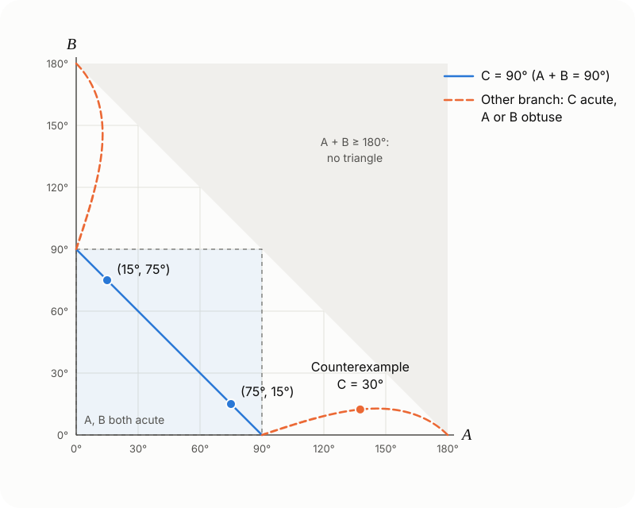

## The two problems

**Problem 1** (source: the WeChat account "浙江省高中数学", Zhejiang High School Mathematics). The area of $\triangle ABC$ is $\dfrac14$, $\cos 2A+\cos 2B+2\sin C=2$ and $\cos A\cos B\sin C=\dfrac14$. Which of the following are true?

A. $\sin C=\sin^2A+\sin^2B$　　B. $AB=\sqrt2$

C. $\sin A+\sin B=\dfrac{\sqrt6}{2}$　　D. $AC^2+BC^2=3$

**Problem 2** (source: a Bilibili video). In $\triangle ABC$, $A$ and $B$ are acute and $\sin^2A+\sin^2B=\sin C$. Prove that $C=90^\circ$.

Option A of Problem 1 is exactly the hypothesis of Problem 2. Below, I prove Problem 2 first, use it to solve Problem 1, and then answer the question: does the conclusion still hold without "$A$ and $B$ are acute"?

## Proof of Problem 2

### Method 1: compare sizes

Since $\sin C=\sin(A+B)=\sin A\cos B+\cos A\sin B$, the condition can be rewritten as

$$
\sin A\,(\sin A-\cos B)+\sin B\,(\sin B-\cos A)=0.
$$

Because $A,B\in\left(0,\dfrac{\pi}{2}\right)$, the angles $\dfrac{\pi}{2}-A$ and $\dfrac{\pi}{2}-B$ are also in $\left(0,\dfrac{\pi}{2}\right)$, where sine is increasing.

- If $A+B>\dfrac{\pi}{2}$, then $A>\dfrac{\pi}{2}-B$, so $\sin A>\sin\left(\dfrac{\pi}{2}-B\right)=\cos B$. In the same way, $\sin B>\cos A$. Since $\sin A,\sin B>0$, the left side is positive, a contradiction.
- If $A+B<\dfrac{\pi}{2}$, both brackets are negative in the same way, so the left side is negative, a contradiction.

So $A+B=\dfrac{\pi}{2}$, that is, $C=90^\circ$. Conversely, when $C=90^\circ$ we have $\sin A=\cos B$ and $\sin B=\cos A$, and the equation holds.

### Method 2: sum-to-product

$$
\begin{aligned}
&\sin^2A+\sin^2B\\
={}&1-\frac{\cos 2A+\cos 2B}{2}\\
={}&1-\cos(A+B)\cos(A-B)\\
={}&1+\cos C\cos(A-B),
\end{aligned}
$$

so the condition is equivalent to

$$
\cos C\cos(A-B)=\sin C-1.\tag{1}
$$

$A$ and $B$ are acute, so $|A-B|<\dfrac{\pi}{2}$ and $\cos(A-B)>0$.

- If $C<90^\circ$, the left side of (1) is positive while the right side $\sin C-1$ is negative, a contradiction.
- If $C>90^\circ$, then $A+B<90^\circ$ and $0\le|A-B|<A+B<90^\circ$, so $\cos(A-B)>\cos(A+B)=-\cos C>0$. Multiplying by $\cos C<0$ gives
  $$
  \sin C-1=\cos C\cos(A-B)<-\cos^2C=\sin^2C-1,
  $$
  so $\sin C<\sin^2C$ and therefore $\sin C>1$, a contradiction.

So $C=90^\circ$. Method 2 takes a few more steps, but (1) is useful again later: it gives every solution of the original equation.

## Back to Problem 1

**A is true.** Using $\cos 2A=1-2\sin^2A$ and $\cos 2B=1-2\sin^2B$, the first condition becomes

$$
\begin{gathered}
2-2\left(\sin^2A+\sin^2B\right)+2\sin C=2\\
\iff \sin C=\sin^2A+\sin^2B.
\end{gathered}
$$

**To use Problem 2 next, we first need $A$ and $B$ to be acute.** The second condition provides this: $\cos A\cos B\sin C=\dfrac14>0$ and $\sin C>0$, so $\cos A$ and $\cos B$ have the same sign. A triangle has at most one obtuse angle, so they can't both be negative. They are both positive, so $A$ and $B$ are acute. By Problem 2, $C=90^\circ$.

Then $\sin C=1$ and $B=90^\circ-A$, so the second condition becomes $\cos A\sin A=\dfrac14$, that is, $\sin 2A=\dfrac12$. So $A=15^\circ$ or $75^\circ$.

**B is true.** Let the hypotenuse be $AB=c$. Then $BC=c\sin A$ and $AC=c\cos A$, and the area is

$$
\frac12\cdot c\sin A\cdot c\cos A=\frac{c^2}{4}\sin 2A=\frac{c^2}{8}=\frac14,
$$

so $c^2=2$ and $AB=\sqrt2$.

**C is true.** $\sin A+\sin B=\sin A+\cos A=\sqrt{1+\sin 2A}=\sqrt{\dfrac32}=\dfrac{\sqrt6}{2}$.

**D is false.** $AC^2+BC^2=AB^2=2\ne3$.

**Answer: ABC.**

## Why A and B must be acute

In Problem 1, "$A$ and $B$ are acute" was deduced from $\cos A\cos B\sin C>0$, and that step can't be skipped. Here is why: $\sin^2A+\sin^2B=\sin C$ on its own does not make $C$ a right angle.

### Rewriting it with sides

By the law of sines, $\sin A=\dfrac{a}{2R}$ and so on, so the condition becomes

$$
\frac{a^2+b^2}{4R^2}=\frac{c}{2R}\iff a^2+b^2=2Rc=\frac{c^2}{\sin C},
$$

that is, $c^2=(a^2+b^2)\sin C$. Comparing this with the law of cosines, $c^2=a^2+b^2-2ab\cos C$, gives

$$
2ab\cos C=(a^2+b^2)(1-\sin C).\tag{2}
$$

When $C=90^\circ$ both sides are $0$, so (2) holds in every right triangle. When $C\ne90^\circ$:

**$C$ can't be obtuse.** The left side of (2) would be negative and the right side positive.

**$C$ can be any acute angle.** Then (2) can be written as

$$
\frac{a^2+b^2}{2ab}=\frac{\cos C}{1-\sin C}=\tan\left(45^\circ+\frac C2\right).
$$

The right side is greater than $1$, so there is always a ratio $a:b$ that satisfies it. Two sides and the angle $C$ between them determine a triangle, and that triangle satisfies the original equation with $C\ne90^\circ$. By Problem 2, its angles $A$ and $B$ can't both be acute. Neither can be a right angle either: if $A=90^\circ$, then $\sin^2A+\sin^2B>1\ge\sin C$. So exactly one of $A$ and $B$ is obtuse.

### A concrete counterexample

Take $C=30^\circ$. Then $\tan 60^\circ=\sqrt3$, so $\dfrac ab+\dfrac ba=2\sqrt3$ and $\dfrac ab=\sqrt3\pm\sqrt2$. Take

$$
a=\sqrt3+\sqrt2,\quad b=1,\quad c=\sqrt{3+\sqrt6}.
$$

You can check it directly:

- By the law of cosines,
  $$
  \begin{aligned}
  \cos C&=\frac{a^2+b^2-c^2}{2ab}\\
  &=\frac{(6+2\sqrt6)-(3+\sqrt6)}{2(\sqrt3+\sqrt2)}\\
  &=\frac{\sqrt3(\sqrt3+\sqrt2)}{2(\sqrt3+\sqrt2)}=\frac{\sqrt3}{2},
  \end{aligned}
  $$
  so $C=30^\circ$.
- $a^2+b^2=6+2\sqrt6=\dfrac{c^2}{\sin 30^\circ}$, so $\sin^2A+\sin^2B=\sin C=\dfrac12$.
- $b^2+c^2=4+\sqrt6<5+2\sqrt6=a^2$, so $A$ is obtuse.

Numerically, $A\approx137.6^\circ$, $B\approx12.4^\circ$ and $C=30^\circ$. The equation holds, but the triangle isn't a right triangle.

### Every solution

(1) shows the same thing. When $C\ne90^\circ$,

$$
\begin{aligned}
\cos(A-B)&=\frac{\sin C-1}{\cos C}\\
&=-\tan\left(45^\circ-\frac C2\right).
\end{aligned}
$$

For acute $C$ the right side is in $(-1,0)$, so $|A-B|>90^\circ$ and the larger of the two angles must be obtuse. Here are all the solutions in the $(A,B)$ plane:

The square in the lower left is where $A$ and $B$ are both acute. The only solutions there are on the blue line $A+B=90^\circ$, which also contains the two solutions of Problem 1, $(15^\circ,75^\circ)$ and $(75^\circ,15^\circ)$. One orange branch starts at $(90^\circ,0^\circ)$ and runs close to the horizontal axis to $(180^\circ,0^\circ)$. The other is its reflection in the line $A=B$. Along each branch, $C$ falls from $90^\circ$ to $0^\circ$, and every triangle on it is obtuse. The hypothesis of Problem 2 rules out exactly these two branches.

### Summary

In a triangle, $\sin^2A+\sin^2B=\sin C$ holds if and only if

- $C=90^\circ$, or
- $C$ is acute and $\cos(A-B)=-\tan\left(45^\circ-\dfrac C2\right)$, in which case one of $A$ and $B$ is obtuse.

So the condition "$A$ and $B$ are acute" is necessary. By the analysis above, any of the following can replace it, and the conclusion $C=90^\circ$ still follows:

- $|A-B|\le90^\circ$;
- $C$ is not acute (obtuse $C$ is already ruled out);
- $\cos A\cos B>0$, as in Problem 1.
