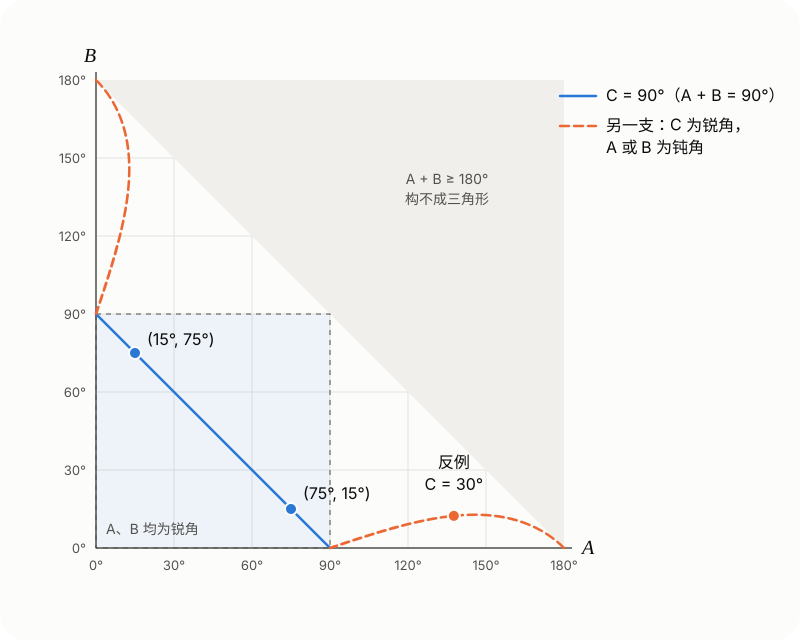

## 两道题

**题一**（来源：微信公众号“浙江省高中数学”）已知 $\triangle ABC$ 的面积为 $\dfrac14$，$\cos 2A+\cos 2B+2\sin C=2$，$\cos A\cos B\sin C=\dfrac14$，则（　）

A. $\sin C=\sin^2A+\sin^2B$　　B. $AB=\sqrt2$

C. $\sin A+\sin B=\dfrac{\sqrt6}{2}$　　D. $AC^2+BC^2=3$

**题二**（来源：B 站视频）在 $\triangle ABC$ 中，$A,B$ 为锐角，且 $\sin^2A+\sin^2B=\sin C$。证明：$C=90^\circ$。

题一的选项 A 正是题二的条件。下面先证题二，再用它解题一，最后回答：如果去掉“$A,B$ 为锐角”，结论还成立吗？

## 题二的证明

### 方法一：比较大小

由 $\sin C=\sin(A+B)=\sin A\cos B+\cos A\sin B$，条件可以改写成

$$
\sin A\,(\sin A-\cos B)+\sin B\,(\sin B-\cos A)=0。
$$

因为 $A,B\in\left(0,\dfrac{\pi}{2}\right)$，所以 $\dfrac{\pi}{2}-A$、$\dfrac{\pi}{2}-B$ 也在 $\left(0,\dfrac{\pi}{2}\right)$ 内，而正弦函数在这个区间上单调递增。

- 若 $A+B>\dfrac{\pi}{2}$，则 $A>\dfrac{\pi}{2}-B$，所以 $\sin A>\sin\left(\dfrac{\pi}{2}-B\right)=\cos B$；同理 $\sin B>\cos A$。又 $\sin A,\sin B>0$，左边大于 $0$，矛盾。
- 若 $A+B<\dfrac{\pi}{2}$，同理两个括号都小于 $0$，左边小于 $0$，矛盾。

所以 $A+B=\dfrac{\pi}{2}$，即 $C=90^\circ$。反过来，$C=90^\circ$ 时 $\sin A=\cos B$、$\sin B=\cos A$，等式成立。

### 方法二：和差化积

$$
\begin{aligned}
&\sin^2A+\sin^2B\\
={}&1-\frac{\cos 2A+\cos 2B}{2}\\
={}&1-\cos(A+B)\cos(A-B)\\
={}&1+\cos C\cos(A-B)，
\end{aligned}
$$

所以条件等价于

$$
\cos C\cos(A-B)=\sin C-1。\tag{1}
$$

$A,B$ 为锐角，所以 $|A-B|<\dfrac{\pi}{2}$，$\cos(A-B)>0$。

- 若 $C<90^\circ$，则 (1) 左边大于 $0$，右边 $\sin C-1<0$，矛盾。
- 若 $C>90^\circ$，则 $A+B<90^\circ$，$0\le|A-B|<A+B<90^\circ$，于是 $\cos(A-B)>\cos(A+B)=-\cos C>0$。两边乘以 $\cos C<0$，得
  $$
  \sin C-1=\cos C\cos(A-B)<-\cos^2C=\sin^2C-1，
  $$
  即 $\sin C<\sin^2C$，于是 $\sin C>1$，矛盾。

所以 $C=90^\circ$。方法二多走了几步，但 (1) 下面还要用：它能给出原等式的全部解。

## 回到题一

**A 正确。** 由 $\cos 2A=1-2\sin^2A$，$\cos 2B=1-2\sin^2B$，第一个条件化为

$$
\begin{gathered}
2-2\left(\sin^2A+\sin^2B\right)+2\sin C=2\\
\iff \sin C=\sin^2A+\sin^2B。
\end{gathered}
$$

**接下来要用题二，就得先知道 $A,B$ 都是锐角。** 这由第二个条件给出：$\cos A\cos B\sin C=\dfrac14>0$，而 $\sin C>0$，所以 $\cos A$ 与 $\cos B$ 同号。三角形最多有一个钝角，两者不能同为负，只能同为正，即 $A,B$ 都是锐角。由题二，$C=90^\circ$。

于是 $\sin C=1$，$B=90^\circ-A$，第二个条件变为 $\cos A\sin A=\dfrac14$，即 $\sin 2A=\dfrac12$，$A=15^\circ$ 或 $75^\circ$。

**B 正确。** 设斜边 $AB=c$，则 $BC=c\sin A$，$AC=c\cos A$。面积

$$
\frac12\cdot c\sin A\cdot c\cos A=\frac{c^2}{4}\sin 2A=\frac{c^2}{8}=\frac14，
$$

所以 $c^2=2$，$AB=\sqrt2$。

**C 正确。** $\sin A+\sin B=\sin A+\cos A=\sqrt{1+\sin 2A}=\sqrt{\dfrac32}=\dfrac{\sqrt6}{2}$。

**D 错误。** $AC^2+BC^2=AB^2=2\ne3$。

**答案：ABC。**

## 为什么必须要求 A、B 为锐角

题一里，“$A,B$ 为锐角”是从 $\cos A\cos B\sin C>0$ 推出来的，这一步不能省。下面说明：只有 $\sin^2A+\sin^2B=\sin C$ 时，$C$ 不一定是直角。

### 化成边的关系

由正弦定理，$\sin A=\dfrac{a}{2R}$ 等，条件变为

$$
\frac{a^2+b^2}{4R^2}=\frac{c}{2R}\iff a^2+b^2=2Rc=\frac{c^2}{\sin C}，
$$

即 $c^2=(a^2+b^2)\sin C$。与余弦定理 $c^2=a^2+b^2-2ab\cos C$ 比较，得

$$
2ab\cos C=(a^2+b^2)(1-\sin C)。\tag{2}
$$

$C=90^\circ$ 时两边都是 $0$，(2) 对任意直角三角形成立。$C\ne90^\circ$ 时：

**$C$ 不可能是钝角。** 此时 (2) 左边小于 $0$，右边大于 $0$。

**$C$ 可以是任意锐角。** 此时 (2) 可写成

$$
\frac{a^2+b^2}{2ab}=\frac{\cos C}{1-\sin C}=\tan\left(45^\circ+\frac C2\right)。
$$

右边大于 $1$，所以总能取到满足这个比例的 $a:b$。两边及其夹角 $C$ 确定一个三角形，它满足原等式，但 $C\ne90^\circ$。由题二，这个三角形的 $A,B$ 不能都是锐角；也不能有直角（若 $A=90^\circ$，则 $\sin^2A+\sin^2B>1\ge\sin C$）。所以 $A,B$ 中恰有一个是钝角。

### 一个具体的反例

取 $C=30^\circ$，则 $\tan 60^\circ=\sqrt3$，$\dfrac ab+\dfrac ba=2\sqrt3$，解得 $\dfrac ab=\sqrt3\pm\sqrt2$。取

$$
a=\sqrt3+\sqrt2，\quad b=1，\quad c=\sqrt{3+\sqrt6}。
$$

可以直接验证：

- 由余弦定理
  $$
  \begin{aligned}
  \cos C&=\frac{a^2+b^2-c^2}{2ab}\\
  &=\frac{(6+2\sqrt6)-(3+\sqrt6)}{2(\sqrt3+\sqrt2)}\\
  &=\frac{\sqrt3(\sqrt3+\sqrt2)}{2(\sqrt3+\sqrt2)}=\frac{\sqrt3}{2}，
  \end{aligned}
  $$
  所以 $C=30^\circ$；
- $a^2+b^2=6+2\sqrt6=\dfrac{c^2}{\sin 30^\circ}$，所以 $\sin^2A+\sin^2B=\sin C=\dfrac12$；
- $b^2+c^2=4+\sqrt6<5+2\sqrt6=a^2$，所以 $A$ 是钝角。

数值上 $A\approx137.6^\circ$，$B\approx12.4^\circ$，$C=30^\circ$。等式成立，但三角形不是直角三角形。

### 全部的解

用 (1) 也能看到同样的结果。$C\ne90^\circ$ 时

$$
\begin{aligned}
\cos(A-B)&=\frac{\sin C-1}{\cos C}\\
&=-\tan\left(45^\circ-\frac C2\right)。
\end{aligned}
$$

$C$ 为锐角时右边在 $(-1,0)$ 内，所以 $|A-B|>90^\circ$，较大的那个角一定是钝角。把所有解画在 $(A,B)$ 平面上：

左下角的正方形是 $A,B$ 都为锐角的区域，那里只有蓝色直线 $A+B=90^\circ$，题一的两个解 $(15^\circ,75^\circ)$、$(75^\circ,15^\circ)$ 就在这条线上。橙色的一支从 $(90^\circ,0^\circ)$ 出发，贴着横轴伸向 $(180^\circ,0^\circ)$，另一支与它关于直线 $A=B$ 对称；沿着曲线，$C$ 从 $90^\circ$ 减小到 $0^\circ$，对应的都是钝角三角形。题二的条件正好把这两支排除在外。

### 小结

在三角形中，$\sin^2A+\sin^2B=\sin C$ 成立，当且仅当

- $C=90^\circ$；或者
- $C$ 为锐角，且 $\cos(A-B)=-\tan\left(45^\circ-\dfrac C2\right)$，此时 $A,B$ 中有一个钝角。

所以“$A,B$ 为锐角”是必要的。由上面的分析，它也可以换成下面任意一个条件，结论 $C=90^\circ$ 不变：

- $|A-B|\le90^\circ$；
- $C$ 不是锐角（钝角已被排除）；
- 像题一那样，$\cos A\cos B>0$。
