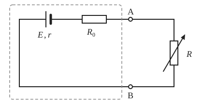
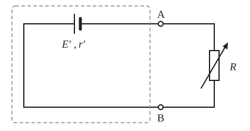
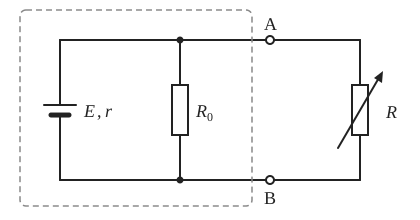
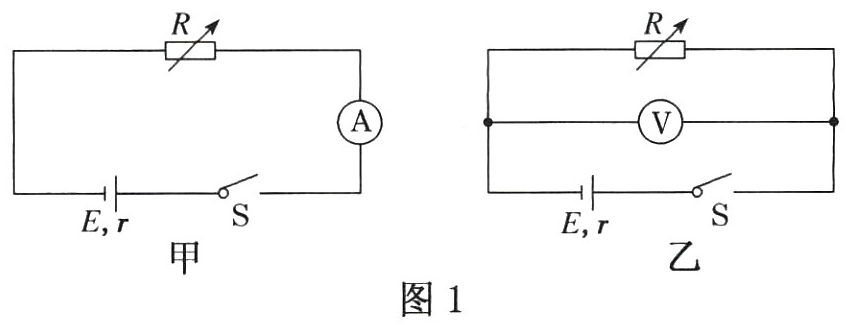
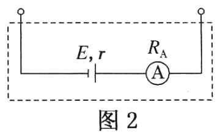
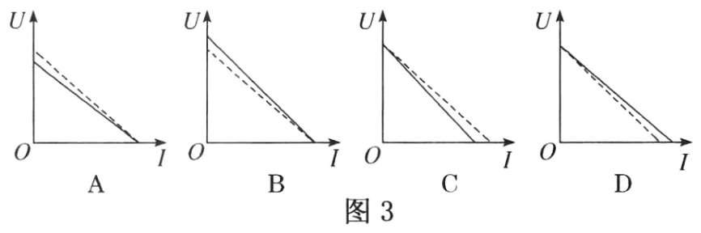
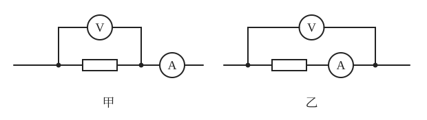

# Intro
在物理中，存在着各种“等效”思想。它们的共同点是：**在某一方面效果相同的前提下，用简单的对象或过程替代复杂的对象或过程。**

| 领域 | 等效思想 | 原对象 / 过程 | 等效为 | 等效依据 |
| :--- | :--- | :--- | :--- | :--- |
| 力学 | 合力与分力 | 几个共点力 | 一个合力 | 作用效果相同 |
| 力学 | 运动的合成与分解 | 平抛、小船渡河等曲线运动 | 两个直线运动 | 位移、速度矢量叠加 |
| 力学 | 重心 | 物体各部分受到的重力 | 作用于一点的重力 | 作用效果相同 |
| 力学 | 串并联弹簧 | 多根弹簧 | 一根弹簧 $k'$ | 相同形变对应相同弹力 |
| 力学 | 平均速度 | 匀变速直线运动 | 以中间时刻速度做匀速运动 | 相同时间内位移相同 |
| 力学 | 逆向思维 | 匀减速至零 | 反向的初速度为零的匀加速 | 运动学规律对称 |
| 力学 | 等效重力场 | 重力与恒定电场力（或惯性力）共同作用 | 一个“等效重力” $mg'$ | 恒力合成 |
| 力学 | 等效摆长 / 等效 $g$ | 双线摆、圆弧轨道上的小球、加速系统中的单摆 | 标准单摆 $T=2\pi\sqrt{L/g'}$ | 回复力规律相同 |
| 电学 | 串并联电阻 | 多个电阻 | 一个电阻 $R'$ | 相同电压下电流相同 |
| 电学 | 串并联电容 | 多个电容 | 一个电容 $C'$ | 相同电压下电荷量相同 |
| 电学 | 非理想电表 | 电压表、电流表 | 一个电阻 | 对电路的影响相同 |
| 电学 | 均匀带电球体 | 球体上分布的电荷 | 球心处的点电荷 | 球外电场相同 |
| 磁学 | 等效电流 | 做圆周运动的电荷、旋转的带电圆环 | 环形电流 $I=q/T$ | 磁效应相同 |
| 磁学 | 分子电流 / 通电螺线管 | 环形电流、通电螺线管 | 小磁针、条形磁铁 | 磁场分布相同 |
| 磁学 | 有效长度 | 弯曲导线（受安培力或切割磁感线） | 首尾连线的直导线 | 安培力、感应电动势相同 |
| 交流电 | 有效值 | 交变电流 | 恒定电流 | 相同时间内在同一电阻上产生的热量相同 |
| 交流电 | 变压器等效电阻 | 副线圈所接负载 $R$ | 原线圈回路中的电阻 $\left(\frac{n_1}{n_2}\right)^2R$ | 输入功率相同 |
| 电磁感应 | 导体棒切割磁感线 | 运动的导体棒 | 电动势 $E=BLv$、内阻为棒电阻的电源 | 对外电路的作用相同 |
| 电学 | 电源的串并联 | 多个电源 | 一个电源 $(E', r')$ | 对外电路的作用相同 |
| 电学 | **等效电源**（戴维南定理） | 含电源的复杂二端网络 | 一个电源 $(E', r')$ | 端口的伏安特性相同 |

可以说，“物理”思想的精髓之一就在于“等效”，其可以直击本质，有效而系统地化简复杂问题。

表格的最后几行就是本文的主角——**等效电源**。
# 数学上的声明
等效电源不是从天上掉下来的，我们不直接给出教科书上的常见结论，而是从纯理论的角度，用“第一性原理”探索并重新发现“等效电源”。

回顾闭合电路中的欧姆定律，有：
$$U=E-Ir$$
路端电压U是关于电流I的一次函数，而这个简单的关系可以帮助我们计算：
1. U,I的定量关系
2. 开路电压
3. 短路电流
4. 输出功率$P=UI$和外电阻$R$的关系
......
类似地，如果对于一个含源二端网络，如果我们也能找到$U(I)$，并且是类似的一次函数，那么就可以照猫画虎解决以上问题。

可见，求“等效电源”的本质就是求伏安特性曲线.
## 源阻串联

### 例题 1

如图，电源电动势 $E=6\ \text{V}$，内阻 $r=1\ \Omega$，定值电阻 $R_0=2\ \Omega$ 与电源串联，$R$ 为滑动变阻器（最大阻值 $10\ \Omega$）。

1. 当 $R$ 取何值时，$R$ 消耗的功率最大？最大功率是多少？
2. 当 $R=6\ \Omega$ 时，A、B 两端的电压是多少？

#### 传统方法

> (I) 我们以 $R$ 为自变量，写出电阻消耗功率的函数：
> $$I=\frac{E}{r+R_0+R}\\ P=I^2R\\ =\frac{E^2R}{(R+R_0+r)^2}\\ =\frac{36R}{(R+3)^2}\\ =\frac{36}{R+\frac{9}{R}+6}\\ R\in(0,3),R+\frac{9}{R}+6\downarrow\\ R\in(3,10),R+\frac{9}{R}+6\uparrow\\ P\le P|_{R=3}=3\ (\text{W})$$
>
> (II)
> $$U=IR\\ =\frac{R}{R+R_0+r}E\\ =\frac{6}{9}\times6=4\ (\text{V})$$

#### 等效电源方法

> (I) 把虚线框内的部分看作一个整体，求出 A、B 两端的 $U(I)$：
>
> 
>
> 我们求伏安特性曲线：设 $R$ 两端电压为 $U$，经过 $R$ 的电流为 $I$：
> $$U=E-I(R_0+r)\\ =E'-Ir'\\ E'=E=6\ (\text{V}),\ r'=R_0+r=3\ (\Omega)\\ P=UI\\ =[E-(R_0+r)I]I\\ =(6-3I)I\\ =-3I^2+6I\\ =-3(I-1)^2+3\le3\ (\text{W})$$
> 取等条件：
> $$I=1\ (\text{A}),\ U=3\ (\text{V})\\ R=3\ (\Omega)\in(0,10)$$
> 或者可以套用电源最大输出功率结论：
> $$P\le\frac{E'^2}{4r'}\\ =\frac{6^2}{4(1+2)}=3\ (\text{W})\\ R=r'=3\ (\Omega)$$
>
> (II)
> $$U=\frac{R}{r'+R}E'\\ =\frac{6}{3+6}\times6=4\ (\text{V})$$

## 源阻并联

### 例题 2

如图，电源电动势 $E=6\ \text{V}$，内阻 $r=3\ \Omega$，定值电阻 $R_0=6\ \Omega$ 与电源并联，$R$ 为滑动变阻器（最大阻值 $10\ \Omega$）。

1. 当 $R$ 取何值时，$R$ 消耗的功率最大？最大功率是多少？
2. 当 $R=6\ \Omega$ 时，A、B 两端的电压是多少？

#### 传统方法

> (I) 设电阻 $R$ 两端的电压为 $U$，通过电阻 $R$ 的电流为 $I$：
> $$U=E-\left(I+\frac{U}{R_0}\right)r\\ U=IR\\ I=\frac{E}{R+r\left(1+\frac{R}{R_0}\right)}\\ P=I^2R\\ =\left(\frac{E}{R+r\left(1+\frac{R}{R_0}\right)}\right)^2R\\ =\left(\frac{6}{3+\frac{3}{2}R}\right)^2R\\ =\left(\frac{4}{2+R}\right)^2R\\ \le P|_{R=2}=2\ (\text{W})\\ R=2\ (\Omega)$$
>
> (II)
> $$U=IR\\ =\frac{ER}{R+r\left(1+\frac{R}{R_0}\right)}\\ =\frac{6\times6}{6+3\left(1+\frac{6}{6}\right)}=3\ (\text{V})$$

#### 等效电源方法

> 把虚线框内的部分看作一个整体，求出 A、B 两端的 $U(I)$：
>
> 
>
> (I)
> $$U=E-\left(I+\frac{U}{R_0}\right)r\\ U=\frac{E-Ir}{1+\frac{r}{R_0}}\\ =\frac{R_0}{R_0+r}E-\left(\frac{R_0}{R_0+r}r\right)I$$
> 因此有 $E'=\frac{R_0}{R_0+r}E=4\ (\text{V})$，$r'=\frac{R_0}{R_0+r}r=2\ (\Omega)$。
>
> 套用输出功率结论：
> $$P\le\frac{E'^2}{4r'}=\frac{16}{4\times 2}=2\ (\text{W})\\ R=r'=2\ (\Omega)$$
>
> (II)
> $$U=\frac{R}{r'+R}E'\\ =\frac{6}{2+6}\times 4=3\ (\text{V})$$

# 小结：从高观点看等效电源

前面两道例题，我们都是从“第一性原理”出发，硬算出 A、B 两端的 $U(I)$，然后发现它恰好是一次函数。这并不是巧合，电路理论中有两条定理专门描述这件事。

## 戴维南定理

> 任何一个**线性**含源二端网络，对外电路而言，都可以等效为一个理想电压源 $E'$ 与一个电阻 $r'$ 的**串联**。其中：
> - $E'$ 等于 A、B 两端的**开路电压** $U_{\text{开}}$；
> - $r'$ 等于把网络内所有电源“置零”（电压源短路、只保留其内阻）后，从 A、B 看进去的**等效电阻**。

用伏安特性的语言说，就是网络端口满足

$$U=E'-Ir'$$

这正是我们在例题中求出的结果。

## 诺顿定理

> 同一个线性含源二端网络，也可以等效为一个理想电流源 $I'$ 与一个电阻 $r'$ 的**并联**。其中：
> - $I'$ 等于 A、B 两端的**短路电流** $I_{\text{短}}$；
> - $r'$ 与戴维南定理中的相同。

把 $U=E'-Ir'$ 改写一下：

$$I=\frac{E'}{r'}-\frac{U}{r'}=I_{\text{短}}-\frac{U}{r'}$$

就是诺顿等效的形式。可见戴维南与诺顿描述的是**同一条伏安特性直线**，只不过一个从 $U$ 轴截距（开路电压）看，一个从 $I$ 轴截距（短路电流）看，二者满足

$$E'=I_{\text{短}}\,r'$$

## 为什么一定是一次函数？

直观理解：网络内部全是电源和定值电阻，它们的方程都是线性的；外电路无论接什么，对网络而言都只是“从端口抽走电流 $I$”。由线性关系（叠加原理），端口电压只能是

$$U=\underbrace{U_{\text{开}}}_{I=0\text{ 时}}-\underbrace{r'}_{\text{比例系数}}\cdot I$$

所以，**求等效电源 = 求伏安特性直线**，而确定一条直线只需要两个量。下面三个量中任取两个即可：

| 量 | 求法 | 对应 |
| :--- | :--- | :--- |
| 开路电压 $U_{\text{开}}$ | A、B 断开，求两端电压 | 直线的 $U$ 轴截距，即 $E'$ |
| 短路电流 $I_{\text{短}}$ | A、B 用导线短接，求流过导线的电流 | 直线的 $I$ 轴截距 |
| 等效电阻 $r'$ | 电源置零，求 A、B 间电阻 | 直线斜率的绝对值 |

用这种方法回看两道例题，几乎可以口算：

| | 开路电压 $E'$ | 等效电阻 $r'$ | 短路电流 $I_{\text{短}}$ | 校验 $E'=I_{\text{短}}r'$ |
| :--- | :--- | :--- | :--- | :--- |
| 例题 1（源阻串联） | $E=6\ \text{V}$ | $r+R_0=3\ \Omega$ | $\frac{E}{r+R_0}=2\ \text{A}$ | $2\times3=6$ ✓ |
| 例题 2（源阻并联） | $\frac{R_0}{R_0+r}E=4\ \text{V}$ | $\frac{rR_0}{r+R_0}=2\ \Omega$ | $\frac{E}{r}=2\ \text{A}$（$R_0$ 被短路） | $2\times2=4$ ✓ |

## 串联看戴维南，并联看诺顿

两条定理还给出了一个漂亮的“电源变换”技巧：

- **电阻与电源串联**：在戴维南形式下，直接把电阻加到 $r'$ 上，$E'$ 不变。
  $$(E,\ r)\ \text{串}\ R_0\ \Longrightarrow\ (E,\ r+R_0)$$
- **电阻与电源并联**：先换成诺顿形式（电流源 $\frac{E}{r}$ 并联 $r$），再把 $R_0$ 并入，电流源不变，最后换回戴维南形式。
  $$(E,\ r)\ \xrightarrow{\text{诺顿}}\ \left(\tfrac{E}{r},\ r\right)\ \xrightarrow{\text{并 }R_0}\ \left(\tfrac{E}{r},\ r\parallel R_0\right)\ \xrightarrow{\text{戴维南}}\ \left(\tfrac{E}{r}\cdot\tfrac{rR_0}{r+R_0},\ \tfrac{rR_0}{r+R_0}\right)$$

最后的结果 $E'=\frac{R_0}{R_0+r}E$，$r'=\frac{rR_0}{r+R_0}$，与例题 2 中硬算的结果完全一致。反复使用这两步，就可以把任意由电源和电阻串并联组成的网络一步步化简为一个等效电源。

## 适用范围与注意事项

1. **只对外等效，不对内等效。** 等效电源只保证接在 A、B 两端的外电路“感觉不到区别”。网络内部的电流、功率与等效电源内部并不相同。例如例题 2 中，即使 A、B 开路，$R_0$ 上仍有电流、电源仍在消耗功率，而等效电源开路时内部没有任何功率损耗。因此，**求电源效率、内部发热等问题时不能直接用 $r'$ 计算。**
2. **网络必须是线性的。** 虚线框内只能有电源和定值电阻。外电路则不受限制，可以是小灯泡、二极管等非线性元件：把等效电源的直线 $U=E'-Ir'$ 与元件的伏安特性曲线画在同一张图上，交点就是工作点。这正是高中常见的“小灯泡实际功率”图像题的原理。
3. **高中实验中的身影。** 用伏安法测电源电动势和内阻时：
   - 电流表相对电源**内接**（电流表与电源串联）：测得的是“电源串联电流表”的等效电源，$E_{\text{测}}=E$，$r_{\text{测}}=r+R_A>r$，这就是例题 1 的模型；
   - 电流表相对电源**外接**（电压表直接并在电源两端）：测得的是“电源并联电压表”的等效电源，$E_{\text{测}}=\frac{R_V}{R_V+r}E<E$，$r_{\text{测}}=\frac{rR_V}{r+R_V}<r$，这就是例题 2 的模型。

   用等效电源的观点，实验误差分析可以一步到位。

一句话总结：**等效电源的本质是伏安特性；戴维南看开路电压，诺顿看短路电流，二者共用一个等效电阻。**

# 练习与应用

### 例题 3（2020北京卷）

用图 1 所示的甲、乙两种方法测量某电源的电动势和内阻（约为 $1\ \Omega$）。其中 $R$ 为电阻箱，电流表的内阻约为 $0.1\ \Omega$，电压表的内阻约为 $3\ \text{k}\Omega$。

（1）利用图 1 中甲图实验电路测电源的电动势 $E$ 和内阻 $r$，所测量的实际是图 2 中虚线框所示“等效电源”的电动势 $E'$ 和内阻 $r'$。若电流表内阻用 $R_{\text{A}}$ 表示，请你用 $E$、$r$ 和 $R_{\text{A}}$ 表示出 $E'$、$r'$，并简要说明理由。

> $$E'=E,\quad r'=R_{\text{A}}+r$$
>
> 将电源和电流表视为“等效电源”，电动势是电源本身具有的属性，电流表不具有产生电动势的本领，所以 $E'=E$。
>
> 电流表和电源内阻之和为“等效电源”的内阻，所以 $r'=R_{\text{A}}+r$。

（2）某同学利用图像分析甲、乙两种方法中由电表内阻引起的实验误差。在图 3 中，实线是根据实验数据（图甲：$U=IR$，图乙：$I=\dfrac{U}{R}$）描点作图得到的 $U\text{-}I$ 图像；虚线是该电源的路端电压 $U$ 随电流 $I$ 变化的 $U\text{-}I$ 图像（没有电表内阻影响的理想情况）。

在图 3 中，对应图甲电路分析的 $U\text{-}I$ 图像是\_\_\_\_\_\_\_\_；对应图乙电路分析的 $U\text{-}I$ 图像是\_\_\_\_\_\_\_\_。

> 图甲、图乙电路对应曲线都是实线，虚线为 $U=E-rI$。
>
> 图甲电路对应曲线：$U=E-(R_{\text{A}}+r)I$
>
> 图乙电路对应曲线：$U=\dfrac{R_{\text{V}}}{R_{\text{V}}+r}(E-rI)$
>
> 图甲对应曲线在定义域内恒不大于虚线，在 $(0,E)$ 处与虚线重合，故选 **C**。
>
> 图乙对应曲线在定义域内恒不大于虚线，在 $\left(\dfrac{E}{r},0\right)$ 处与虚线重合，故选 **A**。

（3）综合上述分析，为了减小由电表内阻引起的实验误差，本实验应选择图 1 中的\_\_\_\_\_\_\_\_（填“甲”或“乙”）。

> 记测得电动势为 $E'$，内阻为 $r'$。
>
> 图甲对应 $E'=E,\ r'=R_{\text{A}}+r$。
>
> 图乙对应 $E'=\dfrac{R_{\text{V}}}{R_{\text{V}}+r}E,\ r'=\dfrac{R_{\text{V}}}{R_{\text{V}}+r}r$。
>
> 虽然图甲所测得电动势准确，但内阻测量相对误差 $\dfrac{R_{\text{A}}}{r}\approx 0.1$，误差较大，不可接受。
>
> 图乙电动势、内阻相对误差均为 $\dfrac{r}{R_{\text{V}}+r}\approx\dfrac{1}{3000}$，误差较小。
>
> 故应该填“**乙**”。

### 例题 4（无源网络）

[2022 北京，15（1）] 用电压表（内阻约为 $3\ \text{k}\Omega$）和电流表（内阻约为 $0.1\ \Omega$）测量一个电阻的阻值（约为 $5\ \Omega$）。要求尽量减小实验误差，应该选择的测量电路是图\_\_\_\_\_\_\_\_（填“甲”或“乙”）。

#### 解答

> 设电压表、电流表的示数分别为 $U'$、$I'$，电阻测量值为 $R'=\dfrac{U'}{I'}$；流过待测电阻 $R$ 的真实电流为 $I$，其两端真实电压为 $U$。
>
> **分析图甲（电流表外接）**：电压表与 $R$ 并联，故 $U'=U=IR$，$I'=\dfrac{U}{R_{\text{V}}}+I$，得
>
> $$U'=\frac{I'}{\frac{1}{R_{\text{V}}}+\frac{1}{R}}=\frac{R_{\text{V}}R}{R_{\text{V}}+R}I' \implies R'=\frac{R_{\text{V}}}{R_{\text{V}}+R}R$$
>
> 与例 3 图乙的“等效并联”模型一致，测得阻值偏小，相对误差为
>
> $$\delta_{\text{甲}}=\frac{|R'-R|}{R}=\frac{R}{R+R_{\text{V}}}$$
>
> **分析图乙（电流表内接）**：电流表与 $R$ 串联，故 $I'=I$，$U'=I(R+R_{\text{A}})=I'R'$，得
>
> $$R'=R+R_{\text{A}}$$
>
> 与例 3 图甲的“等效串联”模型一致，测得阻值偏大，相对误差为
>
> $$\delta_{\text{乙}}=\frac{|R'-R|}{R}=\frac{R_{\text{A}}}{R}$$
>
> **比较误差**：
>
> $$\begin{aligned} \delta_{\text{甲}}-\delta_{\text{乙}} &= \frac{R}{R+R_{\text{V}}}-\frac{R_{\text{A}}}{R} \\ &= \frac{R^2-R_{\text{A}}(R+R_{\text{V}})}{R(R+R_{\text{V}})} < \frac{R^2-R_{\text{A}}R_{\text{V}}}{R(R+R_{\text{V}})} \end{aligned}$$
>
> 代入 $R\approx 5\ \Omega$、$R_{\text{A}}\approx 0.1\ \Omega$、$R_{\text{V}}\approx 3000\ \Omega$，有 $R^2\approx 25 < R_{\text{A}}R_{\text{V}}\approx 300$，因此 $\delta_{\text{甲}}-\delta_{\text{乙}}<0$，即图甲电路测量误差更小，填“**甲**”。
