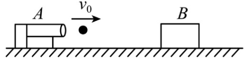
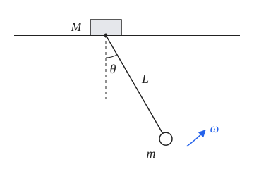

多质点系统的运动往往很复杂，但总可以拆成两部分：整体随质心的平动，以及各部分相对质心的运动。科尼希定理说明，动能也能这样干净地拆开。本文先推导这一定理，由此得到刚体的动能公式、转动惯量与平行轴定理，最后用它处理两个典型问题：完全非弹性碰撞的动能损失，以及椭圆摆。

## Wikipedia
柯尼希定理（König's theorem）是多质点系统在古典力学中的一个基本定理。它的内容是：相对于**某个惯性坐标系**的多质点系统的**总动能**等于该系统相对于该坐标系的**质心动能**加上**相对于该系统质心坐标系的系统总动能**（应注意：系统质心坐标系不一定是惯性坐标系）。
## 推导
我们把质点的速度分解为质心速度+相对质心速度：
$$E_{k_{total}}=\sum \frac{1}{2}m_iv_i^2\\
=\sum \frac{1}{2}m_i(\vec{v}_c+\vec{v}_{ic})^2\\
=\frac{1}{2}(\sum m_i)v_c^2+\sum \frac{1}{2}m_iv_{ic}^2+(\sum m_i\vec{v}_{ic})\cdot\vec{v}_c$$
质心定义：
$$\vec{r}_c=\frac{\sum{m_i\vec{r}_i}}{\sum m_i}\\
\vec{v}_c=\frac{\sum{m_i\vec{v}_i}}{\sum m_i}\\
\vec{v}_{ic}=\vec{v}_i-\vec{v}_c\\
\sum {m_i\vec{v}_{ic}}=\sum {m_i\vec{v}_i}-(\sum m_i)\vec{v}_c=\vec{0}$$
这表明，在质心系中，质心动量为0.
$$E_{k_{total}}=\frac{1}{2}(\sum m_i)v_c^2+\sum \frac{1}{2}m_iv_{ic}^2\\
=E_{k_c}+E_{k_{rel}}$$
结果可谓强大：将质点系的总动能抽离为质心动能和相对动能
如果刚体绕过质心的轴以角速度$\vec{\omega}$旋转，则$\vec{v}_{ic}=\vec{\omega}\times\vec{r}_i$，$v_{ic}=\omega r_i$（$r_i$为质点到转轴的垂直距离），总动能:
$$E_{k_{total}}=\frac{1}{2}(\sum m_i)v_c^2+\sum \frac{1}{2}m_iv_{ic}^2\\
=\frac{1}{2}(\sum m_i)v_c^2+ \frac{1}{2}\sum m_i|\vec{\omega}\times\vec{r}_i|^2\\
=\frac{1}{2}(\sum m_i)v_c^2+ \frac{1}{2}\sum m_i(\omega r_i)^2\\
=\frac{1}{2}(\sum m_i)v_c^2+ \frac{1}{2}(\sum m_ir_i^2)\omega^2\\
=\frac{1}{2}Mv_c^2+\frac{1}{2}I\omega^2$$
其中$I=\sum m_ir_i^2$，称为转动惯量.

## 常见物体的转动惯量
以下物体质量均为$M$，质量分布均匀。

| 物体 | 转轴 | 转动惯量 $I$ |
| --- | --- | --- |
| 细杆（长$L$） | 过中心，垂直于杆 | $\frac{1}{12}ML^2$ |
| 细杆（长$L$） | 过端点，垂直于杆 | $\frac{1}{3}ML^2$ |
| 细圆环（半径$R$） | 过圆心，垂直于环面 | $MR^2$ |
| 细圆环（半径$R$） | 沿直径 | $\frac{1}{2}MR^2$ |
| 薄圆盘 / 实心圆柱（半径$R$） | 中心对称轴 | $\frac{1}{2}MR^2$ |
| 薄圆盘（半径$R$） | 沿直径 | $\frac{1}{4}MR^2$ |
| 薄壁圆筒（半径$R$） | 中心对称轴 | $MR^2$ |
| 厚壁圆筒（内径$R_1$，外径$R_2$） | 中心对称轴 | $\frac{1}{2}M(R_1^2+R_2^2)$ |
| 实心圆柱（半径$R$，长$L$） | 过中心，垂直于对称轴 | $\frac{1}{4}MR^2+\frac{1}{12}ML^2$ |
| 实心球（半径$R$） | 沿直径 | $\frac{2}{5}MR^2$ |
| 薄球壳（半径$R$） | 沿直径 | $\frac{2}{3}MR^2$ |
| 矩形薄板（边长$a$、$b$） | 过中心，垂直于板面 | $\frac{1}{12}M(a^2+b^2)$ |
| 矩形薄板（边长$a$、$b$） | 过中心，平行于边$b$ | $\frac{1}{12}Ma^2$ |

若转轴不过质心，可用平行轴定理（与科尼希定理同源）：
$$I=I_c+Md^2$$
其中$I_c$为绕过质心的平行轴的转动惯量，$d$为两轴间距。例如细杆绕端点：$\frac{1}{12}ML^2+M(\frac{L}{2})^2=\frac{1}{3}ML^2$.
### 平行轴定理的推导
由科尼希动能定理:
$$E_{k_{total}}=\frac{1}{2}Mv_c^2+\frac{1}{2}I_c\omega^2\\
=\frac{1}{2}M(\omega d)^2+\frac{1}{2}I_c\omega^2\\
=\frac{1}{2}(I_c+Md^2)\omega^2\\
=\frac{1}{2}I\omega^2$$
注：不绕质心转动会使质心运动，但物体绕质心转动的角速度仍为$\omega$.
# 应用
## 二体完全非弹性碰撞的动能损失
在碰撞问题中，由于碰撞时间极短，外力可以忽略，故系统动量守恒，质心速度不变。
但是，两个物体相对速度变为零，因此两物体速度与质心速度相同，相对质心速度均为零。
因此，损失的动能等于相对动能，即**资用能**(Available Energy):
$$|\Delta E|=\frac{1}{2}m_1(v_1-v_c)^2+\frac{1}{2}m_2(v_2-v_c)^2\\
=\frac{1}{2}m_1(v_1-\frac{m_1v_1+m_2v_2}{m_1+m_2})^2+\frac{1}{2}m_2(v_2-\frac{m_1v_1+m_2v_2}{m_1+m_2})^2\\
=\frac{1}{2}\cdot \frac{1}{(m_1+m_2)^2}\{m_1[m_2(v_1-v_2)]^2+m_2[m_1(v_1-v_2)]^2\}\\
=\frac{1}{2}\cdot \frac{m_1m_2}{m_1+m_2}(v_1-v_2)^2\\
=\frac{1}{2}\mu v_{12}^2$$
其中，$\mu=\frac{m_1m_2}{m_1+m_2}$称为**约化质量**(Reduced Mass).
### 多选题

**7.（2025 北京四中高三上期中）**

如图所示，在光滑的水平地面上固定一弹丸发射机 A，弹射机能不断地发射质量为 \(m\)、速度为 \(v_0\) 的小弹丸。在弹射机的正前方放置一质量为 \(M\)（\(M>m\)）的物块 B，假设小弹丸击中 B 后能够留在物块 B 中，每颗弹丸出射前，前一颗弹丸已与物块 B 保持相对静止。不计小弹丸的体积，忽略重力对小弹丸的影响，且弹丸在物块 B 中受到的阻力 \(f\) 恒定，水平面足够大。

则以下说法中正确的是（ ）。

**A.** 若第 1 颗弹丸在物块 B 内的运动时间为 \(t_0\)，则它对 B 的平均作用力大小为：

\[
\frac{mv_0}{t_0}
\]

**B.** 第 \(k\) 颗弹丸击中 B 并与 B 相对静止时，物块 B 的速度为：

\[
\frac{km}{km+M}v_0
\]

**C.** 每次弹丸击中物块 B 的过程中，物块 B 的动量变化量均相等

**D.** 每次弹丸击打物块 B 的过程中，系统产生的热量越来越少

分析选项D.
第k+1颗弹丸命中物块B的动能损失（产生的热能）
$$Q=|\Delta E|=\frac{1}{2}\mu (v_0-\frac{km}{km+M}v_0)^2\\
=\frac{m(km+M)}{2(m+km+M)}(\frac{M}{km+M}v_0)^2\\
=\frac{M^2m}{2[(k+1)m+M](km+M)}v_0^2\\
$$
显然$k\uparrow,Q\downarrow$.

## 椭圆摆问题
如图所示，质量为$M$的滑块置于光滑水平导轨上，可沿导轨无摩擦滑动。滑块下方通过长为$L$的不可伸长轻绳悬挂一质量为$m$的小球，小球可视为质点。初始时将小球拉至轻绳与竖直方向夹角为$\theta_0$处，使系统由静止释放。不计空气阻力，重力加速度为$g$。

求当轻绳与竖直方向夹角为$\theta$时，轻绳转动的角速度$\omega$（用$m$、$M$、$L$、$g$、$\theta_0$、$\theta$表示）。

注意到，系统有两个自由度:
1. 水平方向滑块的运动
2. 小球绕滑块的转动
为方便研究，我们将系统动能沿水平，垂直方向分解.
由于系统水平方向不受外力，且初始静止，故质心水平速度为0：
$$E_{kx}=E_{x_{rel}}=\frac{1}{2}\frac{Mm}{M+m}(\omega L\cos\theta)^2\\
E_{ky}=\frac{1}{2}m(\omega L\sin\theta)^2\\
E_{kx}+E_{ky}=mgL(\cos\theta-\cos\theta_0)\\
\omega=\sqrt{\frac{mgL(\cos\theta-\cos\theta_0)}{\frac{1}{2}m(L\sin\theta)^2+\frac{1}{2}\frac{Mm}{M+m}(L\cos\theta)^2}}\\
=\sqrt{\frac{2g(\cos\theta-\cos\theta_0)}{L\sin^2\theta+\frac{M}{M+m}L\cos^2\theta}}$$
当$M\gg m$,退化形式:
$$\omega=\sqrt{\frac{2g(\cos\theta-\cos\theta_0)}{L}}$$

### 追问：小球的运动轨迹
求小球的运动轨迹方程。

轨迹形状无需用到$\omega(\theta)$，只需水平方向动量守恒。系统水平方向不受外力，且初始静止，故质心水平位置$x_c$保持不变。
设滑块位置为$X$，以导轨为$x$轴、竖直向上为$y$轴，则小球坐标：
$$x=X+L\sin\theta\\
y=-L\cos\theta$$
质心水平位置不变：
$$MX+m(X+L\sin\theta)=(M+m)x_c\\
X=x_c-\frac{m}{M+m}L\sin\theta$$
代入小球坐标：
$$x-x_c=\frac{M}{M+m}L\sin\theta\\
y=-L\cos\theta$$
利用$\sin^2\theta+\cos^2\theta=1$消去$\theta$：
$$\frac{(x-x_c)^2}{\left(\frac{M}{M+m}L\right)^2}+\frac{y^2}{L^2}=1$$
小球轨迹为以$(x_c,0)$为中心的**椭圆**（取$|\theta|\le\theta_0$的一段弧），水平半轴$\frac{M}{M+m}L$，竖直半轴$L$，这正是"椭圆摆"名称的由来。
- $M\gg m$：水平半轴$\to L$，轨迹退化为圆，即单摆；
- $M\ll m$：水平半轴$\to 0$，小球几乎只做竖直运动，滑块左右往复。

滑块则在线段$|X-x_c|\le\frac{m}{M+m}L\sin\theta_0$上往复运动。

$\omega(\theta)$决定的是小球沿轨迹运动的快慢。由$\omega=\frac{d\theta}{dt}$：
$$t(\theta)=\int_{\theta_0}^{\theta}\frac{d\theta'}{\omega(\theta')}$$
一般情况下该积分为椭圆积分，无初等形式。

小角度时（$|\theta|\le\theta_0\ll1$），取近似$\sin\theta\approx\theta$，$\cos\theta\approx1-\frac{\theta^2}{2}$，只保留最低阶项。
分子：
$$2g(\cos\theta-\cos\theta_0)\approx2g\left[\left(1-\frac{\theta^2}{2}\right)-\left(1-\frac{\theta_0^2}{2}\right)\right]=g(\theta_0^2-\theta^2)$$
分母：
$$L\sin^2\theta+\frac{M}{M+m}L\cos^2\theta\approx L\theta^2+\frac{M}{M+m}L(1-\theta^2)\approx\frac{M}{M+m}L$$
分子已是$\theta^2$量级，分母中的$\theta^2$项只带来$\theta^4$量级的修正，故略去。于是：
$$\omega^2\approx\frac{(M+m)g}{ML}(\theta_0^2-\theta^2)=\Omega^2(\theta_0^2-\theta^2)\\
\Omega=\sqrt{\frac{(M+m)g}{ML}}$$
两边对时间求导，注意$\frac{d\theta}{dt}=\omega$，$\frac{d\omega}{dt}=\ddot\theta$：
$$2\omega\ddot\theta=-2\Omega^2\theta\omega\\
\ddot\theta=-\Omega^2\theta$$
即简谐运动，结合初始条件$\theta(0)=\theta_0$，$\omega(0)=0$：
$$\theta=\theta_0\cos\Omega t$$
也可直接代入积分验证：
$$t=\int_{\theta_0}^{\theta}\frac{d\theta'}{-\Omega\sqrt{\theta_0^2-\theta'^2}}=\frac{1}{\Omega}\arccos\frac{\theta}{\theta_0}$$
（下摆阶段$\theta$减小，$\omega<0$，故取负根。）
比同摆长的单摆快$\sqrt{\frac{M+m}{M}}$倍.

## 总结
科尼希定理的核心只有一句话：在质心系中，系统总动量为零，因此动能展开式中的交叉项消失。由此：
- 刚体动能 = 质心平动动能 + 绕质心转动动能；
- 平行轴定理$I=I_c+Md^2$是它的直接推论；
- 碰撞中损失的动能只能来自相对动能，即$\frac{1}{2}\mu v_{12}^2$；
- 某方向动量守恒时（如椭圆摆的水平方向），该方向的动能可用约化质量写成相对动能，问题由两个自由度化为一个。

遇到既有整体运动、又有内部运动的系统，不妨先找质心。
