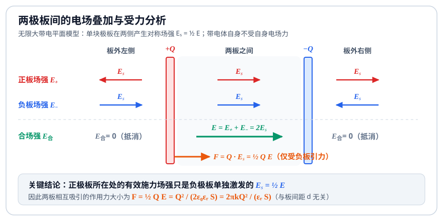
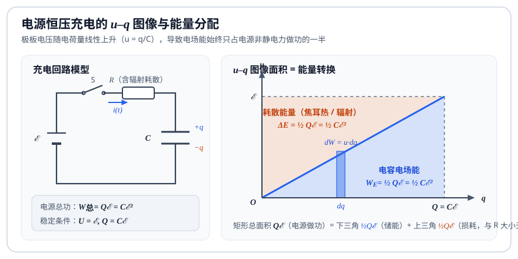
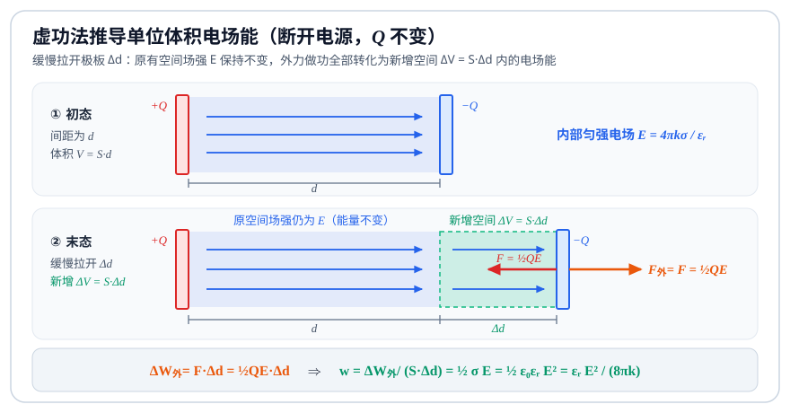

高中物理讲到平行板电容器时，通常在电容决定式 $C = \frac{\varepsilon_r S}{4\pi k d}$ 和“$Q$ 不变 / $U$ 不变”的动态分析处就收尾了。但如果再多追问几步，就会碰到三个表面孤立、实则紧紧咬合在一起的“二分之一”：

1. 两极板间的引力为什么是 $\frac{1}{2}QE$，而不是 $QE$？
2. 电源把电容器充到 $U = \epsilon$ 时，为什么只有 $\frac{1}{2}$ 的电能变成电场能？
3. 这两件事合在一起，如何导出单位体积的电场能（能量密度）？

> **符号约定**：为避免能量与场强重名，下文统一用 $E$ 表示板间合场强（单极板场强记为 $E_s$），用 $W_E$ 表示电容器储存的电场能，用 $\epsilon$ 表示电源电动势。

## 一、 两极板间的作用力：为什么不是 $QE$ 而是 $\frac{1}{2}QE$？

想要分析平行板电容器两极板间的静电引力，首先就要算出极板处的有效电场强度。

虽然极板间的电场可以视为匀强电场，但极板所在位置的施力场强与板间合场强并不相同——**带电体自身不能对自己施加电场力**。

于是，我们自然设出单块极板在两侧激发的匀强电场强度大小 $E_s$（$s = \text{single}$）：

- 在两板之间，正、负两板激发的电场强度同向等大，叠加后 $E = 2E_s$；
- 在两极板之外，两板激发的电场强度反向等大，叠加后 $E_{\text{外}} = E_s - E_s = 0$。

由此，可以解释平行板电容器“场强集中在板间、板外为零”的特征。而站在其中一块极板的位置上看，真正对它施力的只有另一块极板激发的电场，场强大小为 $E_s = \frac{1}{2}E$。

因此，两极板间的静电引力大小为：
$$F = E_s Q = \frac{1}{2}EQ = \frac{Q^2}{2\varepsilon_0 \varepsilon_r S} = \frac{2\pi k Q^2}{\varepsilon_r S}$$
可以看到，当极板带电量 $Q$ 不变时，两板之间的相互引力大小与板间距 $d$ 无关——这个性质将在第三节派上大用场。

## 二、 电源充电的“效率悖论”：为什么只有一半电能变成电场能？

电动势为 $\epsilon$、内阻为 $r$ 的直流电源对初态不带电的电容 $C$ 充电直至稳态。我们审视过程中的能量变化。

熟知电容器的电场能计算公式（结合 $u-q$ 图像，电压从 $0$ 随电荷量线性增至 $U$，储能对应三角形面积）：
$$W_E=\frac{1}{2}UQ=\frac{1}{2}CU^2=\frac{1}{2}\frac{Q^2}{C}$$
电容器稳定后（$U = \epsilon$）：
$$W_E=\frac{1}{2}Q\epsilon$$
整个过程中，电源非静电力做功，即产生的总电能：
$$W_{p}=Q\epsilon$$
可见，只有一半的电能转变为了电场能 $W_E$。

细细想来，另一半电能被电源内阻 $r$ 消耗了。设电阻消耗的电热为 $W$：

$$dW=i^2(t)r\,dt\\
i(t)r+\frac{Q(t)}{C}=\epsilon\\
Q'(t)r+\frac{Q(t)}{C}=\epsilon$$
待定系数 $Q(t)=Ae^{kt}+B$：
$$(Ake^{kt})r+\frac{1}{C}(Ae^{kt}+B)=\epsilon\\
\left(Akr+\frac{A}{C}\right)e^{kt}=\epsilon-\frac{B}{C}\\
Q(0)=A+B=0,\quad Q(\infty)=B=C\epsilon\quad (k\lt 0)\\
k=-\frac{1}{Cr},\quad A=-C\epsilon,\quad B=C\epsilon\\
Q(t)=C\epsilon\left(1-e^{-\frac{1}{Cr}t}\right)$$
结果耐人寻味：理论上讲，电容永远不会达到稳态，只会无限接近.

记时间常数 $\tau = Cr$（以常见参数 $r = 1\text{ k}\Omega$、$C = 1\text{ }\mu\text{F}$、$\epsilon = 10\text{ V}$ 为例，$\tau = 1\text{ ms}$，$Q = C\epsilon \approx 6.24 \times 10^{13}e$）：

| 经过时间 | 具体时间 | 已充进度 $Q(t)/Q$ | 说明 |
| :--- | :--- | :--- | :--- |
| $1\tau$ | $1\text{ ms}$ | $63.21\%$ | — |
| $3\tau$ | $3\text{ ms}$ | $95.02\%$ | — |
| $5\tau$ | $5\text{ ms}$ | $99.33\%$ | 工程上通常视作“已充满” |
| $10\tau$ | $10\text{ ms}$ | $99.9955\%$ | 每多逼近一个“$9$”多等 $\ln 10 \approx 2.30\tau$ |
| $31.76\tau$ | $31.8\text{ ms}$ | 仅差最后 $1$ 个电子 | 触及离散电荷的物理极限 |

我们言归正传：
$$dW=i^2(t)rdt\\
i(t)=Q'(t)=\frac{\epsilon}{r}e^{-\frac{1}{Cr}t}\\
dW=\frac{\epsilon^2}{r}e^{-\frac{2}{Cr}t}dt\\
W=\int_{0}^{+\infty}\frac{\epsilon^2}{r}e^{-\frac{2}{Cr}t}dt\\
=\frac{1}{2}C\epsilon^2$$
这是因为，$f(t)=\frac{\epsilon^2}{r}e^{-\frac{2}{Cr}t}$的原函数为$F(t)=-\frac{1}{2}C\epsilon^2e^{-\frac{2}{Cr}t}+D$，其中 $D$ 为常数。

计算结果表明，电阻消耗的焦耳热恰好为 $W = \frac{1}{2}C\epsilon^2 = \frac{1}{2}Q\epsilon$，与电容最终储存的电场能 $W_E = \frac{1}{2}Q\epsilon$ 恰好平分了电源非静电力做的总功 $W_p = Q\epsilon$。**更反直觉的是：耗散掉的这一半能量与电阻 $r$ 的大小完全无关。**

### 如果回路完全无电阻（$r = 0$）呢？

既然结果与 $r$ 无关，自然会有一个追问：如果用理想超导导线、内阻也为零（$r \to 0$），难道能量还会白白消失一半吗？

答案是**依然只有一半能稳定留在静电场中**，可以从两个层面理解：

1. **数学极限视角（$r \to 0^+$）**：当 $r$ 越来越小时，充电时间常数 $\tau = Cr \to 0$（过程趋近瞬时完成），但初始峰值电流 $i(0) = \frac{\epsilon}{r} \to \infty$、瞬时热功率 $i^2 r = \frac{\epsilon^2}{r} \to \infty$。时间越短、电流越猛，一消一长之下，积分总热量 $\int_0^{+\infty} i^2 r\,\mathrm{d}t = \frac{1}{2}C\epsilon^2$ 始终不变。
2. **真实物理视角（严格 $r = 0$）**：当电阻真正为零时，纯 $RC$ 模型已失效（$i(0)$ 发散），必须计入回路本身的**自感 $L$** 与**电磁辐射**：
   - 若连辐射也忽略（理想 $LC$ 回路），由 $L q'' + \frac{q}{C} = \epsilon$ 解得 $q(t) = C\epsilon(1 - \cos\omega t)$（$\omega = \frac{1}{\sqrt{LC}}$）。电容充到 $q = C\epsilon$（即 $U = \epsilon$）时电流恰达最大，另一半能量 $\frac{1}{2}C\epsilon^2$ 暂存在磁场 $\frac{1}{2}Li^2$ 中，随后电流继续冲过头，在 $0$ 到 $2C\epsilon$ 之间做**无阻尼振荡**，根本无法停在稳态；
   - 在真实电路中，剧烈变化的电流会向空间**辐射电磁波**，正是电磁辐射带走了这多余的 $\frac{1}{2}C\epsilon^2$，振荡才得以衰减并最终稳定在 $U = \epsilon$。

换言之，只要用**恒定电动势**直接给初态不带电的电容充电，不管耗散的出口是电阻焦耳热还是电磁波辐射，最终稳定下来的电场能永远只有电源总功的一半。

### 如果让电流趋近于零（$i \to 0$ 准静态充电）呢？

既然损耗来源于 $i^2 r$ 和突变电流的辐射，想要突破 $50\%$ 的限制，关键就是让电流趋近于零：用电压可调的电源，从 $0$ 开始极为缓慢地把电压升至 $\epsilon$（始终只比电容电压高出微小的 $\Delta u$）。在时间 $T \to \infty$ 的准静态极限下，电流 $i \sim \frac{Q}{T} \to 0$，电阻发热 $W = \int_0^T i^2 r\,\mathrm{d}t \sim \frac{Q^2 r}{T} \to 0$，电磁辐射也可忽略——此时电源做功不再是 $Q\epsilon$，而是 $\int_0^Q u\,\mathrm{d}q = \frac{1}{2}Q\epsilon$，**几乎 $100\%$ 转化为电场能**。

## 三、 单位体积的电场能：两条路线的合流

电场能是电场的属性，犹如质量是物质的属性。从比值定义法出发：

- 质量除以体积，可以得到物质的基本特性：**密度**；
- 电场能除以体积，类似得到电场的基本属性：**单位体积的电场能（能量密度）$w$**。

**路线 A（从总储能直接出发）**：由第二节的 $W_E = \frac{1}{2}CU^2$，代入 $C = \frac{\varepsilon_r S}{4\pi k d}$ 与 $U = Ed$：
$$w = \frac{W_E}{Sd} = \frac{\frac{1}{2}CU^2}{Sd} = \frac{\varepsilon_r}{8\pi k}E^2 = \frac{1}{2}\varepsilon_0\varepsilon_r E^2$$
（其中利用了静电力常量与真空介电常数的换算 $k = \frac{1}{4\pi\varepsilon_0}$。）

**路线 B（用第一节的引力做虚功）**：断开电源保持极板电荷量 $Q$ 不变，此时板间场强 $E$ 不随间距 $d$ 变化。缓慢将两板拉开 $\Delta d$，外力克服极板引力做功，全部转化为新增空间 $\Delta V = S\Delta d$ 内的电场能：
$$\Delta W = F\Delta d = \frac{1}{2}EQ\Delta d = \frac{1}{2}E(CEd)\Delta d = \frac{\varepsilon_r S}{8\pi k}E^2\,\Delta d$$
每拉开 $\Delta d$，电场体积增加 $S\Delta d$，电场能增加 $\frac{\varepsilon_r S}{8\pi k}E^2\,\Delta d$，故单位体积对应的电场能同样为：
$$w = \frac{\Delta W}{S\Delta d} = \frac{\varepsilon_r}{8\pi k}E^2 = \frac{1}{2}\varepsilon_0\varepsilon_r E^2$$

> **对比思考**：如果**保持电源接通（$U$ 不变）**再把极板拉开 $\Delta d$，空间体积变大了，为什么总电场能 $W_E = \frac{1}{2}CU^2 = \frac{\varepsilon_r S U^2}{8\pi k d}$ 反而减小？因为 $E = \frac{U}{d}$ 整体变小了（密度 $w \propto E^2$ 下降得比体积 $V \propto d$ 上升得更快），且外力做的正功连同减少的电场能一起倒灌回了电源。

## 总结

回顾这几个看似零散的结论，三个“$\frac{1}{2}$”其实来自同一套底层物理图景：

1. **$F = \frac{1}{2}QE$**：来自**对称性与场强叠加**——极板自身不对自身施力，只感受另一半场强 $E_s = \frac{1}{2}E$；
2. **$W_E = \frac{1}{2}Q\epsilon$**：来自**线性响应**——电压随电荷量从 $0$ 线性爬升，恒定电动势突加充电必然有一半能量通过焦耳热或电磁辐射耗散；
3. **$w = \frac{\varepsilon_r}{8\pi k}E^2 = \frac{1}{2}\varepsilon_0\varepsilon_r E^2$**：既是总储能除以体积，也是虚功法下“新劈出来的那块空间”所储存的能量，把力学、电路与静电场彻底连成了一个自洽的闭环。

理解了能量是真正储存在“电场所在的空间”里，之后再处理平行板电容器的动态分析与能量账本，就不再需要死记硬背各种二级结论了。
